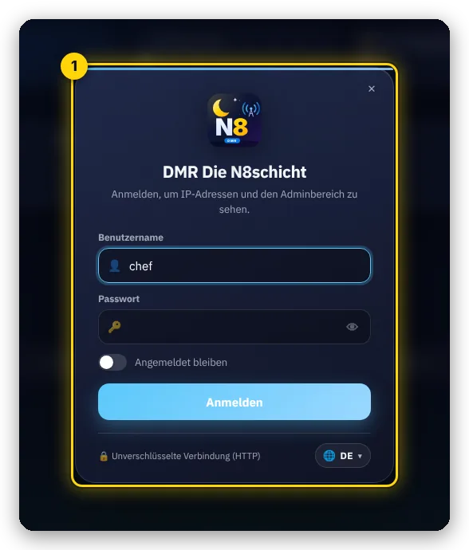
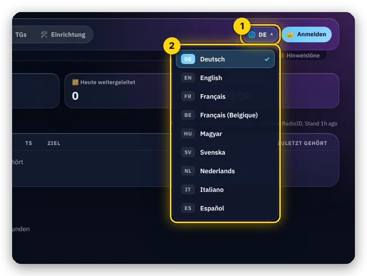
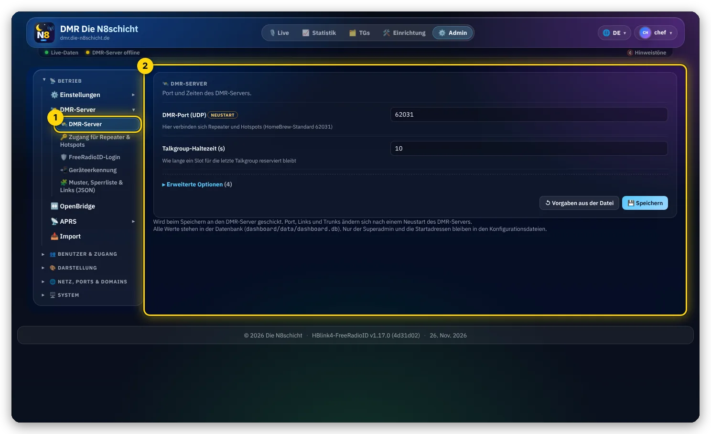
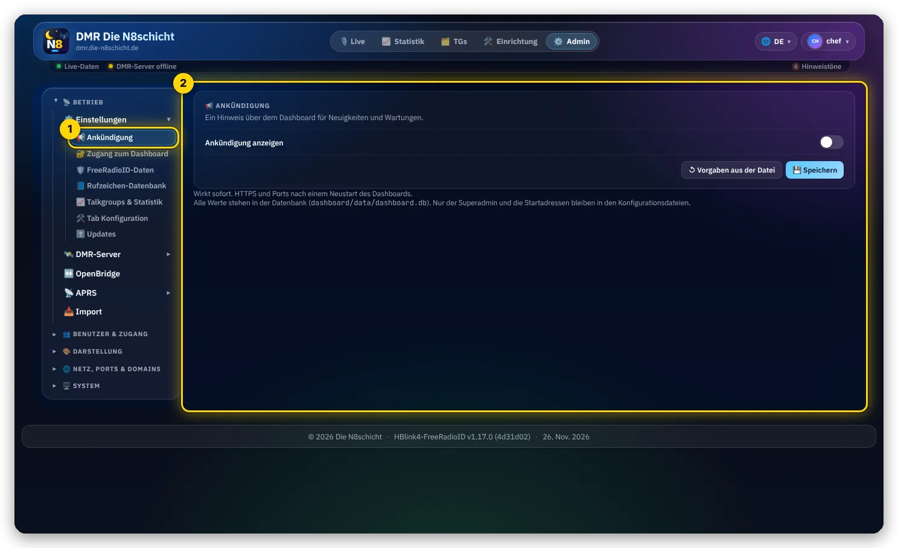
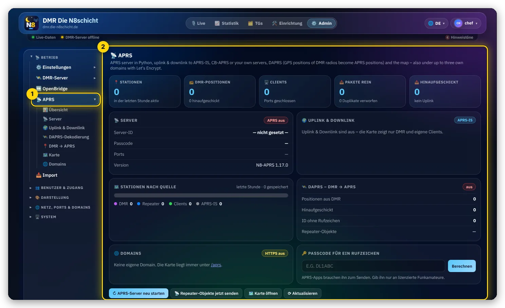
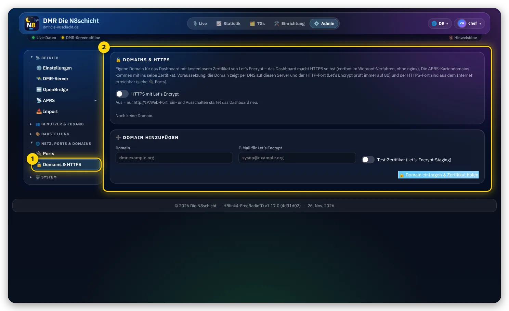
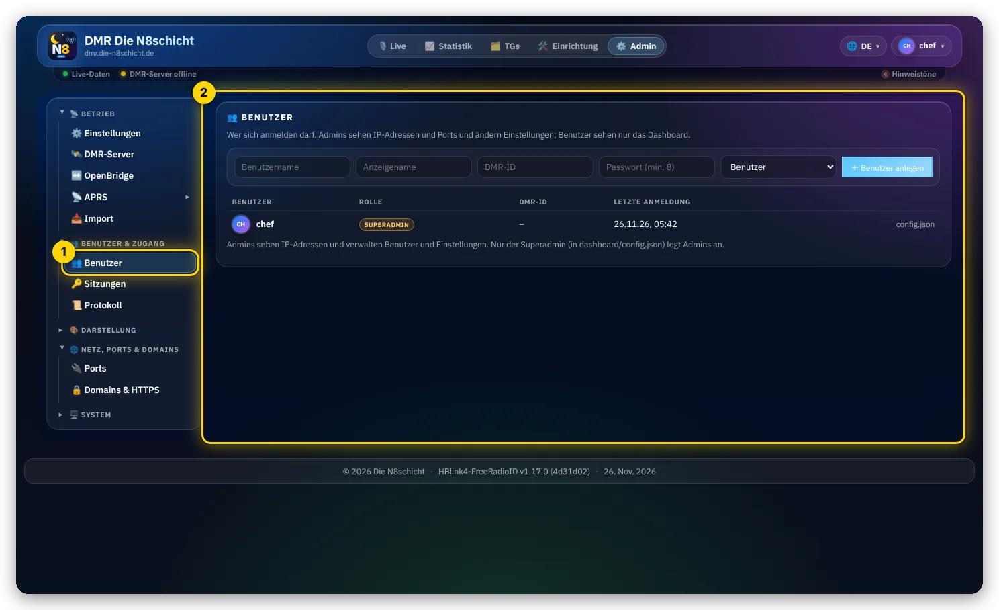
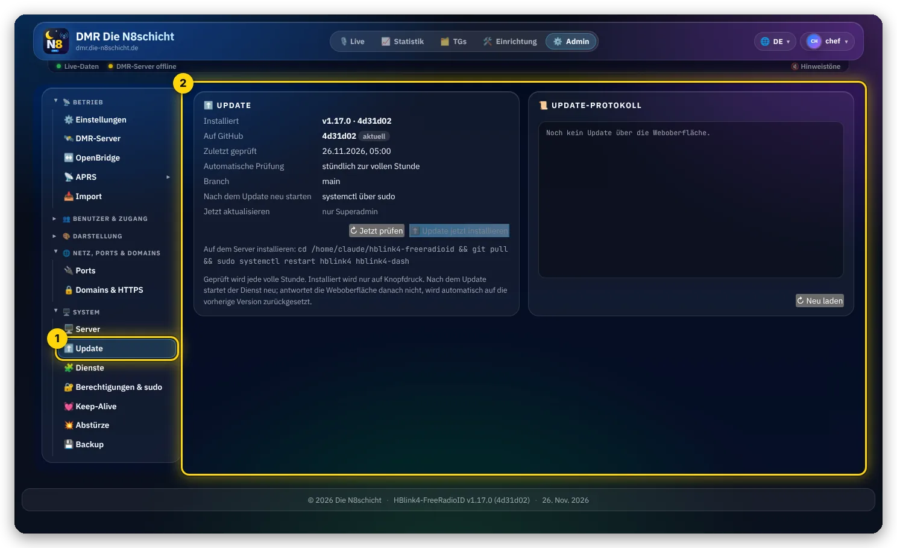

# 📘 HBlink4-FreeRadioID – Schritt für Schritt

<sub>Sprache: **🇩🇪 Deutsch** · [🇬🇧 English](../en/README.md) · [🇫🇷 Français](../fr/README.md) · [🇧🇪 Français (Belgique)](../fr-BE/README.md) · [🇭🇺 Magyar](../hu/README.md) · [🇸🇪 Svenska](../sv/README.md) · [🇳🇱 Nederlands](../nl/README.md) · [🇮🇹 Italiano](../it/README.md) · [🇪🇸 Español](../es/README.md)</sub>

HBlink4-FreeRadioID ist ein DMR-Server mit FreeRadioID-Anmeldung, Dashboard, OpenBridge und APRS. Diese Anleitung führt durch die ersten Schritte.

> 💡 Die gelben Ziffern im Bild gehören zu den Ziffern im Text.

## Inhalt

1. [Installieren](#1-installieren)
2. [Anmelden](#2-anmelden)
3. [Sprache wählen](#3-sprache-wählen)
4. [DMR-Server einstellen](#4-dmr-server-einstellen)
5. [Zugang und FreeRadioID](#5-zugang-und-freeradioid)
6. [APRS einschalten](#6-aprs-einschalten)
7. [Eigene Domain mit HTTPS](#7-eigene-domain-mit-https)
8. [Benutzer anlegen](#8-benutzer-anlegen)
9. [Aktualisieren](#9-aktualisieren)

## 1. Installieren

Auf einem Debian- oder Ubuntu-Server mit sudo-Rechten:

```bash
git clone https://github.com/dhartmann1979/HBlink4-FreeRadioID /opt/HBlink4
sudo /opt/HBlink4/scripts/setup.sh
```

Das Setup fragt Servername, Ports, Superadmin und FreeRadioID-Anmeldung ab und richtet die Dienste ein. Danach ist das Dashboard unter `http://<server>:8080` erreichbar.

## 2. Anmelden

<p align="center"></p>

Oben rechts auf **🔐 Anmelden** klicken. Im Anmeldefenster ① Benutzername und Passwort eingeben; 👁 zeigt das Passwort, „Angemeldet bleiben“ spart die Anmeldung beim nächsten Mal. Nach fünf falschen Versuchen ist der Name für 15 Minuten gesperrt. Angemeldet erscheinen Avatar und Name ▾ mit Konto, Adminbereich und Abmelden.

## 3. Sprache wählen

<p align="center"></p>

Oben rechts öffnet **🌐 DE ▾** ① das Sprachmenü ② mit neun Sprachen. Die Wahl gilt sofort und für alle N8-Oberflächen auf diesem Server. Beim ersten Besuch gilt die Sprache des Browsers.

## 4. DMR-Server einstellen

<p align="center"></p>

Im Adminbereich unter **📡 Betrieb → 🛰️ DMR-Server** ① stehen Port (Standard 62031), Zeiten und Verbindungen zu anderen Servern ②. Repeater und Hotspots verbinden sich auf diesen Port; Änderungen gelten nach einem Neustart des DMR-Servers.

## 5. Zugang und FreeRadioID

<p align="center"></p>

Unter **⚙️ Einstellungen** ① legst du fest, wer das Dashboard sieht, und den Zugang für Repeater und Hotspots ②: Passphrase, Talkgroups und die **FreeRadioID-Anmeldung**. Mit FreeRadioID meldet sich jede Station mit ihrem persönlichen Passwort an; die Passphrase wird zum Gastzugang mit eigenen Talkgroups.

## 6. APRS einschalten

<p align="center"></p>

Unter **📡 APRS** ① schaltest du den APRS-Server mit Karte ein ②: Server-ID (dein Rufzeichen mit SSID), offene Ports für APRS-Apps und iGates sowie der Uplink zu APRS-IS. GPS-Positionen aus dem DMR-Verkehr erscheinen dann auf der Karte.

## 7. Eigene Domain mit HTTPS

<p align="center"></p>

Unter **🌐 Netz, Ports & Domains → 🔒 Domains & HTTPS** ① trägst du eine Domain ein, die per DNS auf den Server zeigt, dazu eine E-Mail-Adresse für Let’s Encrypt ②. Das Zertifikat wird geholt und automatisch erneuert. Ports 80 und 443 müssen aus dem Internet erreichbar sein.

## 8. Benutzer anlegen

<p align="center"></p>

Unter **👥 Benutzer & Zugang → Benutzer** ① legst du weitere Konten an und vergibst die Rolle ②. Admins sehen IP-Adressen und ändern Einstellungen, Benutzer sehen nur das Dashboard. Unter **Sitzungen** beendest du Anmeldungen, das **Protokoll** zeigt jede Änderung.

## 9. Aktualisieren

<p align="center"></p>

Unter **🖥️ System → ⬆️ Update** ① siehst du die installierte Version und ob GitHub eine neuere hat ②. **⬆️ Update jetzt installieren** lädt sie, prüft danach die Weboberfläche und stellt bei einem Fehler automatisch die vorherige Version wieder her. Ein Passwort ist dafür nicht nötig.

---

📖 Ausführliche Beschreibung (Deutsch): [docs/de/installation.md](../../../docs/de/installation.md)
