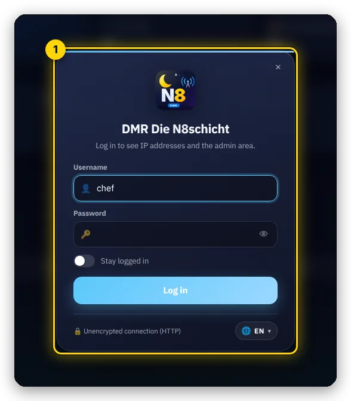
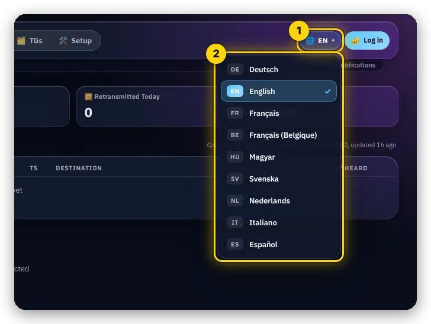
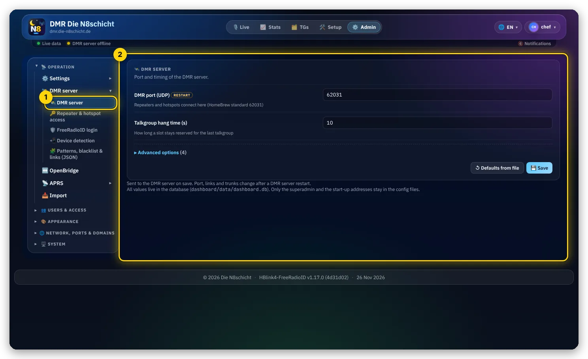
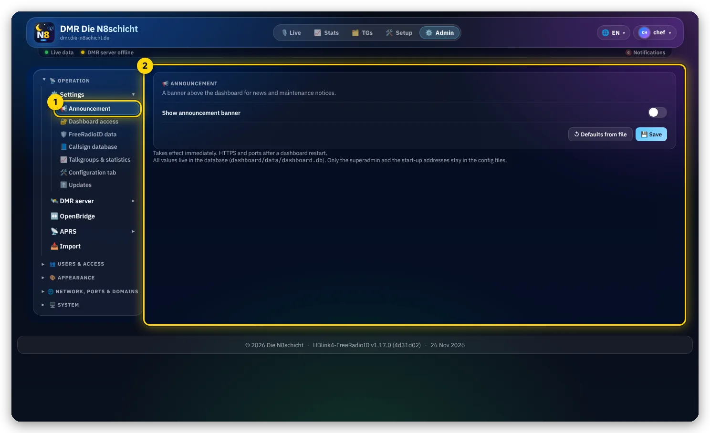
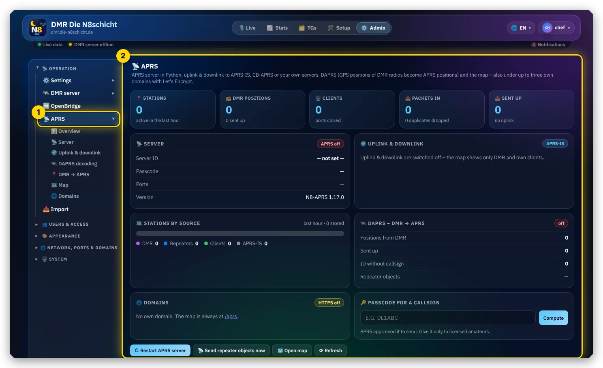
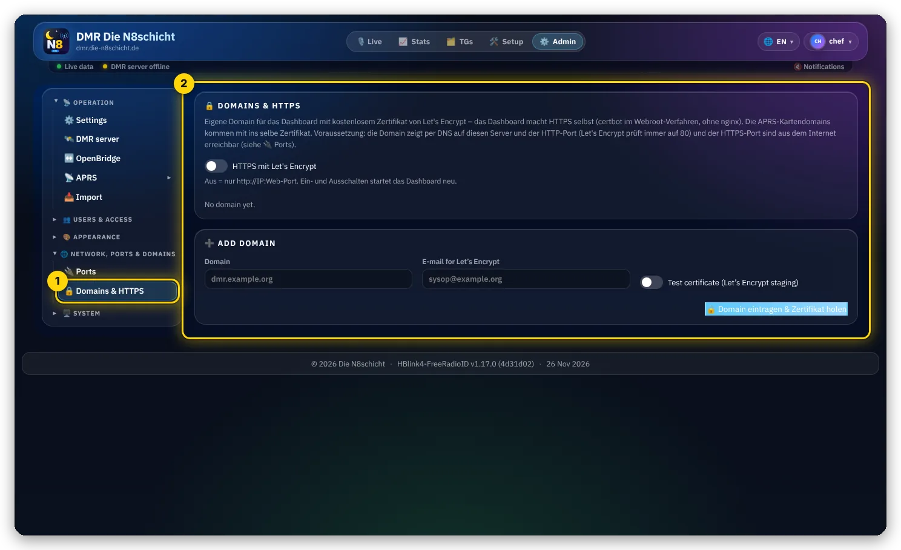
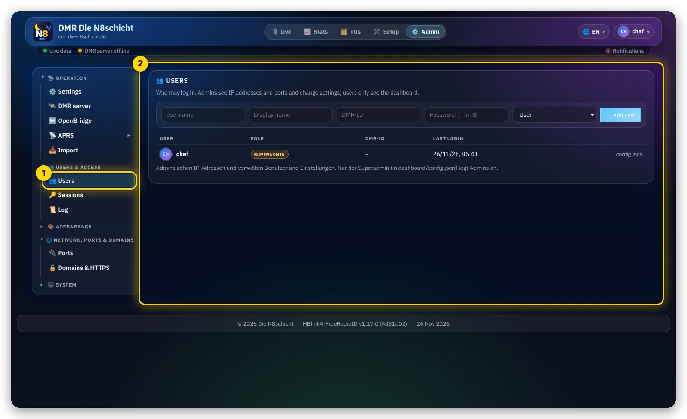
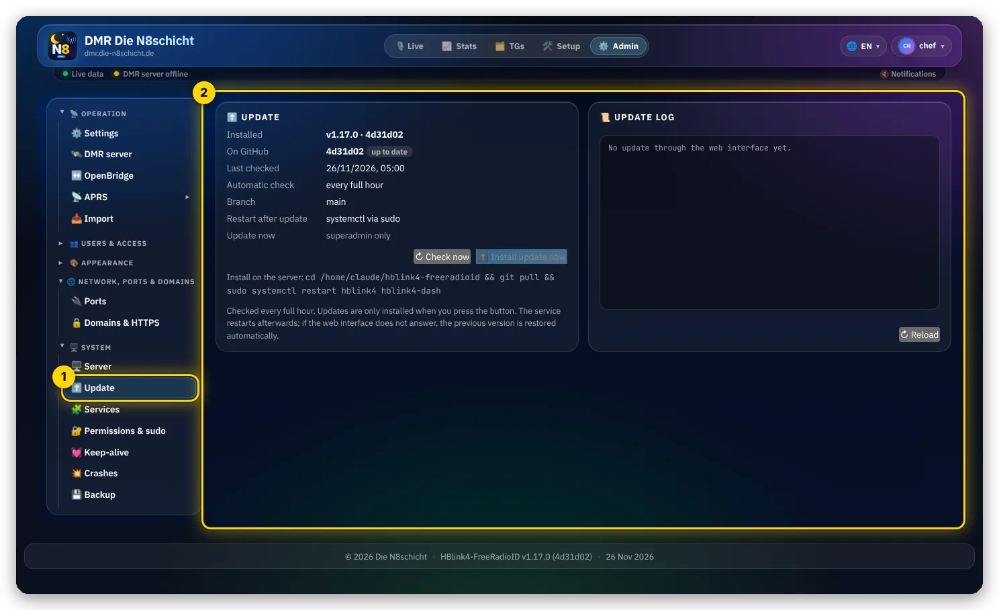

# 📘 HBlink4-FreeRadioID – Step by step

<sub>Language: [🇩🇪 Deutsch](../de/README.md) · **🇬🇧 English** · [🇫🇷 Français](../fr/README.md) · [🇧🇪 Français (Belgique)](../fr-BE/README.md) · [🇭🇺 Magyar](../hu/README.md) · [🇸🇪 Svenska](../sv/README.md) · [🇳🇱 Nederlands](../nl/README.md) · [🇮🇹 Italiano](../it/README.md) · [🇪🇸 Español](../es/README.md)</sub>

HBlink4-FreeRadioID is a DMR server with FreeRadioID login, dashboard, OpenBridge and APRS. This guide takes you through the first steps.

> 💡 The yellow numbers in the pictures belong to the numbers in the text.

## Contents

1. [Install](#1-install)
2. [Log in](#2-log-in)
3. [Choose the language](#3-choose-the-language)
4. [Set up the DMR server](#4-set-up-the-dmr-server)
5. [Access and FreeRadioID](#5-access-and-freeradioid)
6. [Switch on APRS](#6-switch-on-aprs)
7. [Own domain with HTTPS](#7-own-domain-with-https)
8. [Add users](#8-add-users)
9. [Update](#9-update)

## 1. Install

On a Debian or Ubuntu server with sudo rights:

```bash
git clone https://github.com/dhartmann1979/HBlink4-FreeRadioID /opt/HBlink4
sudo /opt/HBlink4/scripts/setup.sh
```

The setup asks for server name, ports, superadmin and FreeRadioID login and sets up the services. Afterwards the dashboard is at `http://<server>:8080`.

## 2. Log in

<p align="center"></p>

Click **🔐 Log in** at the top right. In the login window ① enter username and password; 👁 shows the password, “Stay logged in” saves the login next time. After five wrong attempts the name is locked for 15 minutes. Once logged in, avatar and name ▾ appear with account, admin area and log out.

## 3. Choose the language

<p align="center"></p>

At the top right, **🌐 EN ▾** ① opens the language menu ② with nine languages. The choice applies at once and to all N8 interfaces on this server. On the first visit the language of the browser is used.

## 4. Set up the DMR server

<p align="center"></p>

In the admin area under **📡 Operation → 🛰️ DMR server** ① you find port (default 62031), timings and links to other servers ②. Repeaters and hotspots connect to this port; changes apply after a restart of the DMR server.

## 5. Access and FreeRadioID

<p align="center"></p>

Under **⚙️ Settings** ① decide who sees the dashboard and set the access for repeaters and hotspots ②: passphrase, talkgroups and the **FreeRadioID login**. With FreeRadioID every station logs in with its personal password; the passphrase becomes the guest access with its own talkgroups.

## 6. Switch on APRS

<p align="center"></p>

Under **📡 APRS** ① switch on the APRS server with map ②: server ID (your callsign with SSID), open ports for APRS apps and iGates and the uplink to APRS-IS. GPS positions from the DMR traffic then appear on the map.

## 7. Own domain with HTTPS

<p align="center"></p>

Under **🌐 Network, ports & domains → 🔒 Domains & HTTPS** ① enter a domain that points to the server by DNS, plus an e-mail address for Let’s Encrypt ②. The certificate is fetched and renewed automatically. Ports 80 and 443 must be reachable from the internet.

## 8. Add users

<p align="center"></p>

Under **👥 Users & access → Users** ① add further accounts and give them a role ②. Admins see IP addresses and change settings, users only see the dashboard. Under **Sessions** you end logins, the **Log** shows every change.

## 9. Update

<p align="center"></p>

Under **🖥️ System → ⬆️ Update** ① you see the installed version and whether GitHub has a newer one ②. **⬆️ Install update now** downloads it, then checks the web interface and restores the previous version automatically if something goes wrong. No password is needed for this.

---

📖 Detailed description (German): [docs/de/installation.md](../../../docs/de/installation.md)
