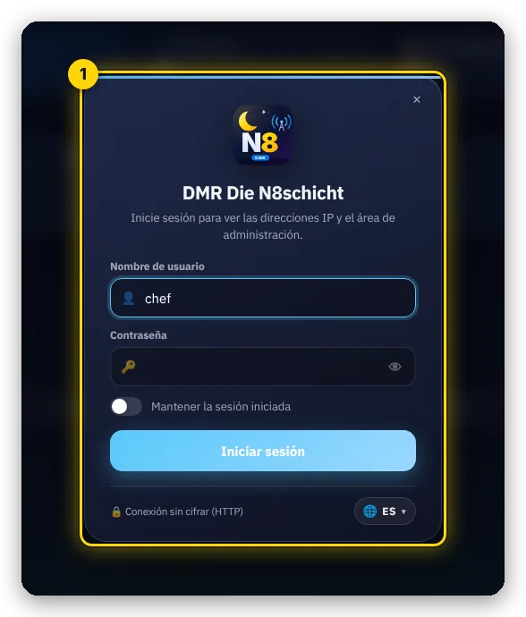
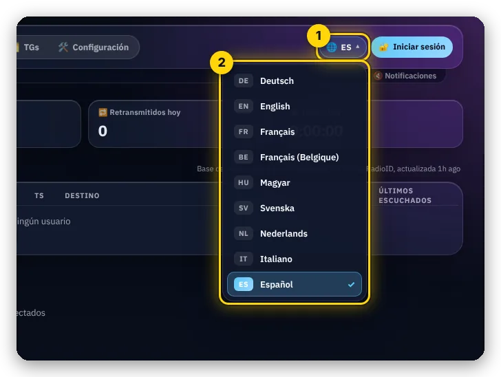
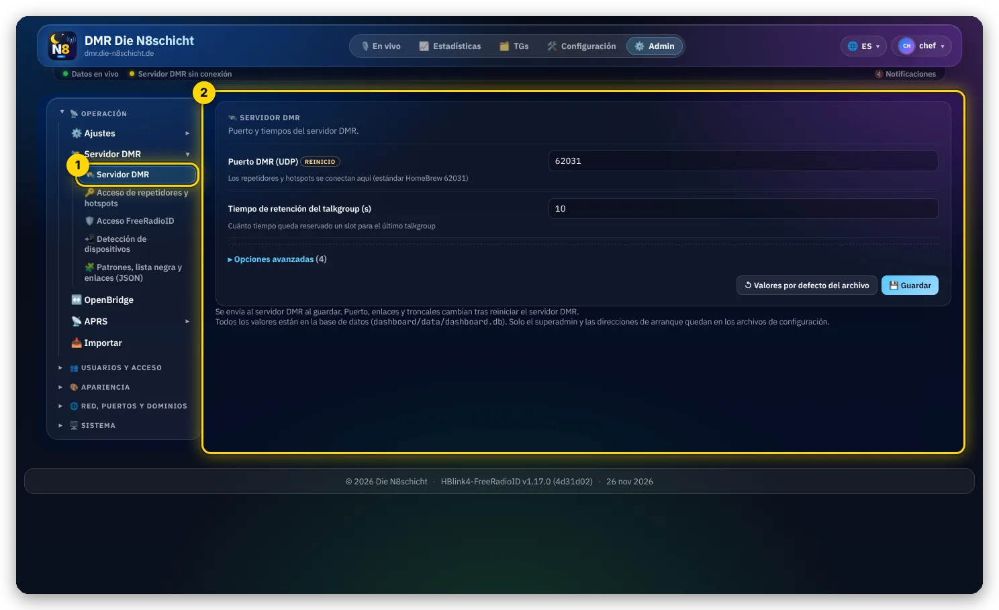
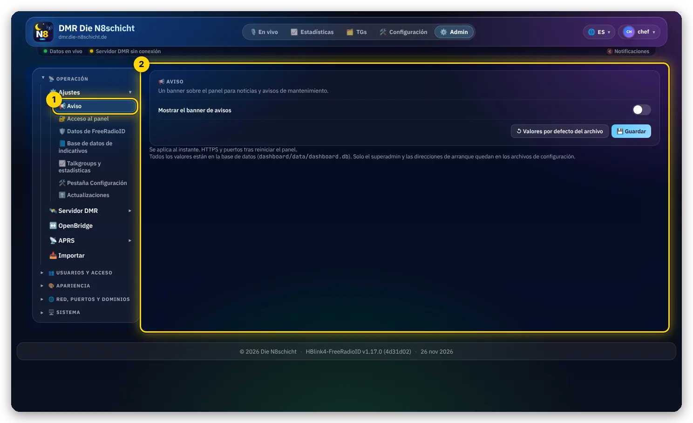
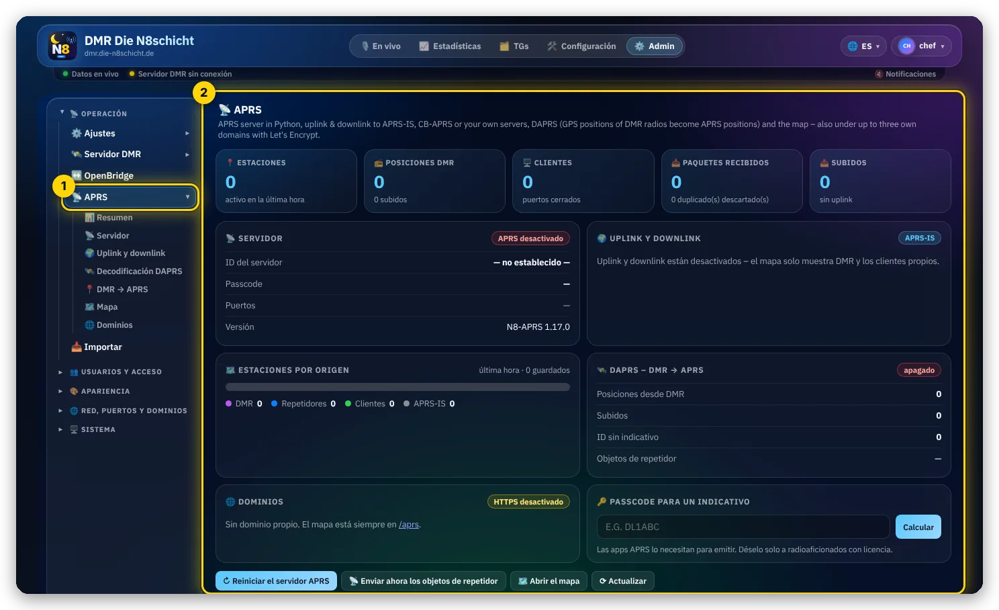
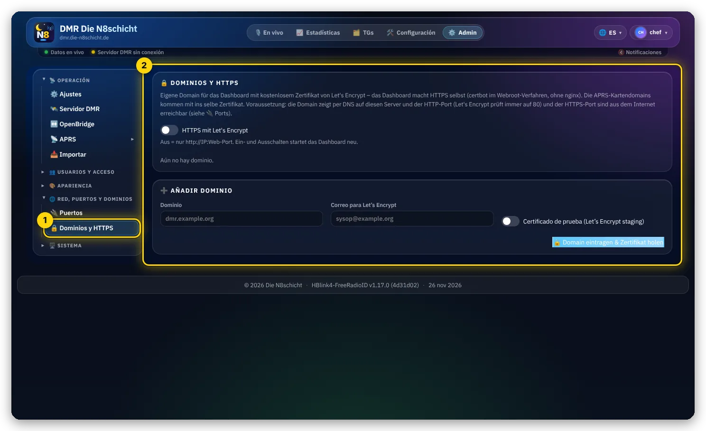
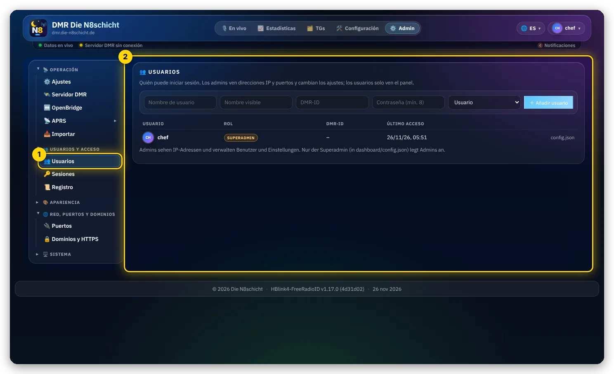
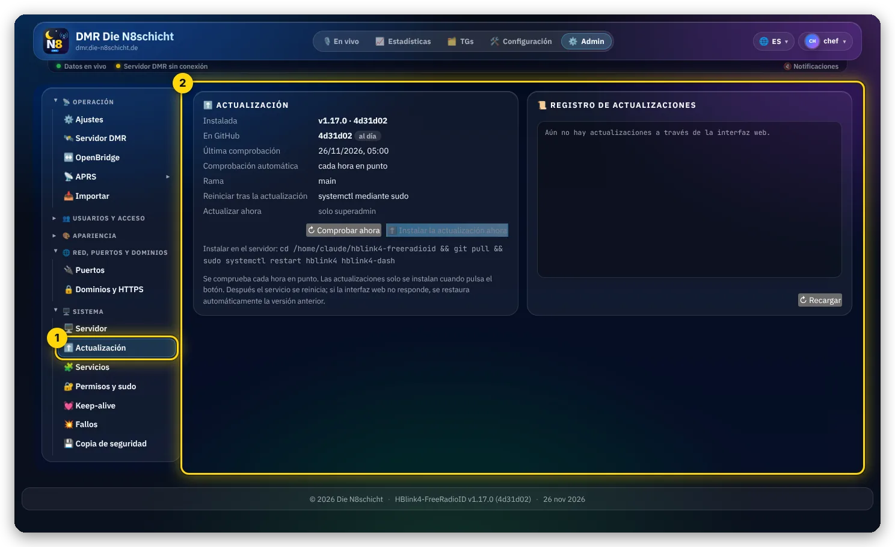

# 📘 HBlink4-FreeRadioID – Paso a paso

<sub>Idioma: [🇩🇪 Deutsch](../de/README.md) · [🇬🇧 English](../en/README.md) · [🇫🇷 Français](../fr/README.md) · [🇧🇪 Français (Belgique)](../fr-BE/README.md) · [🇭🇺 Magyar](../hu/README.md) · [🇸🇪 Svenska](../sv/README.md) · [🇳🇱 Nederlands](../nl/README.md) · [🇮🇹 Italiano](../it/README.md) · **🇪🇸 Español**</sub>

HBlink4-FreeRadioID es un servidor DMR con acceso FreeRadioID, panel, OpenBridge y APRS. Esta guía le acompaña en los primeros pasos.

> 💡 Los números amarillos de las imágenes corresponden a los números del texto.

## Contenido

1. [Instalar](#1-instalar)
2. [Iniciar sesión](#2-iniciar-sesión)
3. [Elegir el idioma](#3-elegir-el-idioma)
4. [Ajustar el servidor DMR](#4-ajustar-el-servidor-dmr)
5. [Acceso y FreeRadioID](#5-acceso-y-freeradioid)
6. [Activar APRS](#6-activar-aprs)
7. [Dominio propio con HTTPS](#7-dominio-propio-con-https)
8. [Añadir usuarios](#8-añadir-usuarios)
9. [Actualizar](#9-actualizar)

## 1. Instalar

En un servidor Debian o Ubuntu con derechos sudo:

```bash
git clone https://github.com/dhartmann1979/HBlink4-FreeRadioID /opt/HBlink4
sudo /opt/HBlink4/scripts/setup.sh
```

El setup pregunta nombre del servidor, puertos, superadmin y acceso FreeRadioID y configura los servicios. Después el panel está en `http://<servidor>:8080`.

## 2. Iniciar sesión

<p align="center"></p>

Haga clic en **🔐 Iniciar sesión** arriba a la derecha. En la ventana de inicio de sesión ① introduzca nombre de usuario y contraseña; 👁 muestra la contraseña, «Mantener la sesión iniciada» evita iniciar sesión la próxima vez. Tras cinco intentos fallidos el nombre se bloquea 15 minutos. Con la sesión iniciada aparecen avatar y nombre ▾ con cuenta, área de administración y cerrar sesión.

## 3. Elegir el idioma

<p align="center"></p>

Arriba a la derecha, **🌐 ES ▾** ① abre el menú de idiomas ② con nueve idiomas. La elección se aplica al instante y a todas las interfaces N8 de este servidor. En la primera visita se usa el idioma del navegador.

## 4. Ajustar el servidor DMR

<p align="center"></p>

En el área de administración, en **📡 Operación → 🛰️ Servidor DMR** ①, están el puerto (por defecto 62031), los tiempos y los enlaces a otros servidores ②. Repetidores y hotspots se conectan a este puerto; los cambios se aplican tras reiniciar el servidor DMR.

## 5. Acceso y FreeRadioID

<p align="center"></p>

En **⚙️ Ajustes** ① decida quién ve el panel y el acceso de repetidores y hotspots ②: frase de paso, talkgroups y el **acceso FreeRadioID**. Con FreeRadioID cada estación inicia sesión con su contraseña personal; la frase de paso pasa a ser el acceso de invitado con talkgroups propios.

## 6. Activar APRS

<p align="center"></p>

En **📡 APRS** ① active el servidor APRS con mapa ②: ID del servidor (su indicativo con SSID), puertos abiertos para apps APRS e iGates y el uplink hacia APRS-IS. Las posiciones GPS del tráfico DMR aparecen entonces en el mapa.

## 7. Dominio propio con HTTPS

<p align="center"></p>

En **🌐 Red, puertos y dominios → 🔒 Dominios y HTTPS** ① introduzca un dominio que apunte al servidor por DNS y una dirección de correo para Let’s Encrypt ②. El certificado se obtiene y se renueva automáticamente. Los puertos 80 y 443 deben ser accesibles desde Internet.

## 8. Añadir usuarios

<p align="center"></p>

En **👥 Usuarios y acceso → Usuarios** ① añada más cuentas y asígneles un rol ②. Los admins ven las direcciones IP y cambian los ajustes, los usuarios solo ven el panel. En **Sesiones** termina accesos, el **Registro** muestra cada cambio.

## 9. Actualizar

<p align="center"></p>

En **🖥️ Sistema → ⬆️ Actualización** ① ve la versión instalada y si GitHub tiene una más reciente ②. **⬆️ Instalar la actualización ahora** la descarga, comprueba después la interfaz web y, si algo falla, restaura automáticamente la versión anterior. No hace falta contraseña.

---

📖 Descripción detallada (alemán): [docs/de/installation.md](../../../docs/de/installation.md)
