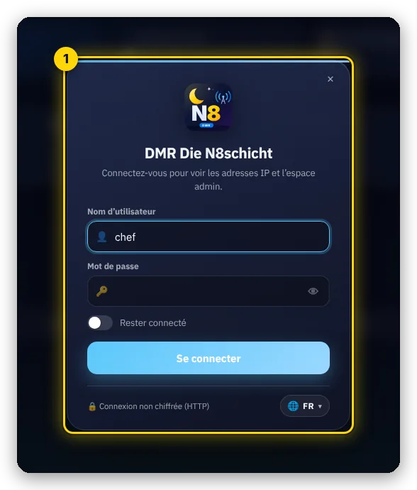
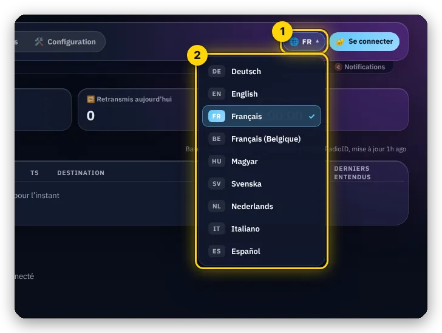
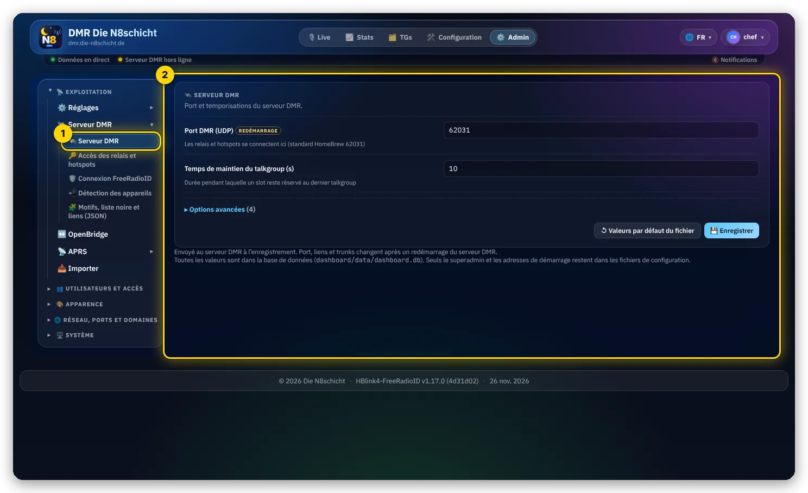
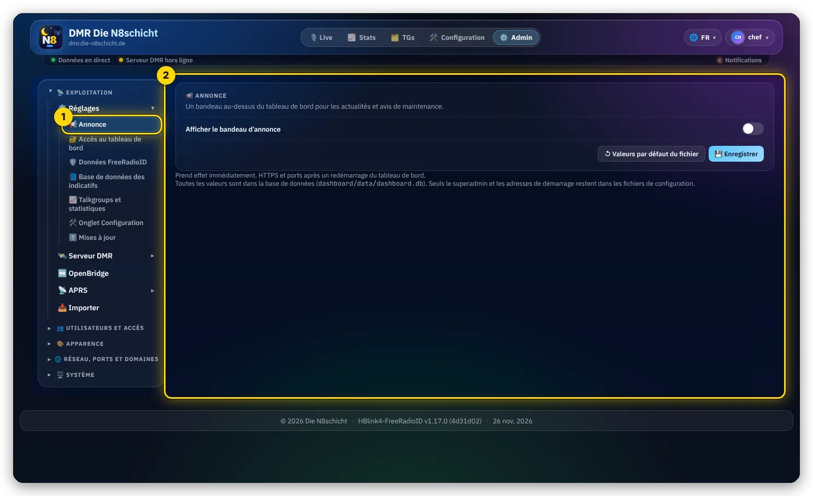
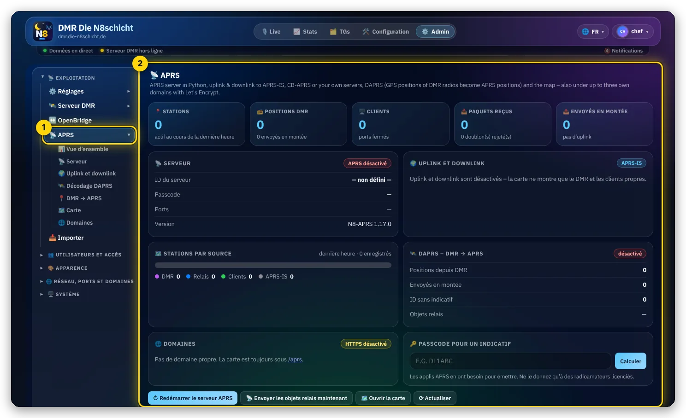
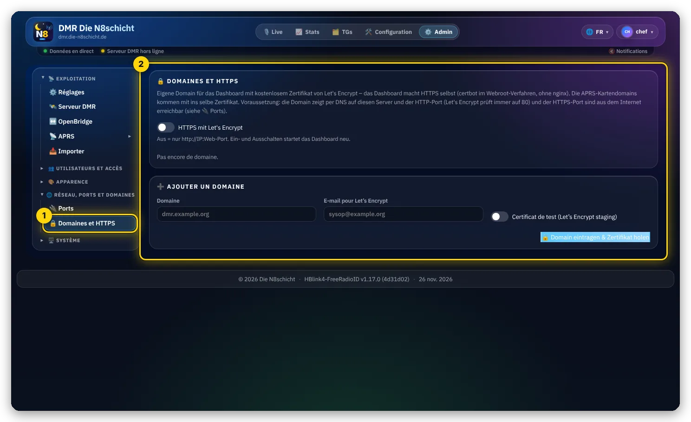
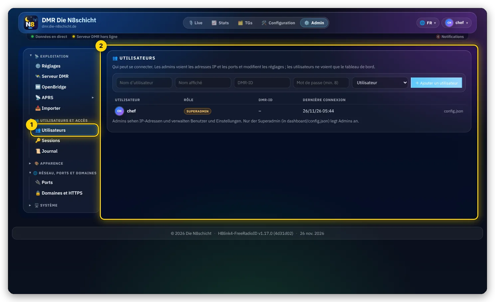
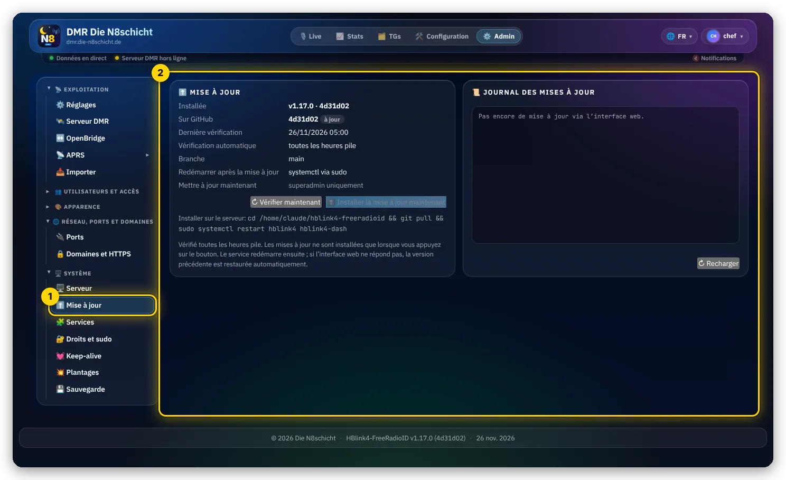

# 📘 HBlink4-FreeRadioID – Pas à pas

<sub>Langue: [🇩🇪 Deutsch](../de/README.md) · [🇬🇧 English](../en/README.md) · **🇫🇷 Français** · [🇧🇪 Français (Belgique)](../fr-BE/README.md) · [🇭🇺 Magyar](../hu/README.md) · [🇸🇪 Svenska](../sv/README.md) · [🇳🇱 Nederlands](../nl/README.md) · [🇮🇹 Italiano](../it/README.md) · [🇪🇸 Español](../es/README.md)</sub>

HBlink4-FreeRadioID est un serveur DMR avec connexion FreeRadioID, tableau de bord, OpenBridge et APRS. Ce guide vous accompagne dans les premières étapes.

> 💡 Les chiffres jaunes des images correspondent aux chiffres du texte.

## Sommaire

1. [Installer](#1-installer)
2. [Se connecter](#2-se-connecter)
3. [Choisir la langue](#3-choisir-la-langue)
4. [Régler le serveur DMR](#4-régler-le-serveur-dmr)
5. [Accès et FreeRadioID](#5-accès-et-freeradioid)
6. [Activer l’APRS](#6-activer-laprs)
7. [Domaine propre avec HTTPS](#7-domaine-propre-avec-https)
8. [Ajouter des utilisateurs](#8-ajouter-des-utilisateurs)
9. [Mettre à jour](#9-mettre-à-jour)

## 1. Installer

Sur un serveur Debian ou Ubuntu avec les droits sudo :

```bash
git clone https://github.com/dhartmann1979/HBlink4-FreeRadioID /opt/HBlink4
sudo /opt/HBlink4/scripts/setup.sh
```

Le setup demande le nom du serveur, les ports, le superadmin et la connexion FreeRadioID, puis configure les services. Ensuite, le tableau de bord est accessible sous `http://<serveur>:8080`.

## 2. Se connecter

<p align="center"></p>

Cliquez sur **🔐 Se connecter** en haut à droite. Dans la fenêtre de connexion ①, saisissez le nom d’utilisateur et le mot de passe ; 👁 affiche le mot de passe, « Rester connecté » évite de se reconnecter la prochaine fois. Après cinq tentatives erronées, le nom est bloqué pendant 15 minutes. Une fois connecté, l’avatar et le nom ▾ apparaissent avec le compte, l’espace admin et la déconnexion.

## 3. Choisir la langue

<p align="center"></p>

En haut à droite, **🌐 FR ▾** ① ouvre le menu des langues ② avec neuf langues. Le choix s’applique immédiatement et à toutes les interfaces N8 de ce serveur. Lors de la première visite, la langue du navigateur est utilisée.

## 4. Régler le serveur DMR

<p align="center"></p>

Dans l’espace admin, sous **📡 Exploitation → 🛰️ Serveur DMR** ①, se trouvent le port (par défaut 62031), les temporisations et les liens vers d’autres serveurs ②. Relais et hotspots se connectent sur ce port ; les modifications s’appliquent après un redémarrage du serveur DMR.

## 5. Accès et FreeRadioID

<p align="center"></p>

Sous **⚙️ Réglages** ①, déterminez qui voit le tableau de bord et l’accès des relais et hotspots ② : phrase secrète, talkgroups et **connexion FreeRadioID**. Avec FreeRadioID, chaque station se connecte avec son mot de passe personnel ; la phrase secrète devient l’accès invité avec ses propres talkgroups.

## 6. Activer l’APRS

<p align="center"></p>

Sous **📡 APRS** ①, activez le serveur APRS avec carte ② : ID du serveur (votre indicatif avec SSID), ports ouverts pour les applis APRS et iGates, et l’uplink vers APRS-IS. Les positions GPS du trafic DMR apparaissent alors sur la carte.

## 7. Domaine propre avec HTTPS

<p align="center"></p>

Sous **🌐 Réseau, ports et domaines → 🔒 Domaines et HTTPS** ①, saisissez un domaine qui pointe vers le serveur par DNS, ainsi qu’une adresse e-mail pour Let’s Encrypt ②. Le certificat est obtenu et renouvelé automatiquement. Les ports 80 et 443 doivent être joignables depuis Internet.

## 8. Ajouter des utilisateurs

<p align="center"></p>

Sous **👥 Utilisateurs et accès → Utilisateurs** ①, ajoutez d’autres comptes et attribuez-leur un rôle ②. Les admins voient les adresses IP et modifient les réglages, les utilisateurs ne voient que le tableau de bord. Sous **Sessions**, vous terminez des connexions ; le **Journal** affiche chaque modification.

## 9. Mettre à jour

<p align="center"></p>

Sous **🖥️ Système → ⬆️ Mise à jour** ①, vous voyez la version installée et si GitHub en propose une plus récente ②. **⬆️ Installer la mise à jour maintenant** la télécharge, vérifie ensuite l’interface web et restaure automatiquement la version précédente en cas de problème. Aucun mot de passe n’est nécessaire.

---

📖 Description détaillée (allemand): [docs/de/installation.md](../../../docs/de/installation.md)
