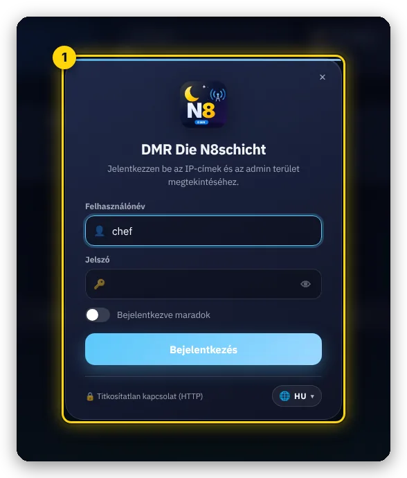
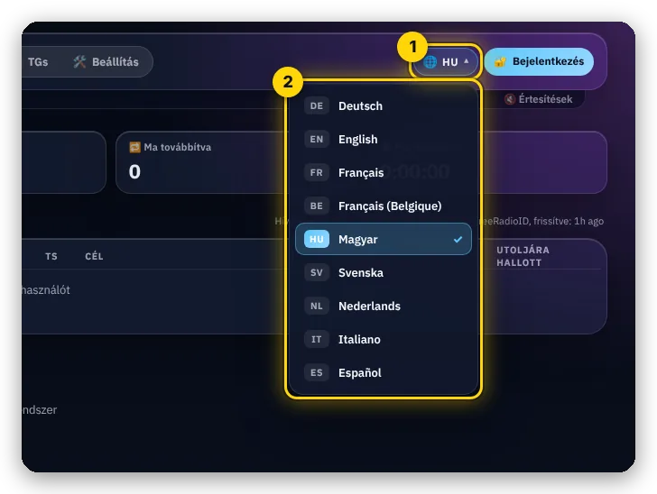
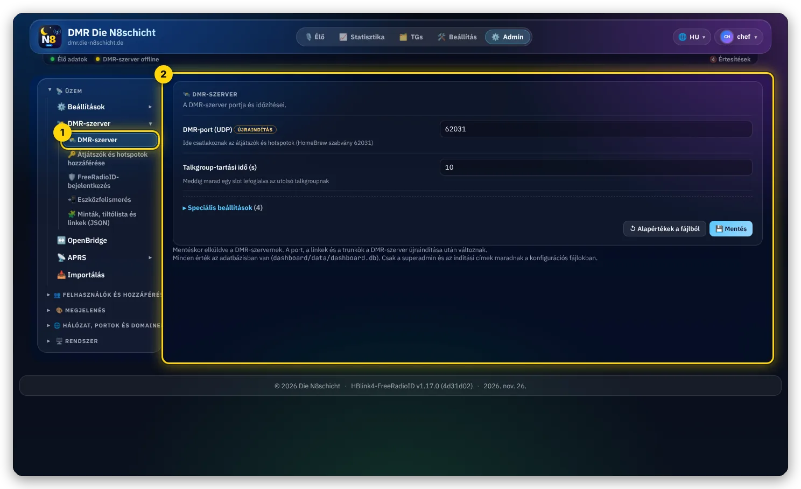
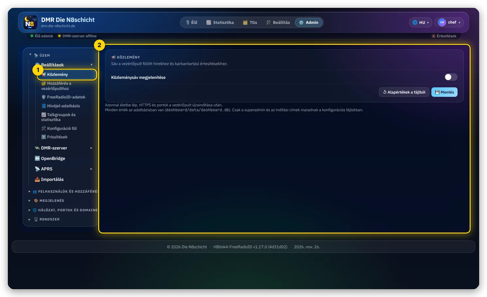
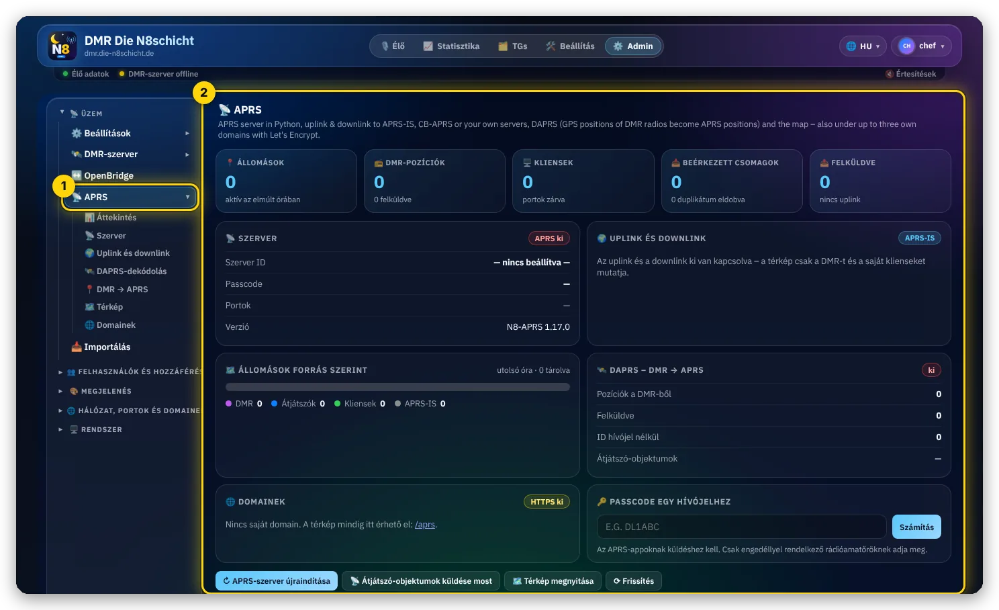
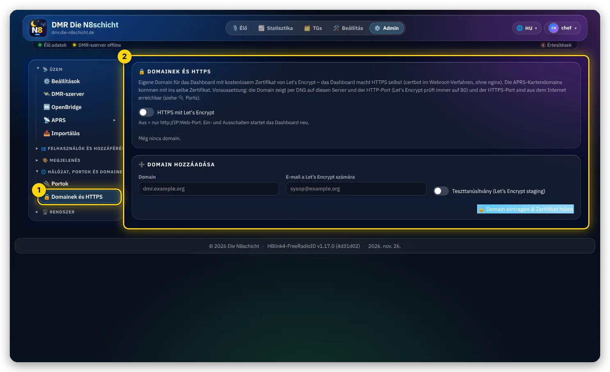
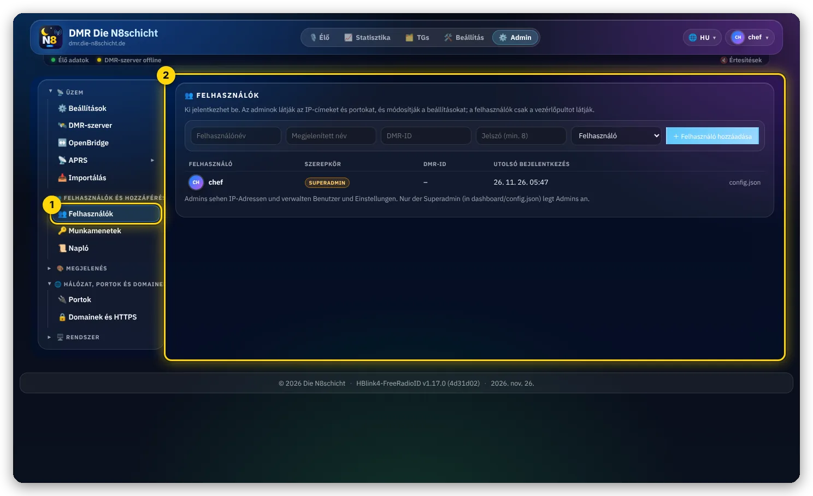
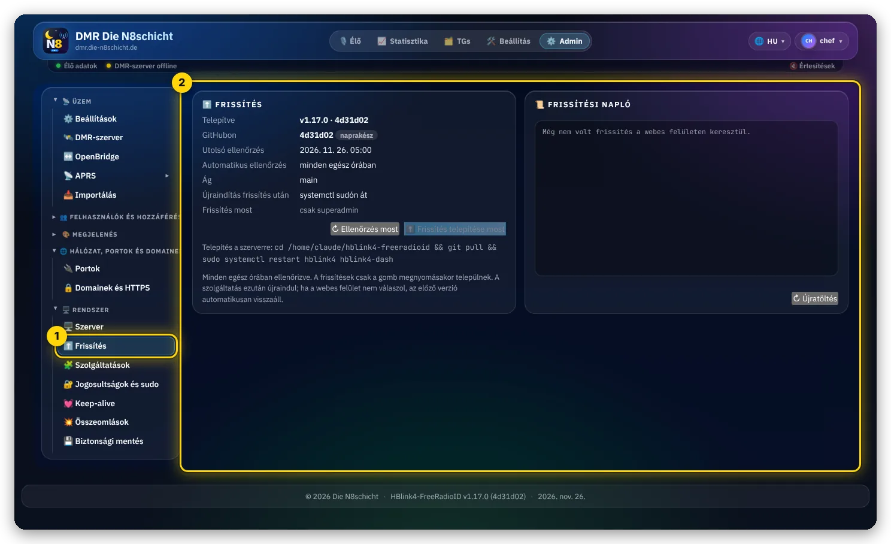

# 📘 HBlink4-FreeRadioID – Lépésről lépésre

<sub>Nyelv: [🇩🇪 Deutsch](../de/README.md) · [🇬🇧 English](../en/README.md) · [🇫🇷 Français](../fr/README.md) · [🇧🇪 Français (Belgique)](../fr-BE/README.md) · **🇭🇺 Magyar** · [🇸🇪 Svenska](../sv/README.md) · [🇳🇱 Nederlands](../nl/README.md) · [🇮🇹 Italiano](../it/README.md) · [🇪🇸 Español](../es/README.md)</sub>

A HBlink4-FreeRadioID egy DMR-szerver FreeRadioID-bejelentkezéssel, vezérlőpulttal, OpenBridge-dzsel és APRS-sel. Ez az útmutató végigvezet az első lépéseken.

> 💡 A képeken lévő sárga számok a szövegben szereplő számokhoz tartoznak.

## Tartalom

1. [Telepítés](#1-telepítés)
2. [Bejelentkezés](#2-bejelentkezés)
3. [Nyelv kiválasztása](#3-nyelv-kiválasztása)
4. [A DMR-szerver beállítása](#4-a-dmr-szerver-beállítása)
5. [Hozzáférés és FreeRadioID](#5-hozzáférés-és-freeradioid)
6. [Az APRS bekapcsolása](#6-az-aprs-bekapcsolása)
7. [Saját domain HTTPS-sel](#7-saját-domain-https-sel)
8. [Felhasználók hozzáadása](#8-felhasználók-hozzáadása)
9. [Frissítés](#9-frissítés)

## 1. Telepítés

Debian vagy Ubuntu szerveren sudo-jogosultsággal:

```bash
git clone https://github.com/dhartmann1979/HBlink4-FreeRadioID /opt/HBlink4
sudo /opt/HBlink4/scripts/setup.sh
```

A setup bekéri a szervernevet, a portokat, a superadmint és a FreeRadioID-bejelentkezést, majd beállítja a szolgáltatásokat. Utána a vezérlőpult itt érhető el: `http://<szerver>:8080`.

## 2. Bejelentkezés

<p align="center"></p>

Kattintson jobbra fent a **🔐 Bejelentkezés** gombra. A bejelentkezési ablakban ① adja meg a felhasználónevet és a jelszót; a 👁 megmutatja a jelszót, a „Bejelentkezve maradok” megspórolja a következő bejelentkezést. Öt hibás próbálkozás után a név 15 percre zárolódik. Bejelentkezve megjelenik az avatar és a név ▾ a fiókkal, az admin területtel és a kijelentkezéssel.

## 3. Nyelv kiválasztása

<p align="center"></p>

Jobbra fent a **🌐 HU ▾** ① megnyitja a nyelvi menüt ② kilenc nyelvvel. A választás azonnal érvényes, és a szerver összes N8-felületére vonatkozik. Az első látogatáskor a böngésző nyelve érvényes.

## 4. A DMR-szerver beállítása

<p align="center"></p>

Az admin területen az **📡 Üzem → 🛰️ DMR-szerver** alatt ① található a port (alapértelmezés 62031), az időzítések és a más szerverekhez vezető linkek ②. Az átjátszók és hotspotok erre a portra csatlakoznak; a módosítások a DMR-szerver újraindítása után érvényesek.

## 5. Hozzáférés és FreeRadioID

<p align="center"></p>

A **⚙️ Beállítások** alatt ① határozza meg, ki látja a vezérlőpultot, valamint az átjátszók és hotspotok hozzáférését ②: passphrase, talkgroupok és a **FreeRadioID-bejelentkezés**. FreeRadioID esetén minden állomás a személyes jelszavával jelentkezik be; a passphrase a saját talkgroupokkal rendelkező vendéghozzáférés lesz.

## 6. Az APRS bekapcsolása

<p align="center"></p>

Az **📡 APRS** alatt ① kapcsolja be az APRS-szervert térképpel ②: szerver ID (hívójele SSID-vel), nyitott portok APRS-appokhoz és iGate-ekhez, valamint az uplink az APRS-IS felé. A DMR-forgalom GPS-pozíciói ezután megjelennek a térképen.

## 7. Saját domain HTTPS-sel

<p align="center"></p>

A **🌐 Hálózat, portok és domainek → 🔒 Domainek és HTTPS** alatt ① adjon meg egy domaint, amely DNS-sel a szerverre mutat, valamint egy e-mail-címet a Let’s Encrypt számára ②. A tanúsítvány beszerzése és megújítása automatikus. A 80-as és 443-as portnak elérhetőnek kell lennie az internetről.

## 8. Felhasználók hozzáadása

<p align="center"></p>

A **👥 Felhasználók és hozzáférés → Felhasználók** alatt ① további fiókokat hozhat létre, és szerepkört adhat nekik ②. Az adminok látják az IP-címeket és módosítják a beállításokat, a felhasználók csak a vezérlőpultot látják. A **Munkamenetek** alatt bejelentkezéseket fejezhet be, a **Napló** minden változást mutat.

## 9. Frissítés

<p align="center"></p>

A **🖥️ Rendszer → ⬆️ Frissítés** alatt ① látja a telepített verziót, és hogy van-e újabb a GitHubon ②. A **⬆️ Frissítés telepítése most** letölti, majd ellenőrzi a webes felületet, és hiba esetén automatikusan visszaállítja az előző verziót. Ehhez nem kell jelszó.

---

📖 Részletes leírás (német): [docs/de/installation.md](../../../docs/de/installation.md)
