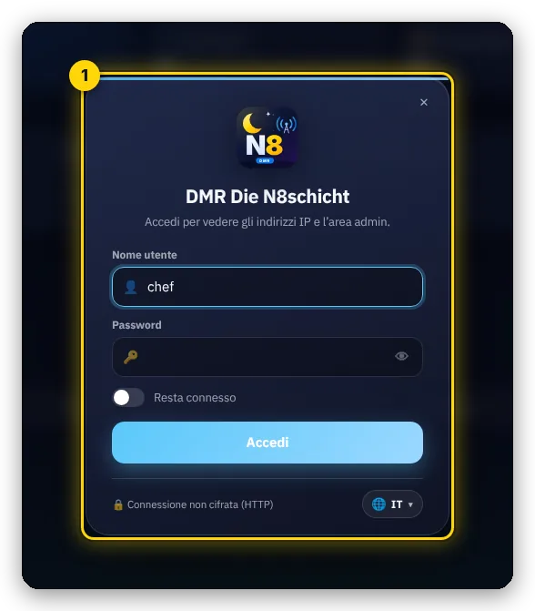
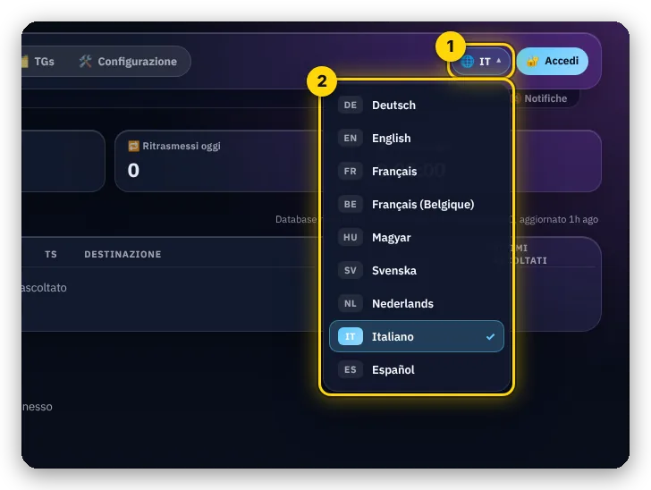
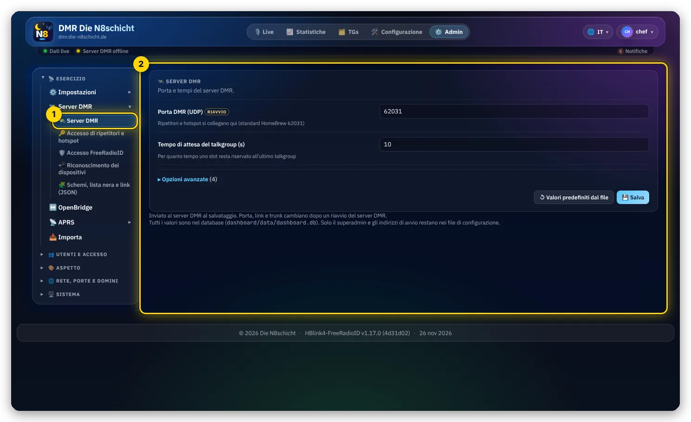
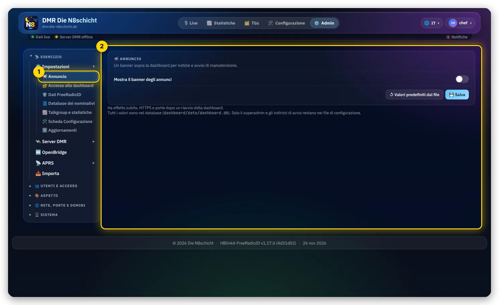
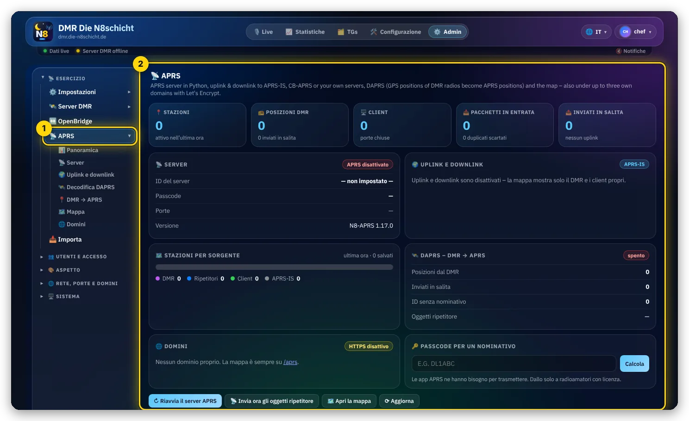
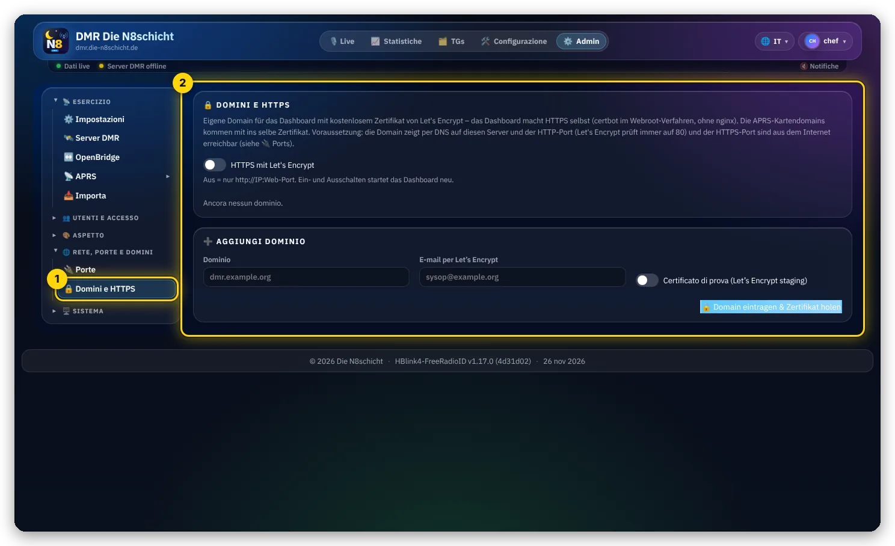
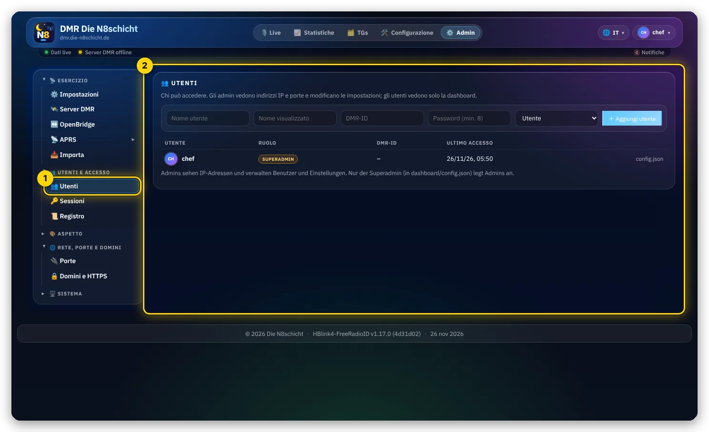
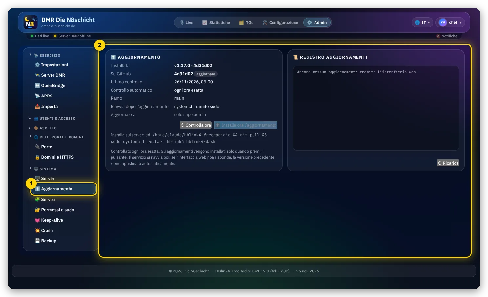

# 📘 HBlink4-FreeRadioID – Passo dopo passo

<sub>Lingua: [🇩🇪 Deutsch](../de/README.md) · [🇬🇧 English](../en/README.md) · [🇫🇷 Français](../fr/README.md) · [🇧🇪 Français (Belgique)](../fr-BE/README.md) · [🇭🇺 Magyar](../hu/README.md) · [🇸🇪 Svenska](../sv/README.md) · [🇳🇱 Nederlands](../nl/README.md) · **🇮🇹 Italiano** · [🇪🇸 Español](../es/README.md)</sub>

HBlink4-FreeRadioID è un server DMR con accesso FreeRadioID, dashboard, OpenBridge e APRS. Questa guida ti accompagna nei primi passi.

> 💡 I numeri gialli nelle immagini corrispondono ai numeri nel testo.

## Indice

1. [Installare](#1-installare)
2. [Accedere](#2-accedere)
3. [Scegliere la lingua](#3-scegliere-la-lingua)
4. [Impostare il server DMR](#4-impostare-il-server-dmr)
5. [Accesso e FreeRadioID](#5-accesso-e-freeradioid)
6. [Attivare l’APRS](#6-attivare-laprs)
7. [Dominio proprio con HTTPS](#7-dominio-proprio-con-https)
8. [Aggiungere utenti](#8-aggiungere-utenti)
9. [Aggiornare](#9-aggiornare)

## 1. Installare

Su un server Debian o Ubuntu con diritti sudo:

```bash
git clone https://github.com/dhartmann1979/HBlink4-FreeRadioID /opt/HBlink4
sudo /opt/HBlink4/scripts/setup.sh
```

Il setup chiede nome del server, porte, superadmin e accesso FreeRadioID e configura i servizi. Dopo la dashboard è raggiungibile su `http://<server>:8080`.

## 2. Accedere

<p align="center"></p>

Fai clic su **🔐 Accedi** in alto a destra. Nella finestra di accesso ① inserisci nome utente e password; 👁 mostra la password, «Resta connesso» evita l’accesso la volta successiva. Dopo cinque tentativi errati il nome viene bloccato per 15 minuti. Dopo l’accesso compaiono avatar e nome ▾ con account, area admin ed esci.

## 3. Scegliere la lingua

<p align="center"></p>

In alto a destra **🌐 IT ▾** ① apre il menu delle lingue ② con nove lingue. La scelta vale subito e per tutte le interfacce N8 di questo server. Alla prima visita viene usata la lingua del browser.

## 4. Impostare il server DMR

<p align="center"></p>

Nell’area admin, in **📡 Esercizio → 🛰️ Server DMR** ①, trovi porta (predefinita 62031), tempi e collegamenti ad altri server ②. Ripetitori e hotspot si collegano a questa porta; le modifiche hanno effetto dopo un riavvio del server DMR.

## 5. Accesso e FreeRadioID

<p align="center"></p>

In **⚙️ Impostazioni** ① stabilisci chi vede la dashboard e l’accesso di ripetitori e hotspot ②: passphrase, talkgroup e l’**accesso FreeRadioID**. Con FreeRadioID ogni stazione accede con la propria password personale; la passphrase diventa l’accesso ospite con talkgroup propri.

## 6. Attivare l’APRS

<p align="center"></p>

In **📡 APRS** ① attivi il server APRS con mappa ②: ID del server (il tuo nominativo con SSID), porte aperte per app APRS e iGate e l’uplink verso APRS-IS. Le posizioni GPS del traffico DMR compaiono poi sulla mappa.

## 7. Dominio proprio con HTTPS

<p align="center"></p>

In **🌐 Rete, porte e domini → 🔒 Domini e HTTPS** ① inserisci un dominio che punta al server tramite DNS e un indirizzo e-mail per Let’s Encrypt ②. Il certificato viene ottenuto e rinnovato automaticamente. Le porte 80 e 443 devono essere raggiungibili da Internet.

## 8. Aggiungere utenti

<p align="center"></p>

In **👥 Utenti e accesso → Utenti** ① aggiungi altri account e assegni loro un ruolo ②. Gli admin vedono gli indirizzi IP e modificano le impostazioni, gli utenti vedono solo la dashboard. In **Sessioni** termini gli accessi, il **Registro** mostra ogni modifica.

## 9. Aggiornare

<p align="center"></p>

In **🖥️ Sistema → ⬆️ Aggiornamento** ① vedi la versione installata e se GitHub ne ha una più recente ②. **⬆️ Installa ora l’aggiornamento** la scarica, poi controlla l’interfaccia web e in caso di errore ripristina automaticamente la versione precedente. Non serve alcuna password.

---

📖 Descrizione dettagliata (tedesco): [docs/de/installation.md](../../../docs/de/installation.md)
