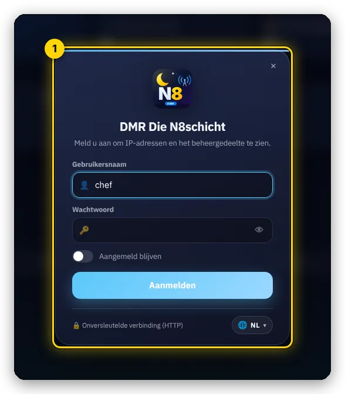
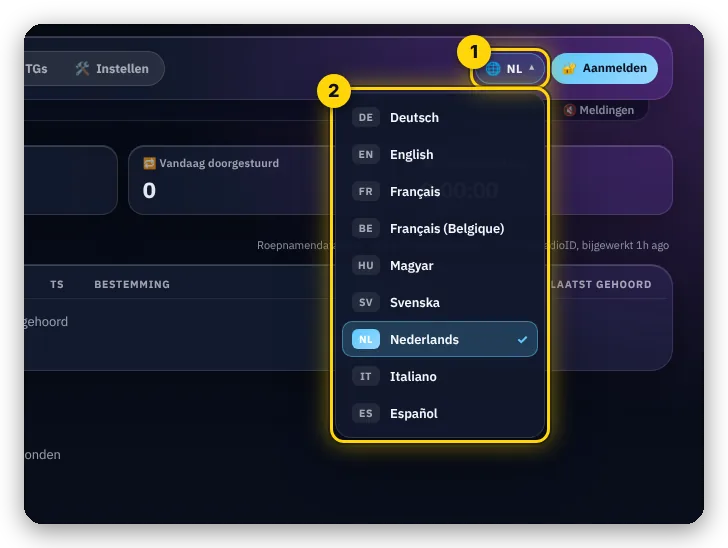
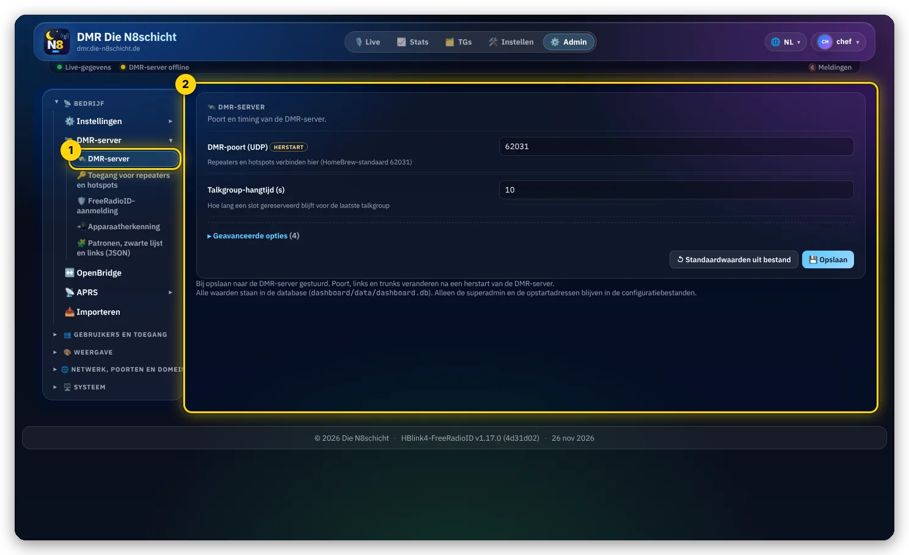
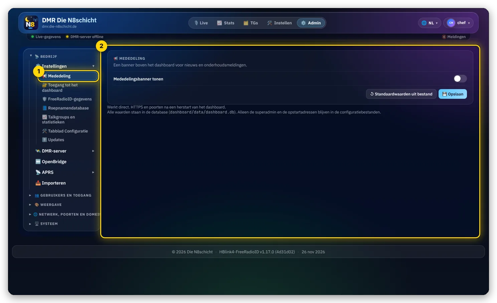
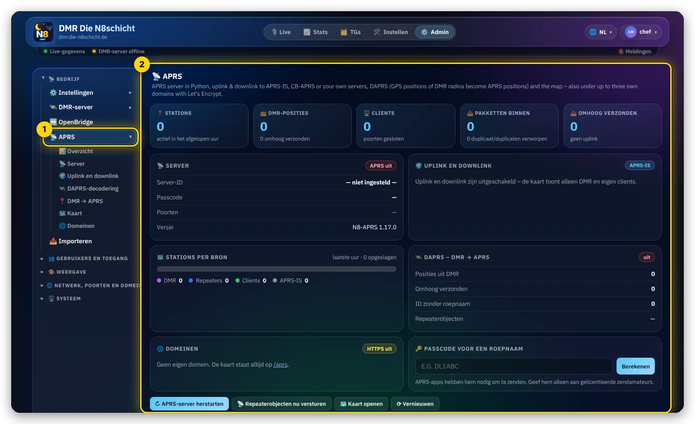
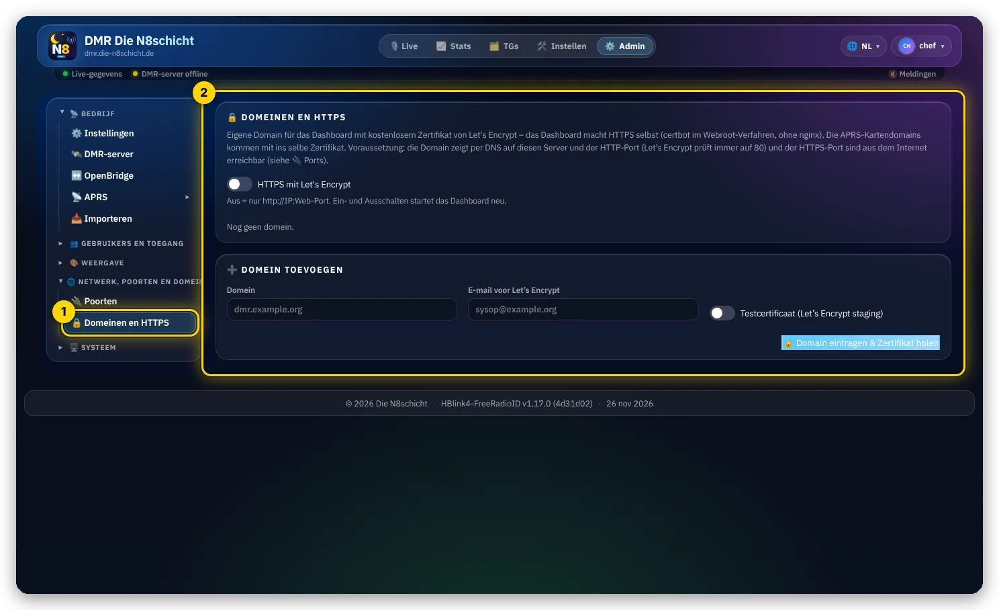
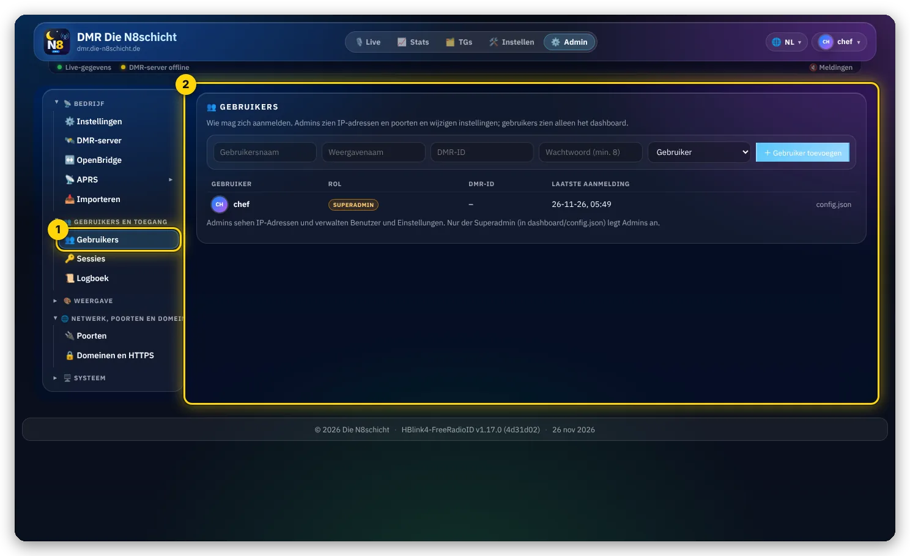
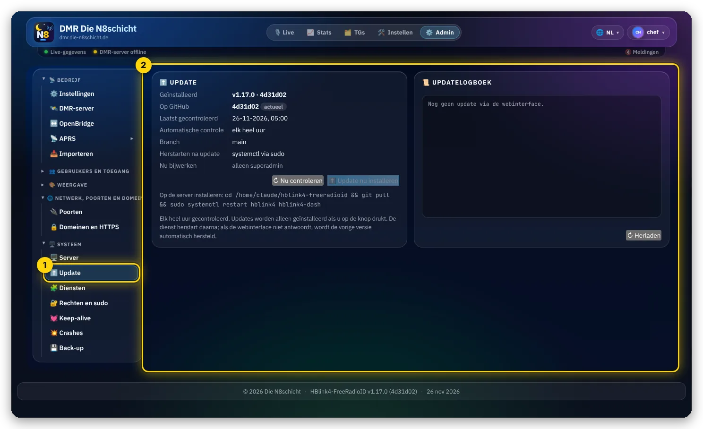

# 📘 HBlink4-FreeRadioID – Stap voor stap

<sub>Taal: [🇩🇪 Deutsch](../de/README.md) · [🇬🇧 English](../en/README.md) · [🇫🇷 Français](../fr/README.md) · [🇧🇪 Français (Belgique)](../fr-BE/README.md) · [🇭🇺 Magyar](../hu/README.md) · [🇸🇪 Svenska](../sv/README.md) · **🇳🇱 Nederlands** · [🇮🇹 Italiano](../it/README.md) · [🇪🇸 Español](../es/README.md)</sub>

HBlink4-FreeRadioID is een DMR-server met FreeRadioID-aanmelding, dashboard, OpenBridge en APRS. Deze handleiding leidt u door de eerste stappen.

> 💡 De gele cijfers in de afbeeldingen horen bij de cijfers in de tekst.

## Inhoud

1. [Installeren](#1-installeren)
2. [Aanmelden](#2-aanmelden)
3. [Taal kiezen](#3-taal-kiezen)
4. [De DMR-server instellen](#4-de-dmr-server-instellen)
5. [Toegang en FreeRadioID](#5-toegang-en-freeradioid)
6. [APRS inschakelen](#6-aprs-inschakelen)
7. [Eigen domein met HTTPS](#7-eigen-domein-met-https)
8. [Gebruikers toevoegen](#8-gebruikers-toevoegen)
9. [Bijwerken](#9-bijwerken)

## 1. Installeren

Op een Debian- of Ubuntu-server met sudo-rechten:

```bash
git clone https://github.com/dhartmann1979/HBlink4-FreeRadioID /opt/HBlink4
sudo /opt/HBlink4/scripts/setup.sh
```

De setup vraagt naar servernaam, poorten, superadmin en FreeRadioID-aanmelding en richt de diensten in. Daarna is het dashboard bereikbaar op `http://<server>:8080`.

## 2. Aanmelden

<p align="center"></p>

Klik rechtsboven op **🔐 Aanmelden**. Voer in het aanmeldvenster ① gebruikersnaam en wachtwoord in; 👁 toont het wachtwoord, „Aangemeld blijven” bespaart de volgende keer het aanmelden. Na vijf verkeerde pogingen wordt de naam 15 minuten geblokkeerd. Aangemeld verschijnen avatar en naam ▾ met account, beheergedeelte en afmelden.

## 3. Taal kiezen

<p align="center"></p>

Rechtsboven opent **🌐 NL ▾** ① het taalmenu ② met negen talen. De keuze geldt direct en voor alle N8-interfaces op deze server. Bij het eerste bezoek wordt de taal van de browser gebruikt.

## 4. De DMR-server instellen

<p align="center"></p>

In het beheergedeelte onder **📡 Bedrijf → 🛰️ DMR-server** ① staan poort (standaard 62031), timing en links naar andere servers ②. Repeaters en hotspots verbinden met deze poort; wijzigingen werken na een herstart van de DMR-server.

## 5. Toegang en FreeRadioID

<p align="center"></p>

Onder **⚙️ Instellingen** ① legt u vast wie het dashboard ziet en de toegang voor repeaters en hotspots ②: passphrase, talkgroups en de **FreeRadioID-aanmelding**. Met FreeRadioID meldt elk station zich aan met zijn persoonlijke wachtwoord; de passphrase wordt de gasttoegang met eigen talkgroups.

## 6. APRS inschakelen

<p align="center"></p>

Onder **📡 APRS** ① schakelt u de APRS-server met kaart in ②: server-ID (uw roepnaam met SSID), open poorten voor APRS-apps en iGates en de uplink naar APRS-IS. GPS-posities uit het DMR-verkeer verschijnen dan op de kaart.

## 7. Eigen domein met HTTPS

<p align="center"></p>

Onder **🌐 Netwerk, poorten en domeinen → 🔒 Domeinen en HTTPS** ① voert u een domein in dat via DNS naar de server wijst, plus een e-mailadres voor Let’s Encrypt ②. Het certificaat wordt automatisch opgehaald en vernieuwd. Poorten 80 en 443 moeten vanaf internet bereikbaar zijn.

## 8. Gebruikers toevoegen

<p align="center"></p>

Onder **👥 Gebruikers en toegang → Gebruikers** ① voegt u meer accounts toe en geeft u ze een rol ②. Admins zien IP-adressen en wijzigen instellingen, gebruikers zien alleen het dashboard. Onder **Sessies** beëindigt u aanmeldingen, het **Logboek** toont elke wijziging.

## 9. Bijwerken

<p align="center"></p>

Onder **🖥️ Systeem → ⬆️ Update** ① ziet u de geïnstalleerde versie en of GitHub een nieuwere heeft ②. **⬆️ Update nu installeren** downloadt hem, controleert daarna de webinterface en zet bij een fout automatisch de vorige versie terug. Hiervoor is geen wachtwoord nodig.

---

📖 Uitgebreide beschrijving (Duits): [docs/de/installation.md](../../../docs/de/installation.md)
