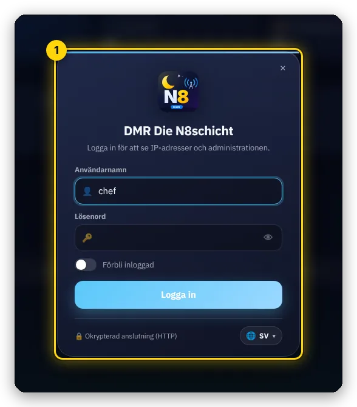
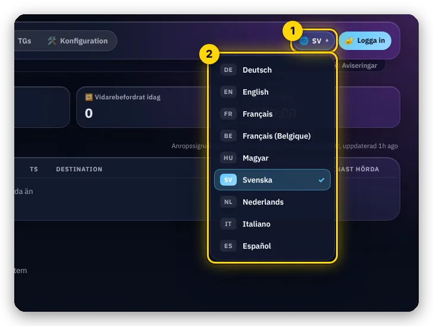
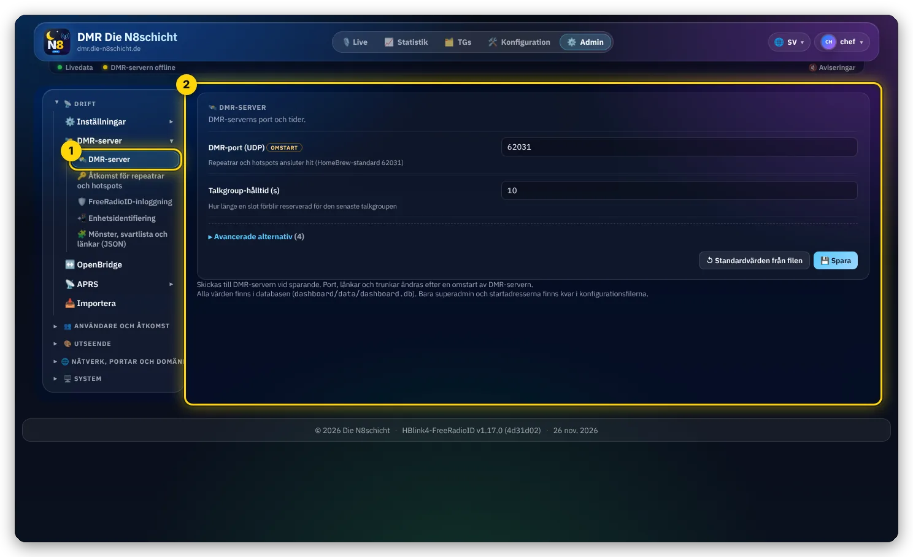
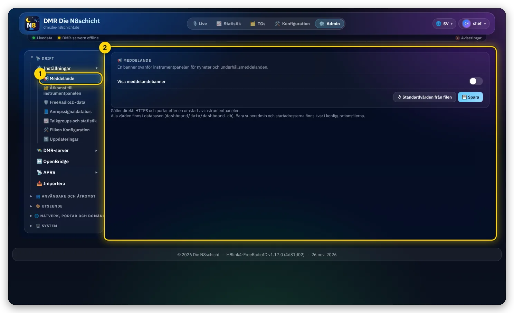
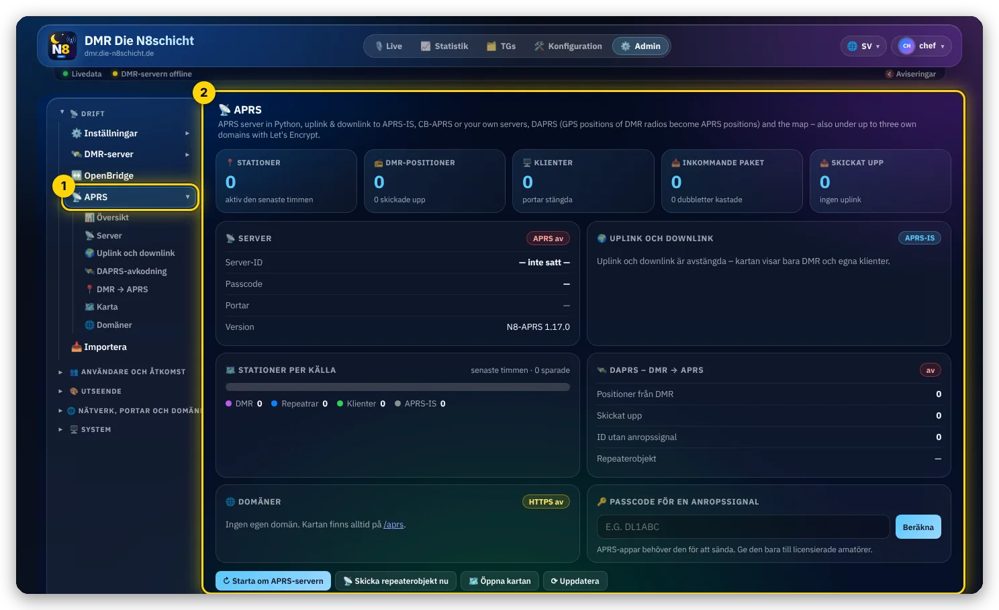
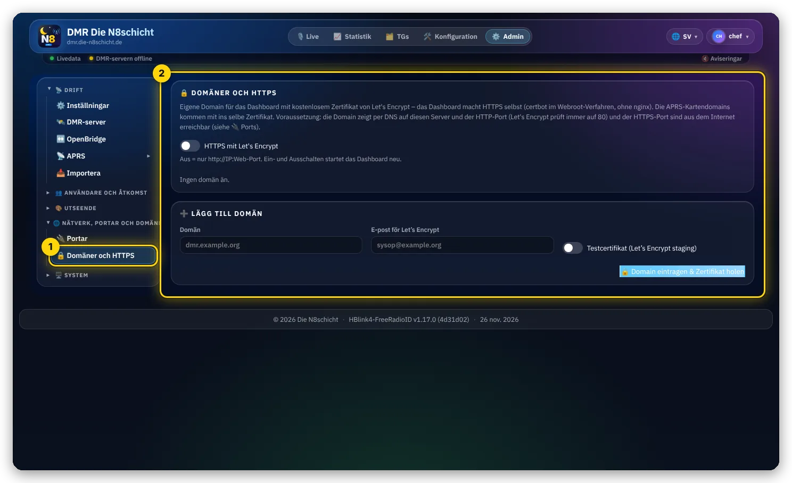
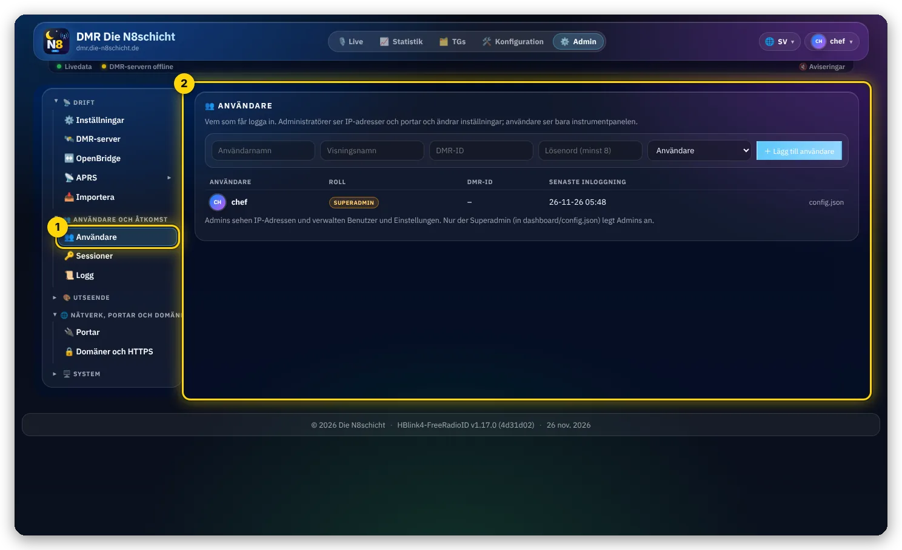
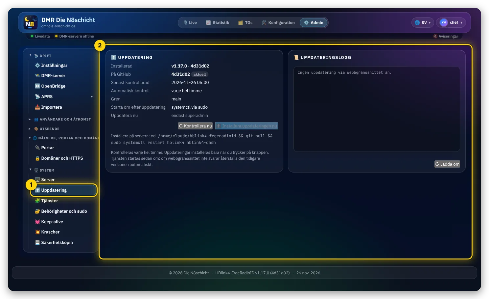

# 📘 HBlink4-FreeRadioID – Steg för steg

<sub>Språk: [🇩🇪 Deutsch](../de/README.md) · [🇬🇧 English](../en/README.md) · [🇫🇷 Français](../fr/README.md) · [🇧🇪 Français (Belgique)](../fr-BE/README.md) · [🇭🇺 Magyar](../hu/README.md) · **🇸🇪 Svenska** · [🇳🇱 Nederlands](../nl/README.md) · [🇮🇹 Italiano](../it/README.md) · [🇪🇸 Español](../es/README.md)</sub>

HBlink4-FreeRadioID är en DMR-server med FreeRadioID-inloggning, instrumentpanel, OpenBridge och APRS. Denna guide tar dig genom de första stegen.

> 💡 De gula siffrorna i bilderna hör till siffrorna i texten.

## Innehåll

1. [Installera](#1-installera)
2. [Logga in](#2-logga-in)
3. [Välj språk](#3-välj-språk)
4. [Ställ in DMR-servern](#4-ställ-in-dmr-servern)
5. [Åtkomst och FreeRadioID](#5-åtkomst-och-freeradioid)
6. [Slå på APRS](#6-slå-på-aprs)
7. [Egen domän med HTTPS](#7-egen-domän-med-https)
8. [Lägg till användare](#8-lägg-till-användare)
9. [Uppdatera](#9-uppdatera)

## 1. Installera

På en Debian- eller Ubuntu-server med sudo-rättigheter:

```bash
git clone https://github.com/dhartmann1979/HBlink4-FreeRadioID /opt/HBlink4
sudo /opt/HBlink4/scripts/setup.sh
```

Setup frågar efter servernamn, portar, superadmin och FreeRadioID-inloggning och sätter upp tjänsterna. Därefter nås instrumentpanelen på `http://<server>:8080`.

## 2. Logga in

<p align="center"></p>

Klicka på **🔐 Logga in** uppe till höger. Ange användarnamn och lösenord i inloggningsfönstret ①; 👁 visar lösenordet, ”Förbli inloggad” sparar inloggningen nästa gång. Efter fem felaktiga försök spärras namnet i 15 minuter. Inloggad visas avatar och namn ▾ med konto, adminområde och utloggning.

## 3. Välj språk

<p align="center"></p>

Uppe till höger öppnar **🌐 SV ▾** ① språkmenyn ② med nio språk. Valet gäller direkt och för alla N8-gränssnitt på denna server. Vid första besöket används webbläsarens språk.

## 4. Ställ in DMR-servern

<p align="center"></p>

I adminområdet under **📡 Drift → 🛰️ DMR-server** ① finns port (standard 62031), tider och länkar till andra servrar ②. Repeatrar och hotspots ansluter till denna port; ändringar gäller efter en omstart av DMR-servern.

## 5. Åtkomst och FreeRadioID

<p align="center"></p>

Under **⚙️ Inställningar** ① bestämmer du vem som ser instrumentpanelen och åtkomsten för repeatrar och hotspots ②: lösenfras, talkgroups och **FreeRadioID-inloggningen**. Med FreeRadioID loggar varje station in med sitt personliga lösenord; lösenfrasen blir gäståtkomsten med egna talkgroups.

## 6. Slå på APRS

<p align="center"></p>

Under **📡 APRS** ① slår du på APRS-servern med karta ②: server-ID (din anropssignal med SSID), öppna portar för APRS-appar och iGates samt uplinken till APRS-IS. GPS-positioner från DMR-trafiken visas då på kartan.

## 7. Egen domän med HTTPS

<p align="center"></p>

Under **🌐 Nätverk, portar och domäner → 🔒 Domäner och HTTPS** ① anger du en domän som pekar på servern via DNS, samt en e-postadress för Let’s Encrypt ②. Certifikatet hämtas och förnyas automatiskt. Portarna 80 och 443 måste kunna nås från internet.

## 8. Lägg till användare

<p align="center"></p>

Under **👥 Användare och åtkomst → Användare** ① lägger du till fler konton och ger dem en roll ②. Administratörer ser IP-adresser och ändrar inställningar, användare ser bara instrumentpanelen. Under **Sessioner** avslutar du inloggningar, **Loggen** visar varje ändring.

## 9. Uppdatera

<p align="center"></p>

Under **🖥️ System → ⬆️ Uppdatering** ① ser du den installerade versionen och om GitHub har en nyare ②. **⬆️ Installera uppdateringen nu** laddar ner den, kontrollerar sedan webbgränssnittet och återställer automatiskt den tidigare versionen om något går fel. Inget lösenord behövs för detta.

---

📖 Utförlig beskrivning (tyska): [docs/de/installation.md](../../../docs/de/installation.md)
