# ⚙️ Adminbereich

[← Übersicht](../../readme.md) · [Installation](installation.md) · [Dashboard](dashboard.md) · **Adminbereich** · [APRS](aprs.md) · [Anleitungen](anleitungen.md) · [Konfiguration](konfiguration.md) · [FreeRadioID](freeradioid.md) · [Betrieb & Fehlersuche](betrieb.md)

---

Im Adminbereich stellst du **Dashboard und DMR-Server** ein, ohne SSH und ohne Config-Dateien. Alles wird in SQLite gespeichert (`dashboard/data/dashboard.db`).

## Anmelden

  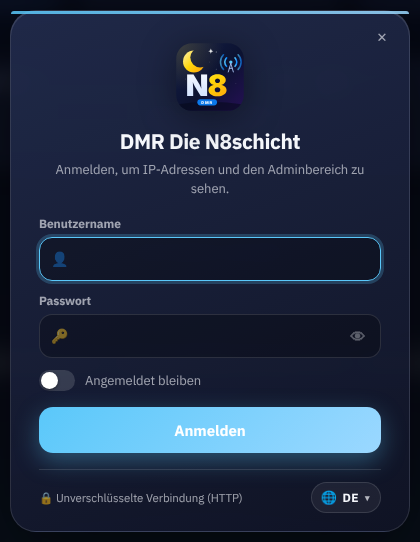
  &nbsp;
  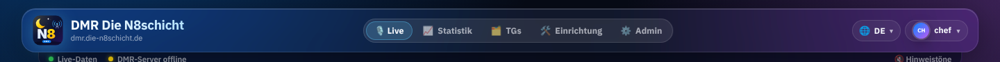

**🔐 Login** ganz rechts in der Kopfzeile. Danach erscheint im Menü der Punkt **⚙️ Admin**; rechts stehen dein Name (Passwort ändern) und **⏻** zum Abmelden. Mit *Angemeldet bleiben* gilt die Anmeldung 30 Tage, sonst 12 Stunden; beides ist einstellbar. Nach 5 Fehlversuchen ist der Login für 15 Minuten gesperrt.

## Rollen

| Rolle | Darf |
|---|---|
| **Superadmin** | alles, auch Admins anlegen. Er steht **nur** in `dashboard/config.json` und kann im Browser weder gelöscht noch herabgestuft werden. So kannst du dich nie aussperren. |
| **Admin** | sieht **IP-Adressen und Ports**, verwaltet Benutzer, alle Einstellungen, Sitzungen, Protokoll, Neustarts |
| **User** | sieht das Dashboard, auch wenn es nicht öffentlich ist; keine IP-Adressen und Ports |
| nicht angemeldet | sieht das öffentliche Dashboard ohne IP-Adressen und Ports |

**Nur für Admins:** IP-Adressen und Ports von Repeatern, Hotspots, Outbound-Links und OpenBridge-Trunks, also Gegenstelle, Port der Gegenstelle und unser lokaler Port. Der Server entfernt sie, bevor Daten an Nicht-Admins gehen; sie werden also nicht nur im Browser ausgeblendet. Nicht-Admins sehen an diesen Stellen **🔒 hidden**.

## 👥 Users

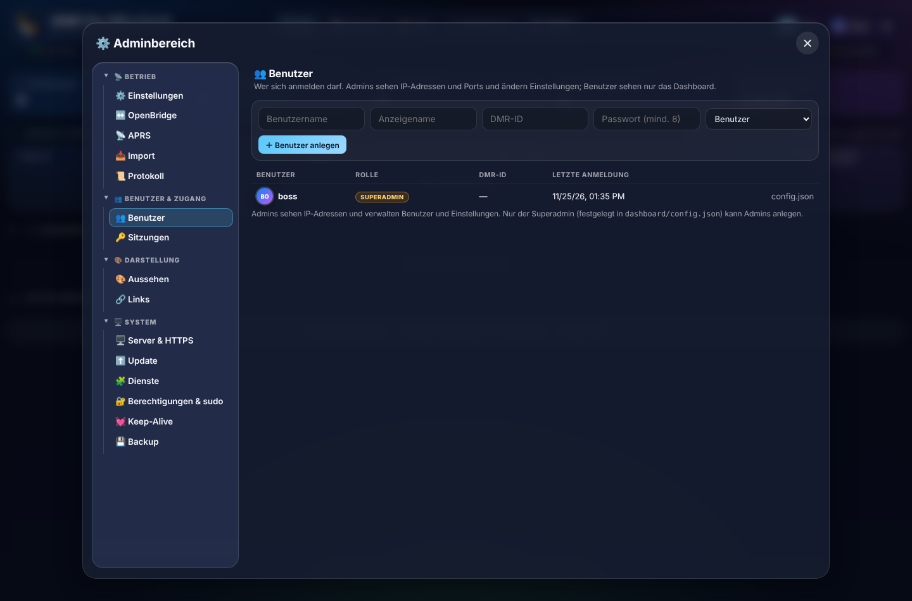

- **Anlegen**: Benutzername, Anzeigename, DMR-ID (für den Avatar), Passwort (mindestens 8 Zeichen) und Rolle. Admins kann nur der Superadmin anlegen.
- **Bearbeiten**: Name, DMR-ID, Rolle, neues Passwort, sperren. Wer gesperrt wird oder ein neues Passwort bekommt, wird sofort abgemeldet.
- **Löschen**: Zur Sicherheit braucht es zwei Klicks.

## Aufbau

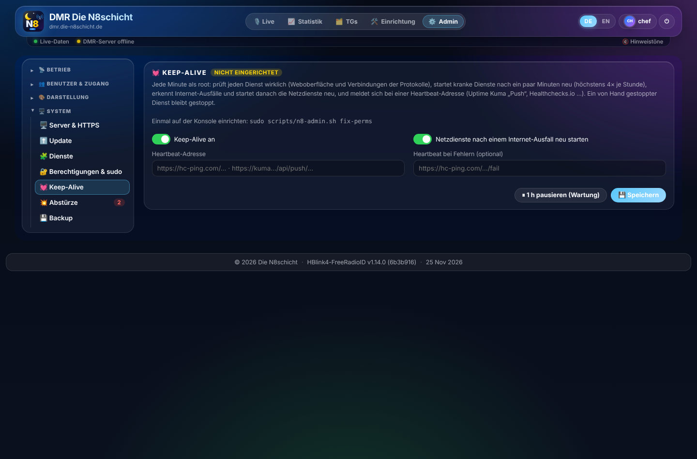

Seit **1.14.1** ist der Adminbereich kein schwebendes Fenster mehr, sondern – wie in N8 Crosslink und allen N8-Systemen – eine **Seite unter der Kopfzeile über die ganze Browser-Breite**; **⚙️ Admin** in der Menüleiste ist dabei hervorgehoben, ein Klick auf einen anderen Menüpunkt (oder Esc) verlässt ihn. Seit **1.13.0** steht links ein **Baum-Menü** – dasselbe wie im HobbyRadioPortal, ADN-FRN-Server, N8 Hotspot
und N8 Crosslink, mit denselben Gruppen in derselben Reihenfolge:

| Gruppe | Einträge |
|---|---|
| 📡 **Betrieb** | ⚙️ Einstellungen (Zweige: Abschnitte des Dashboards) · 🛰️ DMR-Server (Zweige: Abschnitte für HBlink4) · ↔️ OpenBridge · 📡 APRS (Zweige: Übersicht, Server, Uplink & Downlink, DAPRS, DMR → APRS, Karte, Domains) · 📥 Import |
| 👥 **Benutzer & Zugang** | 👥 Benutzer · 🔑 Sitzungen · 📜 Protokoll |
| 🎨 **Darstellung** | 🎨 Aussehen · 🔗 Links |
| 🌐 **Netz, Ports & Domains** | 🔌 Ports · 🔒 Domains & HTTPS |
| 🖥️ **System** | 🖥️ Server · ⬆️ Update · 🧩 Dienste · 🔐 Berechtigungen & sudo · 💓 Keep-Alive · 💥 Abstürze · 💾 Backup |

Alle Gruppen sind **anfangs zugeklappt** – offen ist nur die Gruppe der gerade gewählten Seite; ein Klick auf eine Gruppe klappt sie auf (gemerkt bis zum Schließen des Browser-Tabs). Am Smartphone steht das Menü über dem Inhalt als aufklappbare
Leiste „☰ *aktueller Bereich*“. Kacheln einer Reihe sind gleich hoch.

## 💾 Backup

Der Superadmin kann die vollständige HBlink4-Installation sichern, herunterladen und auf einer
vorbereiteten anderen Installation wiederherstellen. Archivvorschau, Passwortbestätigung und
ein automatisches Backup vor dem Überschreiben schützen den Zielzustand. Für die Wiederherstellung
wird einmalig `sudo ./scripts/install_backup_helper.sh` auf dem Zielserver ausgeführt.
Siehe [Backup und Klonen](backup.md) für Inhalt, Voraussetzungen und Wiederherstellung.

**AutoBackup** im selben Menü ergänzt verschlüsselte tägliche/wöchentliche Sicherungen
nach SFTP oder Google Drive, Schlüsselexport, Zieltest und Aufbewahrung.
Einrichtung: [Automatische Backups](autobackup.md).

Schritt-für-Schritt-Anleitungen für die häufigsten Aufgaben stehen in [🧭 Anleitungen](anleitungen.md).

Für alle Bereiche gilt:
- **Schalter** für Ja/Nein, **Auswahllisten** statt Texteingaben, wo es feste Möglichkeiten gibt.
- **Nur was gerade zählt, ist sichtbar:** Ist ein Schalter aus, verschwinden die Felder, die davon abhängen. Ohne Ankündigung kein Textfeld für die Ankündigung, ohne HTTPS keine Domain.
- **Seltene Einstellungen** stehen unter **▸ Advanced options**.
- **unsaved** zeigt ungespeicherte Änderungen an; gespeichert wird mit **💾 Save**.

## ⚙️ Settings

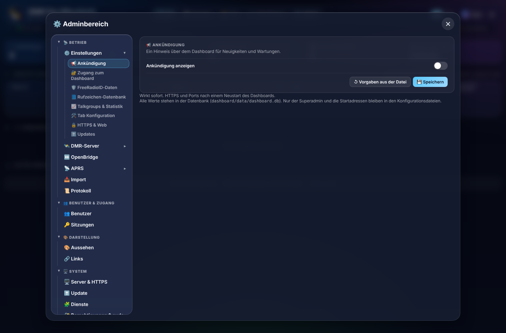

Seit **1.13.2** hängen die Abschnitte als Zweige im Baum-Menü: unter **⚙️ Einstellungen** die des Dashboards, unter **🛰️ DMR-Server** die für HBlink4 (die frühere Seitenleiste mit „Dashboard · DMR server“ ist entfallen, der Abschnitt hat die volle Breite). Am Smartphone klappt der Baum über dem Inhalt auf. **↺ Defaults from file** holt einen Abschnitt wieder aus der Config-Datei.

### 📊 Dashboard

| Abschnitt | Einstellungen | Wirkt |
|---|---|---|
| 📢 Announcement | Hinweis-Banner an/aus und Text | sofort |
| 🔐 Dashboard access | öffentlich ja/nein, Sitzungsdauer, „angemeldet bleiben“ | sofort |
| 🛡️ FreeRadioID data | Avatare, Profilabfrage, FreeRadioID-ID-Liste | sofort |
| 📘 Callsign database | Quelle (**FreeRadioID.net**, Vorgabe, oder nur radioid.net), Länder, Uhrzeit des Updates, **⟳ Refresh now** | sofort; bei neuer Quelle oder neuen Ländern wird die Liste gleich neu geladen |
| 📈 Talkgroups & statistics | Statistik an/aus, ohne Login sichtbar, Speicherdauer (Vorgabe 30 Tage), **Talkgroup-Liste der N8schicht** an/aus, **eigene Namen** (`26500 = N8schicht Ortsrunde`, eine pro Zeile); die URL der Liste unter *Advanced* | sofort |
| 🛠️ Configuration tab | Tab an/aus, Server-Adresse für Hotspots (leer = Untertitel), Standard-Passwort zeigen ja/nein, **Hinweis für Nutzer** | sofort |
| ⬆️ Updates | Update-Hinweis an/aus, GitHub-Repository, wer **Update now** drücken darf; Branch und Prüfabstand (Standard 1 Stunde) unter *Advanced* | sofort |

  

Die **Talkgroup-Namen** gelten für die Statistik, den Tab *Configuration* und den OpenBridge-Editor. Ältere Gespräche als die eingestellte Speicherdauer löscht das Dashboard jede Nacht. Ist die Statistik aus, wird nichts mehr gespeichert und der Tab **📈 Statistics** verschwindet.

### 🛰️ DMR-Server (HBlink4)

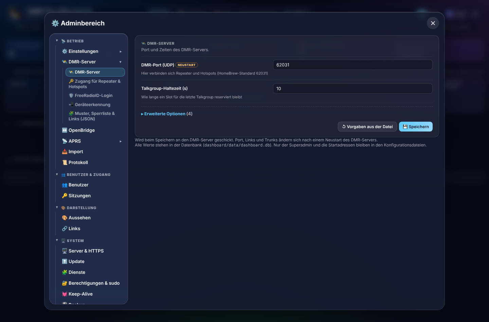

| Abschnitt | Einstellungen | Wirkt |
|---|---|---|
| 🛰️ DMR server | DMR-Port, Hang-Time; verpasste Pings, Timeouts und Reconnect-Logging unter *Advanced* | sofort; der **Port** erst nach Neustart des DMR-Servers |
| 🔑 Repeater & hotspot access | Standard-Passwort, Talkgroups TS1/TS2 (`all` = alle, `none` = keine), ob die Talkgroup-Liste des Geräts (RPTO) gilt, Einzelrufe | sofort für neue Anmeldungen; Talkgroups auch für verbundene Stationen ohne eigene Liste |
| 🛡️ FreeRadioID login | Secure Login an/aus, Gast-Talkgroups; API-Timeout unter *Advanced* | sofort |
| 📲 Device detection | Listen, an denen Repeater, Hotspots, **Apps** und Netzwerke erkannt werden (Paketname enthält …, kommagetrennt, Groß/klein egal); Software-Listen unter *Advanced* | sofort, auch für bereits verbundene Stationen |
| 🧩 Patterns, blacklist & links | eigene Regeln pro ID/Rufzeichen, Blacklist, Verbindungen zu anderen Servern, jeweils als JSON | Patterns und Blacklist sofort, Verbindungen nach Neustart |

**Geräteerkennung:** Taucht im Dashboard eine Station unter **❔ Unknown device type** auf, steht auf ihrer Karte der gemeldete Paketname (z. B. `📦 OpenGD77-Net`). Trag einen eindeutigen Teil davon (z. B. `opengd77`) in die passende Liste ein und speichere – die Station wandert sofort in den richtigen Bereich. Reihenfolge der Prüfung: Netzwerk → App → Hotspot → Repeater.

OpenBridge-Trunks haben einen eigenen Bereich: [↔️ OpenBridge](#️-openbridge).

**So kommen die Änderungen beim DMR-Server an:** Beim Speichern schickt das Dashboard dem DMR-Server über ihre gemeinsame Verbindung den Befehl *Einstellungen übernehmen*. HBlink4 liest die Datenbank neu und meldet im Log `⚙️ Settings from the admin area applied`.
- **Neustart nötig:** Bei Port, Links oder Trunks erscheint ein Hinweis mit dem Knopf **Restart DMR server**.
- **DMR-Server nicht verbunden:** Läuft er gerade nicht, übernimmt er die Werte beim nächsten Start.

**Patterns und Trunks werden vor dem Speichern geprüft:** HBlink4 muss sie verstehen, sonst werden sie abgelehnt und die alten Werte bleiben. Beispiele stehen in [Konfiguration → Patterns](konfiguration.md#patterns-eigene-regeln-pro-repeater).

## 🎨 Appearance

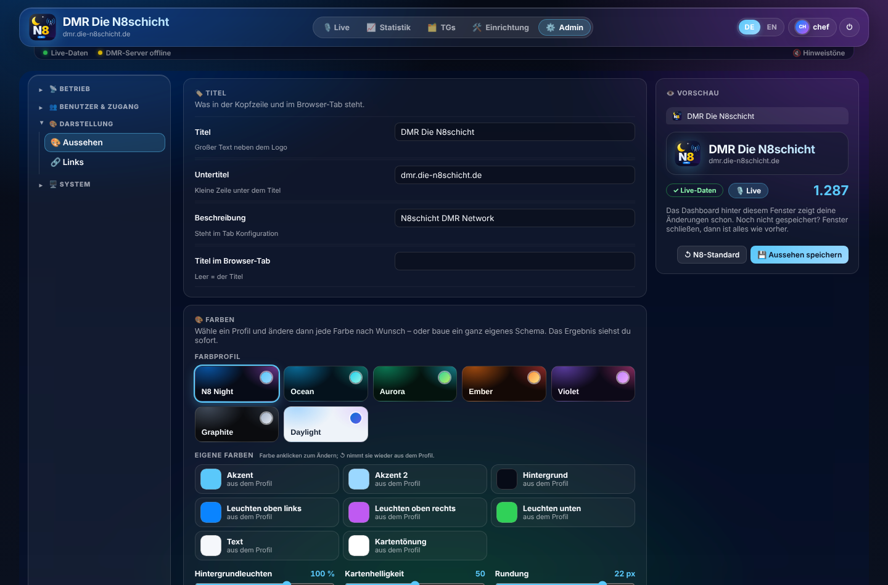
&nbsp;

Rechts zeigt eine **Vorschau** Browser-Tab und Kopfzeile. Gleichzeitig ändert sich das ganze Dashboard sofort mit. Was du nicht speicherst, verschwindet beim Verlassen des Adminbereichs wieder.

| Bereich | Einstellungen |
|---|---|
| 🏷️ **Titles** | **Title** (groß neben dem Logo), **Subtitle** (Zeile darunter), **Description** (im Tab *Configuration*), **Browser tab title** (leer = Title) |
| 🎨 **Colours** | **Farbprofil** per Klick: 🌙 N8 Night (Vorgabe), 🌊 Ocean, 🌌 Aurora, 🔥 Ember, 🔮 Violet, ⚫ Graphite und ☀️ **Daylight** (hell). Danach **jede Farbe einzeln**: *Accent* (Knöpfe, Zahlen, aktive Tabs), *Accent 2* (Verlauf von Knöpfen und Titel), *Background*, die drei Leuchtfarben *Glow top left / top right / bottom*, *Text* und *Card tint*. „from profile“ = Farbe kommt aus dem Profil, **↺** setzt sie zurück. Regler: **Background glow** (0 = flach), **Card brightness**, **Roundness** (Ecken, 0–28 px) und **Glass blur** (aus = schneller auf alten Handys). Unter den Reglern prüft eine **Lesbarkeitsanzeige** den Kontrast von Text zu Hintergrund und warnt unter 4,5 : 1. |
| 🖼️ **Logo & browser icon** | **⬆️ Upload image**: PNG, JPEG, WebP, GIF oder SVG, höchstens 1 MB; das Favicon auch als ICO. Alternativ die Adresse eines Bildes. **↺ N8 logo** stellt das N8schicht-Logo wieder her. Dazu **Logo size** (24–96 px) und **Logo corners** (0 = wie gezeichnet, 50 = rund). |

  

**☀️ Daylight** ist das helle Profil für Tageslicht und helle Räume. Alle Bereiche – Live, Statistik, OpenBridge, Talkgroups,
Dialoge und der Adminbereich – haben dafür eine eigene helle Darstellung (`dashboard/static/n8-light.css`):

  
  &nbsp;
  

**Dieselbe Farb-Engine in allen N8-Oberflächen.** Das *N8 Theme* (`n8-theme.js`, `n8theme.py`) steckt genauso in der
[FRN-Weboberfläche](https://github.com/dhartmann1979/adn-frn-server) (Admin → Theme) und im
[N8-Hotspot](https://github.com/dhartmann1979/N8-HotSpot) (Admin → Appearance). Ein Farbschema lässt sich dort als JSON
kopieren und hier wieder einsetzen – oder umgekehrt –, dann sehen alle drei gleich aus.

**↺ N8 standard** stellt Farben und Logo-Größe auf das N8-Design zurück. Hochgeladene Bilder liegen in der Datenbank und sind unter `/branding/logo` und `/branding/favicon` erreichbar. SVG-Dateien mit Skripten oder externen Links werden abgelehnt.

## 🔗 Links

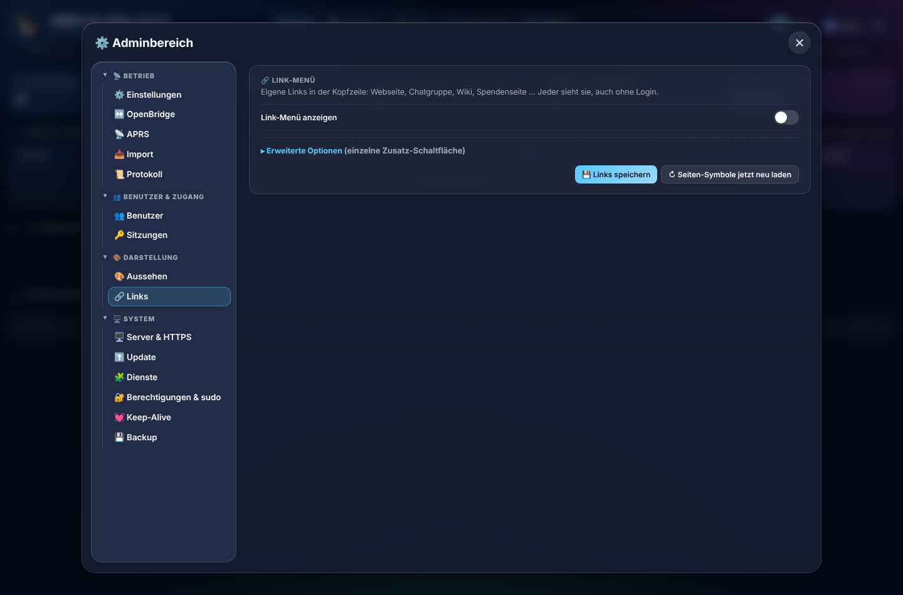

Eigene Links für alle Besucher, auch ohne Login: Webseite, Chat-Gruppe, Wiki, Kontakt.

- **Show the link menu** schaltet das Menü ein.
- **Menu button text**: Beschriftung des Knopfs, Vorgabe „🔗 Links“.
- **Display**: *Button with drop-down menu* (ein Knopf oben rechts mit aufklappender Liste) oder *Row of buttons under the header* (alle Links nebeneinander unter der Kopfzeile).
- **Links**: Emoji, Name, Adresse, ob der Link in einem neuen Tab öffnet und ob das **Site-Icon** der Seite gezeigt wird. Mit **↑ ↓** sortieren, **🗑** löschen, **➕ Add link** oder die Schnellstart-Knöpfe (Website, Chat, E-Mail, Setup-Tab) zum Anlegen. Erlaubt sind `https://…`, `mailto:…`, Pfade wie `/static/…` und Tabs wie `#config`.
- Unter *Advanced* bleibt der frühere einzelne **Network-Info-Knopf**.

**🌐 Site-Icons.** Für Web-Links (`https://`, `http://`) holt das Dashboard das Favicon der verlinkten Seite – aus
`<link rel="icon">` der Startseite oder `/favicon.ico` – und legt es in seiner SQLite-Datenbank ab (Tabelle `link_icons`,
30 Tage gültig; fehlt eins, wird es nach einer Stunde neu versucht). Abgerufen wird beim Start, nach jedem Speichern der Links und täglich um Mitternacht. **Refresh site icons now** lädt alle Icons sofort erneut und zeigt, wie viele Treffer es gab.
Der Browser holt das Bild dann vom Dashboard (`/api/link-icon/…`), nicht von der fremden Seite – Besucher hinterlassen dort also
keine Spuren. Gibt es kein Icon oder ist die Seite nicht erreichbar, steht das Emoji da. Für `mailto:`, `/pfad` und `#tab` ist der
Schalter grau.

Sicherheit: Nur öffentliche Adressen werden abgefragt (keine privaten oder lokalen IPs, auch nicht über Weiterleitungen),
höchstens 256 KB, nur echte Bilddateien (PNG, ICO, GIF, JPEG, WebP, SVG); SVG mit Skripten oder externen Verweisen wird verworfen.
Ausgeliefert wird mit strenger Content-Security-Policy und nur für Links, die wirklich eingetragen sind.

## ↔️ OpenBridge

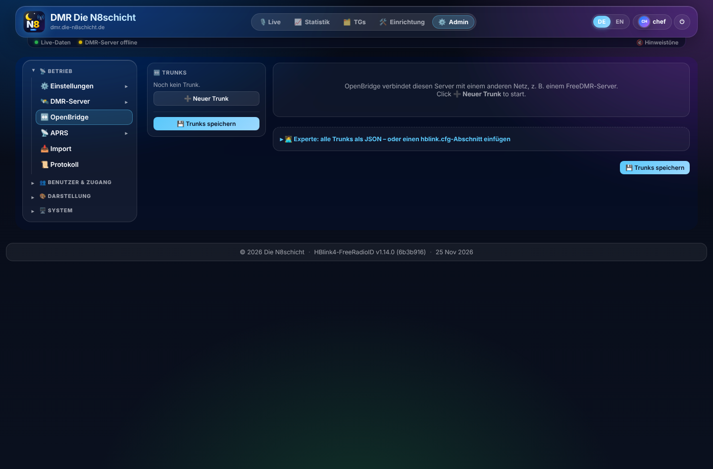
&nbsp;

Trunks zu anderen Netzen richtest du hier in einem Formular ein, ohne JSON. Links stehen die Trunks (grün = aktiv), rechts der gewählte Trunk in fünf Schritten:

| Schritt | Inhalt |
|---|---|
| ① **Basics** | aktiv an/aus, Name, Beschreibung |
| ② **Protocol** | Auswahl **🟢 FreeDMR v5** (FDMR+, FDMR-Secure-Server; Vorgabe) oder **⚪ Classic OpenBridge** (Brandmeister, HBlink3). Bei FreeDMR erscheinen die Schalter *Keep-alives* und *Accept changing address*, bei Classic der Schalter *Send the real repeater ID*. |
| ③ **Connection** | Adresse und Port der Gegenstelle, unser Port, Netzwerk-ID, Passwort (bei FreeDMR mit Warnung ab 21 Zeichen); Bind-Adresse und Source-Server-ID unter *Advanced* |
| ④ **Talkgroups** | **🌐 All talkgroups – no filter** mit Wahl des Zeitschlitzes, oder **☑️ Only selected talkgroups** mit der Liste aller bekannten Talkgroups |
| ⑤ **For the far end** | fertiger Abschnitt für die `hblink.cfg` der Gegenstelle; Ports über Kreuz, Protokoll und TG-Liste passend. **Editierbar** vor dem Kopieren |

**Talkgroups auswählen:** Suche nach Nummer oder Name, Filter *All / Selected / Not selected*, Häkchen pro Talkgroup und der Zeitschlitz daneben. **Select all shown** übernimmt alle gerade angezeigten, z. B. alle Treffer für „deutsch“. Talkgroups, die nicht in der Liste stehen, fügst du mit **➕** hinzu. Ausgewählte stehen oben.

**Ohne Filter** laufen alle Talkgroups über den Trunk, außer den lokalen: 1–79, 4000, 5000 und 9990–9999. Das dürfen beliebig viele Trunks, und dieselbe Talkgroup darf auch in den Listen mehrerer Trunks stehen.

#### Wohin ein Gespräch geht

Jeder Trunk, dessen Filter eine Talkgroup durchlässt, bekommt das Gespräch, **alle gleichzeitig**. Kein Trunk „besitzt“ eine Talkgroup.

| Gespräch kommt von | geht an |
|---|---|
| 📶 einer Station hier (Repeater, Hotspot, App) | die Stationen hier **und alle Trunks**, deren Filter die Talkgroup durchlässt |
| ↔️ einem Trunk | die Stationen hier; mit **🔀 Pass calls between trunks** zusätzlich alle **anderen** Trunks mit dieser Talkgroup. Zurück über den Trunk, von dem es kam, geht es nie |

**🔀 Pass calls between trunks** steht links unter den Trunks, sobald es mehr als einen gibt. Der Schalter ist ab Werk an und wirkt nach dem Speichern sofort, ohne Neustart. Ist er aus, verbindet der Server die Netze nicht untereinander; jedes Netz hört dann nur die Stationen hier. Darunter zeigt **Where a call goes**, was gerade gilt.

Damit beim Weiterleiten keine Schleifen entstehen, sind drei Sicherungen eingebaut:
- **Nie zurück:** Ein Gespräch geht nie über den Trunk zurück, von dem es kam.
- **Echo-Schutz:** Kommt ein Gespräch, das wir schon hinausgeschickt haben, über einen anderen Trunk wieder herein (weil die Netze untereinander verbunden sind), wird es verworfen. Im Log steht dann `own stream … came back`.
- **Hop-Zähler (FreeDMR v5):** Beim Weiterleiten zählt HBlink4 einen Hop mehr und behält den Server, auf dem das Gespräch begann. So erkennen auch die FreeDMR-Server Schleifen; nach 10 Hops ist Schluss.
- **Doppelte Gespräche:** Kommt dasselbe Gespräch über zwei Trunks, spielt der Server das erste. Das zweite findet den Zeitschlitz belegt.

Bei Trunks ohne Filter legt die Talkgroup-Liste nur den Zeitschlitz für einzelne Talkgroups fest.
- Jeder aktive Trunk braucht **seinen eigenen Port** auf unserer Seite (*Our port*); doppelte Ports lehnt das Speichern ab.

**Abschnitt für die Gegenstelle anpassen:** Der Text ist ein normales Eingabefeld. Du kannst Zeilen ändern oder ergänzen (z. B. `TS1_STATIC:` oder eine eigene IP), bevor du ihn verschickst. Sobald du etwas änderst, steht daneben **✏️ edited**; die Formularfelder überschreiben den Text dann nicht mehr. **↺ Reset** holt den erzeugten Text zurück. Gespeichert wird der Text nicht, er ist nur eine Vorlage.
- **⧉ Copy** kopiert in die Zwischenablage, auch ohne HTTPS und auf dem iPhone. Klappt das in einem Browser nicht, zeigt der Knopf *Select and copy by hand*.
- **▣ Select all** markiert den ganzen Text, dann geht Kopieren auch per Hand (lange drücken → Kopieren).

Unter **🧑‍💻 Expert: all trunks as JSON – or paste an hblink.cfg stanza** stehen alle Trunks als JSON. **⤴ Take over into the form** übernimmt den Inhalt ins Formular. Das Feld versteht zwei Formate:

- **JSON:** die Liste aller Trunks, wie sie dort steht (oder ein einzelner Trunk).
- **Abschnitte aus einer `hblink.cfg`** von FreeDMR oder HBlink3, z. B. das, was dir der Sysop der Gegenstelle schickt. Zeilen mit `#` am Anfang werden übersprungen.

  
  

So wird ein eingefügter Abschnitt einsortiert:
- **Welcher Trunk:** gleicher Name, sonst gleicher eigener Port, sonst gleiche Network-ID. Dann wird dieser Trunk aktualisiert und behält seinen Namen. Passt nichts, entsteht ein neuer Trunk.
- **Blickrichtung:** Steht bei `TARGET_IP` **unser eigener Server** (Untertitel, Adresse aus dem Configuration-Tab oder die Domain), ist es der Abschnitt der Gegenstelle. Dann werden `PORT` und `TARGET_PORT` vertauscht, und die Adresse der Gegenstelle bleibt wie bisher. Bei einem neuen Trunk musst du sie unter ③ eintragen.
- **Übernommen werden:** Network-ID, Passwort, Ports, `TGID_ACL` (`PERMIT:ALL` = alle Talkgroups, `PERMIT:Liste` = diese Talkgroups), `ENHANCED_OBP`, `PROTO_VER`, `RELAX_CHECKS`. `DENY`-Listen kennt HBlink4 nicht; der Trunk führt dann alle Talkgroups außer den lokalen.

Unter dem Feld steht danach, welcher Trunk geändert oder angelegt wurde, und was du noch prüfen solltest. Erst **💾 Save trunks** speichert. **💾 Save trunks** prüft alles mit HBlink4 und speichert. Trunks ändern sich nach einem Neustart des DMR-Servers.

## 📡 APRS

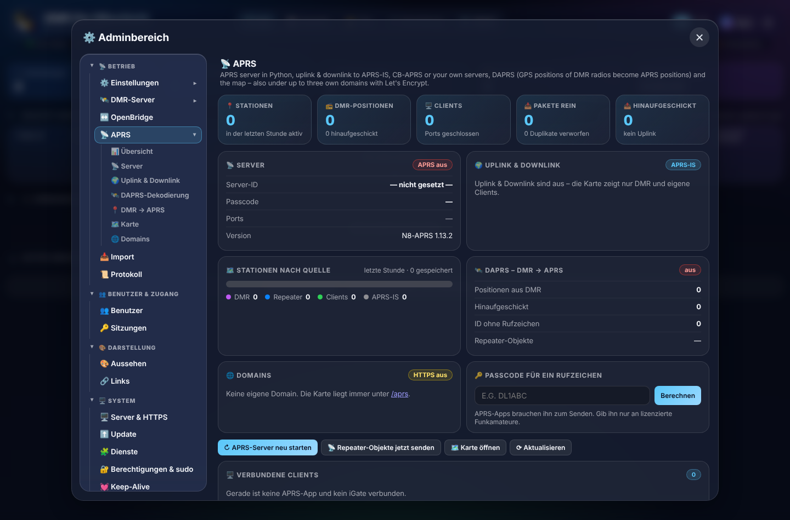

APRS-Server, **Uplink & Downlink** (APRS-IS, CB-APRS oder eigene Server), **DAPRS** (GPS-Positionen von DMR-Funkgeräten werden APRS-Positionen), die Karte und bis zu drei eigene Domains mit Let's Encrypt – alles in einem Bereich mit Seitennavigation: **📊 Overview · 📡 Server · 🌍 Uplink & downlink · 🛰️ DAPRS decoding · 📍 DMR → APRS · 🗺️ Map · 🌐 Domains**. APRS ist nach der Installation **aus**.

Die Übersicht beginnt mit fünf Kennzahlen (Stationen, DMR-Positionen, Clients, Pakete rein, gesendet) und ordnet darunter alles in Karten: Server, jede Verbindung ins APRS-Netz mit Zustand und Zählern, Stationen nach Herkunft, DAPRS, Domains mit Zertifikatsstatus, Passcode-Rechner sowie verbundene APRS-Clients (mit **Disconnect**) und letzte Probleme. Änderungen wirken sofort; nur neue Domains brauchen einen Neustart des Dashboards.

➡️ Alles dazu: **[📡 APRS, DAPRS und Karte](aprs.md)**

## 📥 Import

&nbsp;

Der **Konfigurations-Konverter** übernimmt die Einstellungen eines anderen DMR-Servers:

| Server software | Datei |
|---|---|
| HBlink3 | `hblink.cfg` (+ optional `rules.py` mit den Konferenz-Brücken) |
| FreeDMR / FDMR+ / FDMR-Secure-Server | `hblink.cfg`, `freedmr.cfg` |
| ADN DMR Peer Server | `adn-server.yaml` |
| HBlink4 | `config/config.json` |

**Auto-detect** erkennt das Format selbst. Datei wählen, auf das Feld ziehen oder einfügen, dann **🔍 Analyse**. **🧪 Load an HBlink3 example** lädt die Beispieldatei aus [lz5pn/HBlink3](https://github.com/lz5pn/HBlink3) zum Ausprobieren.

Das Ergebnis ist nach Bereichen sortiert (DMR server, Access, OpenBridge, Links, Blacklist). Jede Zeile zeigt:
- **alt → neu** und woher der Wert stammt, z. B. `[MASTER-1] → PORT: 54000`
- **⚠️ Hinweise** in Gelb, z. B. wenn sich der Hotspot-Port ändert
- **already set**, wenn der Wert schon stimmt (abgewählt)
- bei Trunks und Links **new** oder **replaces existing** (gleicher Name)

**Not taken over** listet die Abschnitte, die HBlink4 nicht braucht, jeweils mit Grund. **③ Apply selected** übernimmt die angehakten Zeilen; HBlink4 prüft sie wie beim normalen Speichern. Die Datei wird nur gelesen, nie ausgeführt.

Die genaue Umsetzung steht in [Anleitungen → Umziehen](anleitungen.md#2-von-hblink3-freedmr-oder-adn-umziehen).

## 🌐 Netz, Ports & Domains

Seit **1.15.0** steht alles zu Netz, HTTPS und Domains **nur noch hier** – wie in N8 Crosslink und allen N8-Systemen (vorher unter
*Einstellungen → HTTPS & web* und *System → Server & HTTPS*).

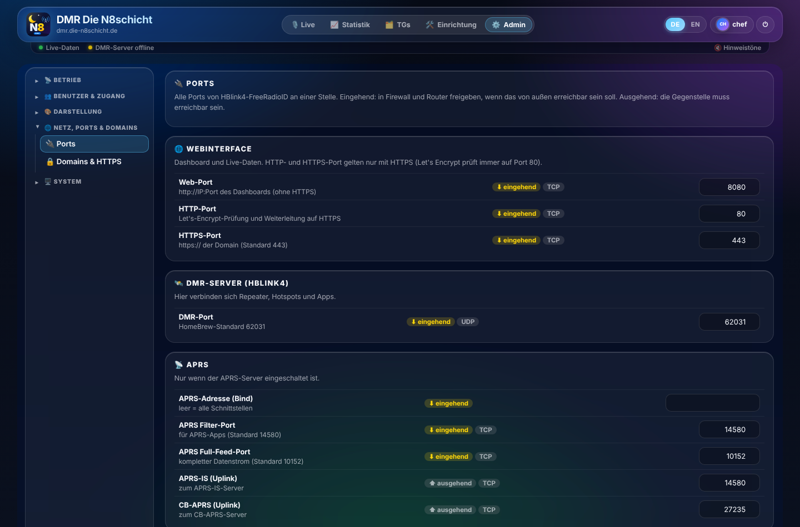 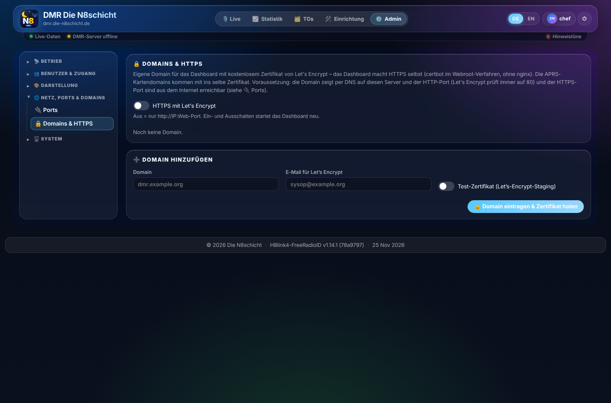

- **🔌 Ports**: alle Ports an einer Stelle – Web-Port, HTTP-/HTTPS-Port, DMR-Port (UDP), APRS-Server und -Uplink – jeweils mit
  *eingehend* (in Firewall/Router freigeben) oder *ausgehend*. **💾 Ports speichern** übernimmt alles; was einen Neustart braucht,
  steht danach unten, **♻️ Dashboard neu starten** erledigt ihn.
- **🔒 Domains & HTTPS**: Domain des Dashboards eintragen → das Dashboard startet neu und holt das Zertifikat von Let's Encrypt selbst
  (certbot im Webroot-Verfahren, ohne nginx). Tabelle mit DNS, Zertifikat (gültig/Test/abgelaufen, bis wann), **🔄 Erneuern**,
  **Entfernen** und dem Schalter *HTTPS mit Let's Encrypt*. Die APRS-Kartendomains stehen mit in der Liste (sie kommen ins selbe
  Zertifikat); Titel und Logo dazu weiter unter *Betrieb → APRS → Domains*.

## 🔑 Sitzungen, 📜 Protokoll, 🖥️ Server

  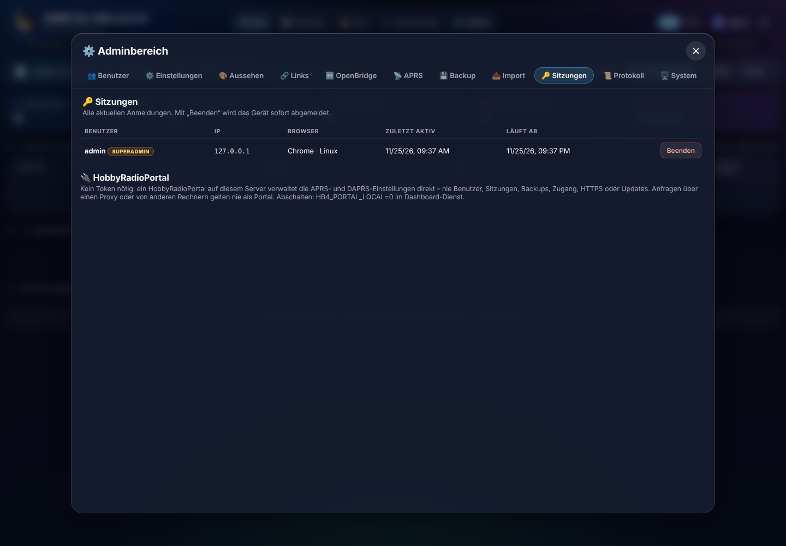
  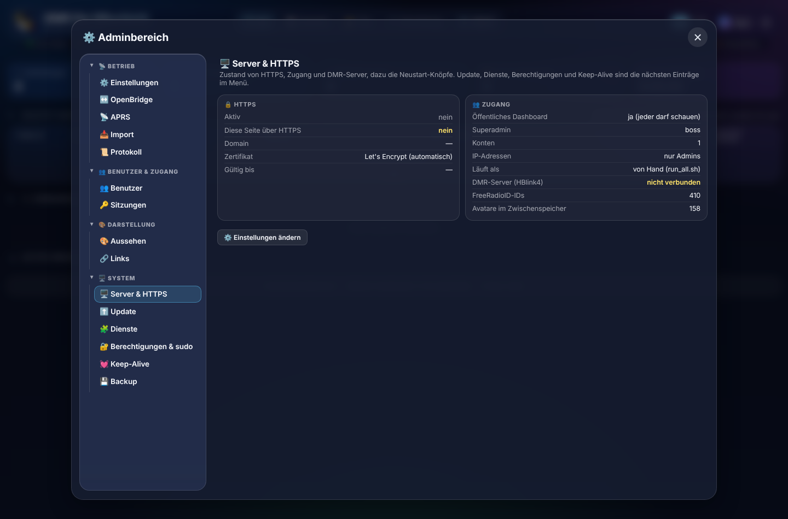

- **Sitzungen**: alle Anmeldungen mit IP, Browser und Ablauf; jede lässt sich beenden.
- **Protokoll**: Anmeldungen, Fehlversuche, Benutzer- und Einstellungsänderungen, Neustarts, jeweils mit Zeit, Person und IP.
- **Server**: HTTPS-Stand mit Verweis auf *🔒 Domains & HTTPS*, Zugriff, Verbindung zum DMR-Server, FreeRadioID-IDs und gespeicherte
  Avatare. Dazu die Knöpfe **Dashboard neu starten** und **DMR-Server neu starten**; sie erscheinen nur, wenn beides als systemd-Dienst läuft.

## ⬆️ Update · 🧩 Dienste · 🔐 Berechtigungen & sudo · 💓 Keep-Alive

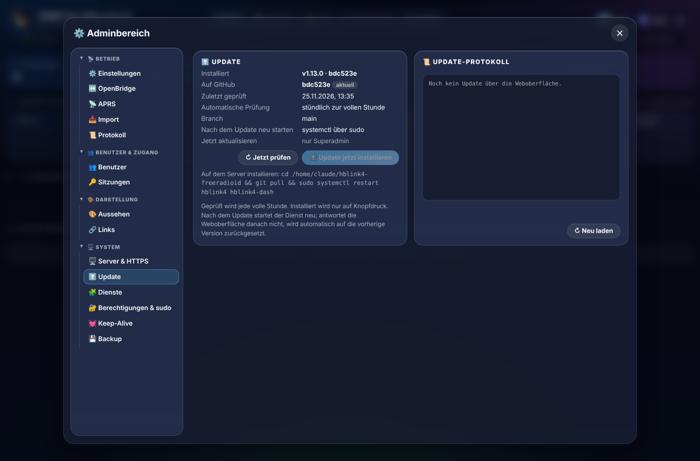

Diese vier Einträge unter **System** sind gemeinsame Ansichten des **N8 Kit** und sehen in allen N8-Systemen gleich aus.

- **⬆️ Update**: installiert, Stand auf GitHub, zuletzt geprüft, Branch, Art des Neustarts und ob du installieren darfst;
  **↻ Jetzt prüfen** und **⬆️ Update jetzt installieren**, rechts das **📜 Update-Protokoll** mit dem letzten Ergebnis.
- **🧩 Dienste**: HBlink4, Dashboard und Update-Auslöser mit Zustand, Autostart und Starten · Stoppen · Neu starten.
- **🔐 Berechtigungen & sudo**: zeigt nur, was nicht stimmt; **🛠️ Korrigieren** repariert und prüft erneut.
- **💓 Keep-Alive**: siehe [Betrieb → Keep-Alive](betrieb.md#-keep-alive).
- **💥 Abstürze**: jeder Absturz, Hänger und Notfall-Neustart von DMR-Server und Dashboard mit Teil, Ursache und Protokoll; neue Befunde erscheinen nach der Anmeldung als Hinweisfenster – siehe [Betrieb → Abstürze](betrieb.md#-abstürze-erkennen-und-aufklären).

  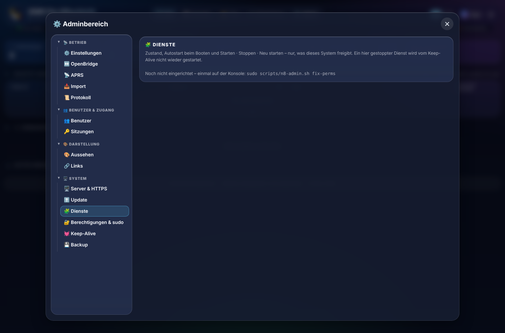
  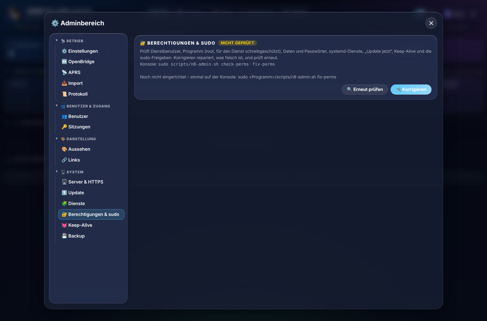

### ⬆️ Update-Hinweis

Hinweis, Updates-Kachel und Fortschritt kommen aus dem **N8 Kit** und sehen in **HBlink4-FreeRadioID, adn-frn-server, N8-HotSpot und N8 Crosslink gleich aus** (siehe [Sicherheit & N8 Kit](sicherheit.md)).

Der Server fragt **zu jeder vollen Stunde** bei GitHub nach (bei einem eingestellten Intervall über einer Stunde an den passenden vollen Stunden), auch wenn niemand eingeloggt ist; eine neue Version steht dann auch im Log. Gibt es eine, sehen **eingeloggte Admins** unter der Statusleiste den Hinweis *Update verfügbar: v1.4.0 · … → v1.5.0 · …* mit den Knöpfen **Was ist neu?** (klappt die Änderungen auf), **Jetzt aktualisieren**, **Details** (öffnet Admin → System → Update) und **Später** (blendet den Hinweis für diese Version einen Tag lang aus). Alle anderen Besucher sehen nichts davon.

#### ⬆️ Jetzt aktualisieren

  
  

Das Fenster zeigt, was neu ist, woher das Update kommt und wie neu gestartet wird. Seit **1.13.0** fragt es **nicht mehr nach dem Passwort** – eine Admin-Sitzung mit dem Sicherheits-Header gegen fremde Seiten genügt, wie in allen N8-Systemen. Danach siehst du drei Schritte: **Update wird geladen und eingespielt → Dienst startet neu → Weboberfläche wird geprüft**. Ist die neue Version da, lädt die Seite von selbst neu.

- **Wer darf:** Standard ist **nur der Superadmin**. Einstellbar unter *Settings → ⬆️ Updates → Who may press “Update now”* (auch „alle Admins“ oder „niemand“).
- **Wie:** Der Knopf legt nur den Auftrag an; installiert wird als root von `scripts/n8-admin.sh` (siehe [Betrieb → Update](betrieb.md#dienste-und-berechtigungen)) – Pakete, Rechte und sudo, Neustart beider Dienste.
- **Automatisch zurück (Rollback):** Antwortet das Dashboard 90 Sekunden nach dem Neustart nicht, setzt `n8-admin.sh` auf den alten Commit zurück und startet erneut. Das Ergebnis steht unter *Letztes Update* („erfolgreich“ oder „zurückgenommen“), das Protokoll unter *System → ⬆️ Update → 📜 Update-Protokoll*.
- **Neue Python-Pakete:** installiert der Helfer mit.

Was Update now **nicht** tut, mit Absicht:
- Es lädt nur vom Git-Remote `origin`, der **auf dem Server** eingerichtet ist; eine Adresse aus dem Browser wird nie benutzt. Das Repository in den Settings dient nur dem Hinweis.
- Es installiert nur **genau den Commit**, den du gesehen hast. Ist auf GitHub inzwischen etwas Neues dazugekommen, bricht es ab und bittet um eine neue Prüfung.
- Es geht nur **vorwärts** (`git merge --ff-only`). Es bricht ab, wenn Dateien von Hand geändert wurden oder die Installation eigene Commits hat; dann bitte auf der Konsole aktualisieren.
- Es führt keine Git-Hooks aus und benutzt keine Shell. Jeder Versuch steht im **📜 Log** (`update`, `update_failed`).

Einstellungen unter **Settings → ⬆️ Updates**: an/aus, Repository (`owner/name`), wer installieren darf, unter *Advanced* Branch und Prüfabstand (Standard: jede Stunde).
- Das Dashboard fragt dafür die öffentliche GitHub-API ab; es werden keine Daten des Servers übertragen.

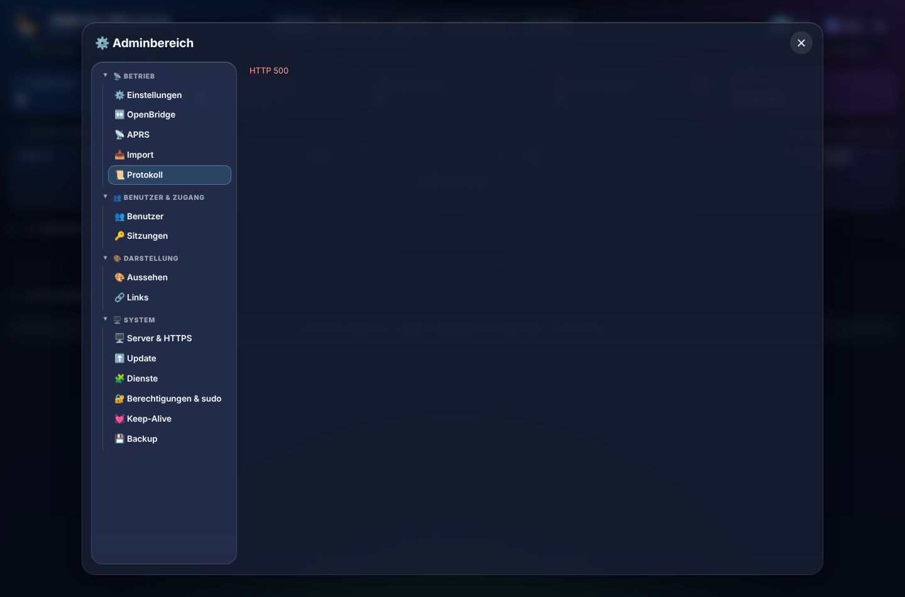

---

Weiter: [🧭 Anleitungen](anleitungen.md)
