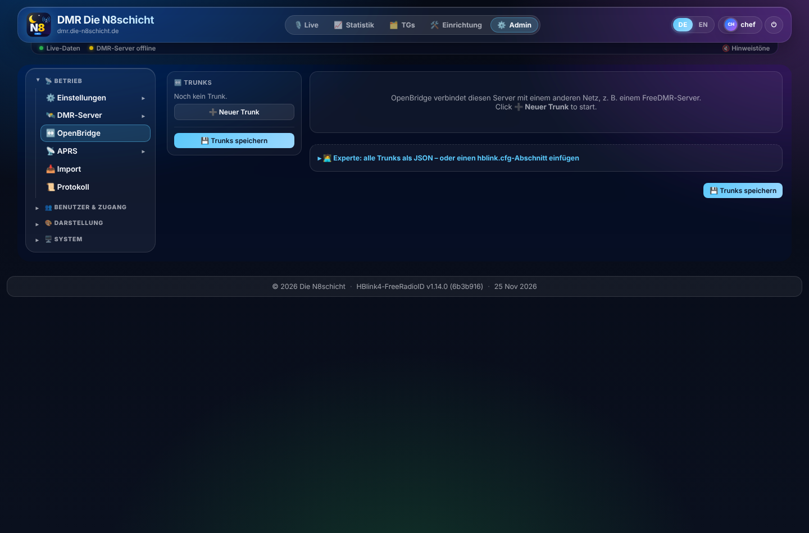
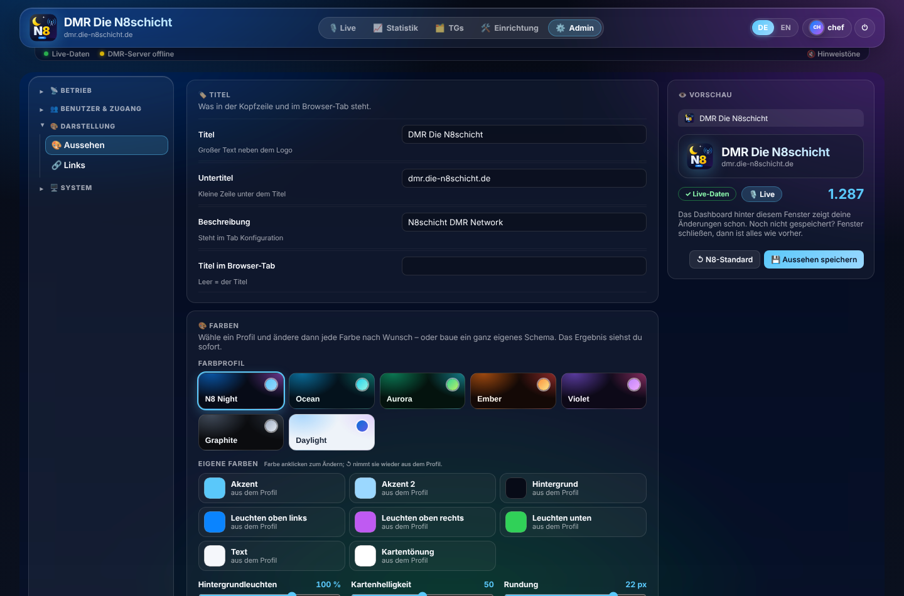
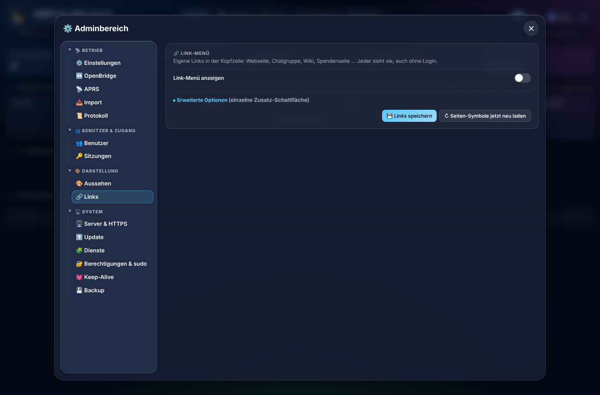
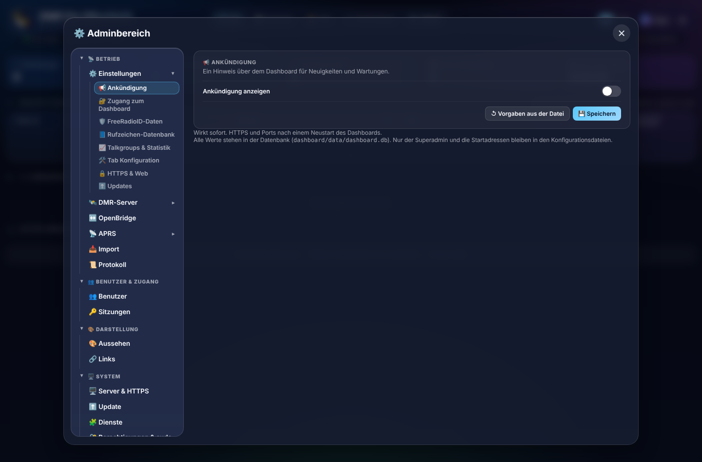
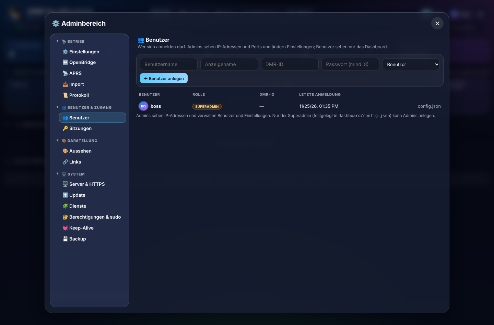

# 🧭 Anleitungen

[← Übersicht](../../readme.md) · [Installation](installation.md) · [Dashboard](dashboard.md) · [Adminbereich](adminbereich.md) · [APRS](aprs.md) · **Anleitungen** · [Konfiguration](konfiguration.md) · [FreeRadioID](freeradioid.md) · [Betrieb & Fehlersuche](betrieb.md)

---

Schritt für Schritt durch die häufigsten Aufgaben. Für alles im Adminbereich gilt: ganz rechts **🔐 Anmelden**, dann im Menü **⚙️ Admin** (oder im Benutzermenü **Name ▾ → Adminbereich**).

| Anleitung | Für |
|---|---|
| [1. Hotspot oder Repeater verbinden](#1-hotspot-oder-repeater-verbinden) | Funkamateure |
| [2. Von HBlink3, FreeDMR oder ADN umziehen](#2-von-hblink3-freedmr-oder-adn-umziehen) | Sysops |
| [3. OpenBridge zu einem FreeDMR-Server](#3-openbridge-zu-einem-freedmr-server) | Sysops |
| [4. Logo, Farben und Titel anpassen](#4-logo-farben-und-titel-anpassen) | Sysops |
| [5. Link-Menü anlegen](#5-link-menü-anlegen) | Sysops |
| [6. Ankündigung anzeigen](#6-ankündigung-anzeigen) | Sysops |
| [7. Weitere Admins anlegen](#7-weitere-admins-anlegen) | Superadmin |
| [8. APRS-Karte unter eigener Domain mit DMR-Positionen](#8-aprs-karte-unter-eigener-domain-mit-dmr-positionen) | Sysops |
| [9. GPS am DMR-Funkgerät für APRS](#9-gps-am-dmr-funkgerät-für-aprs) | Funkamateure |

---

## 1. Hotspot oder Repeater verbinden

1. Im Dashboard oben im Menü **🛠️ Configuration** öffnen (am Smartphone **Setup**).
2. **① Server**: Adresse und Port mit **⧉ Copy** übernehmen.
3. **② Login**: Mit einem Konto bei FreeRadioID.net meldest du dich mit deiner DMR-ID und deinem FreeRadioID-Passwort an und hast volle Rechte. Ohne Konto nimmst du das Gast-Passwort und sendest nur auf den Gast-Talkgroups.
4. **🧰 Ready-made settings**: Bei Pi-Star/WPSD die fertige Zeile nach `/root/DMR_Hosts.txt` kopieren, bei MMDVMHost den Abschnitt `[DMR Network]` übernehmen.
5. Hotspot neu starten. Im Dashboard erscheint er unter **📱 Hotspots**, mit **🛡️ FreeRadioID ✓** oder **👤 Guest**.

Tipp: Den Tab kannst du direkt verlinken: `https://dmr.die-n8schicht.de/#config`.

## 2. Von HBlink3, FreeDMR oder ADN umziehen

Der **📥 Import** im Adminbereich liest die Konfiguration deines alten Servers und schlägt die passenden Einstellungen vor. Erst mit **Apply** ändert sich etwas.

| Alter Server | Datei |
|---|---|
| HBlink3 | `hblink.cfg`, dazu optional `rules.py` |
| FreeDMR, FDMR+, FDMR-Secure-Server | `hblink.cfg` bzw. `freedmr.cfg` |
| ADN DMR Peer Server | `adn-server.yaml` |
| ein anderes HBlink4 | `config/config.json` |

1. **⚙️ Admin area → 📥 Import** öffnen.
2. Bei *Server software* **Auto-detect** stehen lassen.
3. **📂 Choose file**: die Datei wählen, auf das Feld ziehen oder den Inhalt einfügen. Bei HBlink3 unter *add rules.py* zusätzlich die `rules.py` laden; aus ihren Konferenz-Brücken werden Talkgroup-Listen.
4. **🔍 Analyse** klicken.

5. Die Vorschläge prüfen. Jede Zeile zeigt den bisherigen Wert (durchgestrichen) und den neuen, dazu, woher er stammt (`[MASTER-1] → PORT`).
   - **⚠️ gelb**: Bitte lesen, z. B. „Hotspots müssen dann diesen Port nutzen“.
   - **already set**: Der Wert stimmt schon, die Zeile ist abgewählt.
   - **new / replaces existing**: Trunks und Links kommen hinzu; einer mit gleichem Namen wird ersetzt.
6. Häkchen setzen oder entfernen. **☑️ All / ☐ None** wählt alles bzw. nichts.
7. Unter **Not taken over** steht, was HBlink4 nicht braucht und warum, z. B. Logger, MySQL, Proxy.

8. **③ Apply selected** klicken und mit einem zweiten Klick bestätigen. HBlink4 prüft alles, bevor es gespeichert wird.
9. Unter **⚙️ Settings** und **↔️ OpenBridge** kontrollieren. Port, Links und Trunks wirken nach **Restart DMR server**.

**So wird umgesetzt:**

| Alter Server | HBlink4 |
|---|---|
| `MASTER`: `PORT`, `PASSPHRASE`, `GROUP_HANGTIME` | DMR-Port, Standard-Passwort, Hang-Time |
| `MASTER`: `TGID_TS1_ACL` / `TGID_TS2_ACL`, FreeDMR `TS1_STATIC` / `TS2_STATIC`, `rules.py` | Talkgroups TS1/TS2 |
| `OPENBRIDGE` | OpenBridge-Trunk; bei FreeDMR mit Keep-alives, Protokollversion und dem `SERVER_ID` als Netzwerk-ID |
| `PEER`, `XLXPEER` | Links zu anderen Servern |
| `REG_ACL` / `SUB_ACL` mit `DENY` | Blacklist |
| zweiter `MASTER` | nicht übertragbar: HBlink4 hat einen DMR-Port für alle; eigene Regeln pro Station gibt es mit Patterns |

Die Datei wird nur gelesen, nie ausgeführt, auch `rules.py` nicht.

## 3. OpenBridge zu einem FreeDMR-Server

Beispiel: Trunk zum Funkerportal (`freedmr.funkerportal.de`).

1. **⚙️ Admin area → ↔️ OpenBridge → ➕ New trunk**.
2. **① Basics**: Name, z. B. `OBP-Funkerportal`.
3. **② Protocol**: **🟢 FreeDMR v5**. Keep-alives und *Accept changing address* bleiben an.
4. **③ Connection**:
   - *Far end address*: `freedmr.funkerportal.de`, *Far end port*: `62046`, *Our port*: `51084`.
   - *Network ID*: die Nummer, die die Gegenstelle als `NETWORK_ID` für dich eingetragen hat, z. B. `2624`.
   - *Passphrase*: das vereinbarte Passwort, höchstens 20 Zeichen.
5. **④ Talkgroups**: **🌐 All talkgroups – no filter** und *TS2*, oder **☑️ Only selected talkgroups** und in der Liste ankreuzen (Suche, „Select all shown“).
6. **⑤ For the far end**: Den Abschnitt bei Bedarf direkt im Feld anpassen, mit **⧉ Copy** kopieren und dem Sysop der Gegenstelle schicken. **↺ Reset** holt den erzeugten Text zurück.

7. **💾 Save trunks**, dann **Restart DMR server**.
8. Auf dem Server den Port öffnen: `sudo ufw allow 51084/udp`, am Router weiterleiten.
9. Kontrolle im Dashboard unter **↔️ OpenBridge**: **UP** und „keep-alive … s ago“. **WAITING** heißt, dass noch keine Keep-alives ankommen; meist ist dann der Port zu oder vertauscht ([Fehlersuche](betrieb.md#typische-fehler)).

## 4. Logo, Farben und Titel anpassen

1. **⚙️ Admin area → 🎨 Appearance**.
2. **🏷️ Titles**: Titel, Untertitel und Titel im Browser-Tab eintragen.
3. **🎨 Colours**: Ein Farbprofil anklicken (für ein helles Dashboard **☀️ Daylight**). Das Dashboard hinter dem Fenster zeigt es sofort.
4. Feinschliff: unter *Own colours* eine Farbe anklicken und ändern – Akzent, Akzent 2, Hintergrund, die drei Leuchtfarben, Text oder Kartentönung –, dazu **Background glow**, **Card brightness**, **Roundness**. **↺** setzt eine Farbe aufs Profil zurück. Achte auf die Lesbarkeitsanzeige unter der Vorschau.
5. **🖼️ Logo**: **⬆️ Upload image** (PNG, JPEG, WebP, GIF oder SVG, bis 1 MB), Größe und Ecken mit den Reglern. Darunter das Browser-Icon.
6. **💾 Save appearance**. Gefällt es nicht: Fenster schließen, dann ist alles wie vorher; **↺ N8 standard** stellt das N8-Design wieder her.

## 5. Link-Menü anlegen

1. **⚙️ Admin area → 🔗 Links**.
2. **Show the link menu** einschalten.
3. **➕ Add link** oder ein Schnellstart-Knopf (🌐 Website, 💬 Chat, ✉️ E-Mail, 🛠️ Setup tab).
4. Pro Link: Emoji, Name und Adresse (`https://…`, `mailto:…` oder `#config` für den Setup-Tab). Mit **↑ ↓** sortieren.
   **site icon** an lassen, dann zeigt das Menü das Favicon der Webseite (das Emoji bleibt als Ersatz, falls die Seite keins hat).
5. *Display*: Knopf mit Ausklappliste oder Knopfreihe unter der Kopfzeile.
6. **💾 Save links**. Das Menü erscheint sofort für alle Besucher; die Site-Icons kommen nach wenigen Sekunden dazu.

## 6. Ankündigung anzeigen

1. **⚙️ Admin area → ⚙️ Settings → 📢 Announcement**.
2. **Show announcement banner** einschalten; erst dann erscheint das Textfeld.
3. Text eintragen, z. B. „Heute 20 Uhr: Rundspruch auf TG 26500“, und **💾 Save** klicken.
4. Zum Entfernen den Schalter wieder ausschalten und speichern.

## 7. Weitere Admins anlegen

1. **⚙️ Admin area → 👥 Users**.
2. Benutzername, Anzeigename, DMR-ID (für den Avatar) und ein Passwort mit mindestens 8 Zeichen eintragen.
3. Rolle wählen: **Admin** sieht IP-Adressen und Ports und darf alles einstellen; **User** sieht nur das Dashboard. Admins anlegen darf nur der Superadmin.
4. **+ Add user** klicken.

## 8. APRS-Karte unter eigener Domain mit DMR-Positionen

1. Beim DNS-Anbieter für `aprs.example.org` (und ggf. `map.example.org`) einen A-Eintrag auf die IP-Adresse des Servers anlegen.
2. **⚙️ Admin area → 📡 APRS → Server**: *APRS* einschalten, **Server ID** = dein Rufzeichen mit SSID (z. B. `DB0ABC-10`), **💾 Save**.
3. **🌐 Domains**: `aprs.example.org` als Domain 1 eintragen, Titel und Logo nach Wunsch, *HTTPS with Let's Encrypt* an, **💾 Save**, dann im Banner **Restart now**.
4. **🌍 Uplink & downlink**: einschalten, Netz **APRS-IS** wählen (Amateurfunk) – oder **CB-APRS** bzw. **Manual** –, Downlink-Filter z. B. `r/52.3/8.9/150`, **💾 Save**.
5. In der **📊 Overview** prüfen: Uplink *verified*, Domain *🔒 in certificate*. Die Karte steht unter `https://aprs.example.org/`.
6. Optional für APRS-Apps: unter **📡 Server** *Open the APRS-IS ports* an und `sudo ufw allow 14580/tcp`.

## 9. GPS am DMR-Funkgerät für APRS

1. Im Funkgerät GPS einschalten.
2. Entweder **GPS in Sprachrufen** senden (Embedded GPS; z. B. Motorola, Hytera) – dann reicht es, zu sprechen –
3. oder die **GPS-/APRS-Meldung als Datenruf** einschalten (z. B. „Digital APRS“) und als Ziel die ID eintragen, die der Sysop vorgibt (z. B. `900999` als Privatruf), **Rate ½**, Format **NMEA**.
4. Dein Rufzeichen kommt aus der ID-Liste (FreeRadioID.net/radioid.net). SSID, Symbol und Kommentar stellt der Sysop ein, auf Wunsch auch nur für deine ID.
5. Deine Position erscheint auf der APRS-Karte und – wenn der Uplink an ist – bei aprs.fi als `DEINCALL-7`.

---

Weiter: [🧾 Konfiguration](konfiguration.md)
