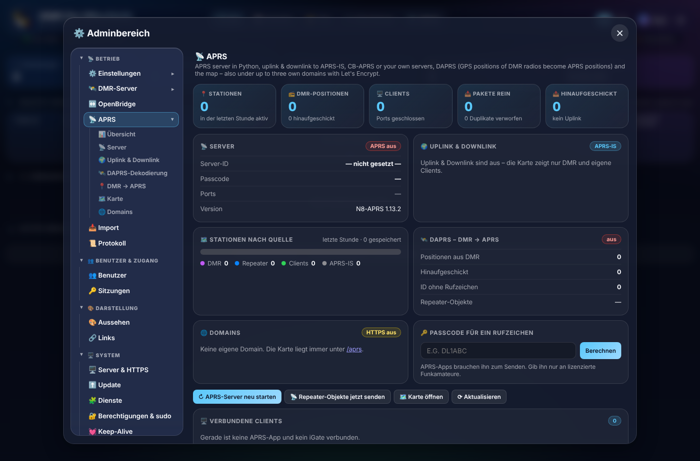

# 📡 APRS, DAPRS und Karte

[← Übersicht](../../readme.md) · [Installation](installation.md) · [Dashboard](dashboard.md) · [Adminbereich](adminbereich.md) · **APRS** · [Anleitungen](anleitungen.md) · [Konfiguration](konfiguration.md) · [FreeRadioID](freeradioid.md) · [Betrieb & Fehlersuche](betrieb.md)

---

Seit Version 1.2.0 bringt der Server **APRS** mit – komplett in Python, ohne aprsc oder andere Zusatzsoftware:

| | |
|---|---|
| 🛰️ **DAPRS** | Der DMR-Server erkennt GPS-Positionen, die Funkgeräte über DMR senden – im Sprachruf (Embedded GPS) und als GPS-Datenruf (NMEA, Motorola LRRP). Daraus werden APRS-Positionen mit dem Rufzeichen aus der ID-Liste. |
| 🗺️ **APRS-Karte** | Live-Karte im N8schicht-Design mit Stationsliste, Suche, Filtern, Spuren, Wetterdaten und Rohpaketen. Erreichbar unter `/aprs`, als Tab **🗺️ APRS** im Dashboard und unter **bis zu drei eigenen Domains**, jede mit eigenem Titel, Logo und Let's-Encrypt-Zertifikat. |
| 📡 **APRS-Server** | APRS-IS-kompatibler Server: APRSdroid, Xastir, YAAC, iGates und Tracker verbinden sich auf Port **14580** (mit Filter) oder **10152** (Full Feed). |
| 🌍 **Uplink & Downlink** | wählbar: **APRS-IS** (Amateurfunk), **CB-APRS** (CB-Funk) oder **manuell** (eigene Server, mehrere Verbindungen, Up- und Downlink getrennt) |
| 📶 **Repeater & Hotspots** | als APRS-Objekte auf der Karte, mit Frequenz und Colour Code aus den Login-Daten |
| ⚙️ **Adminbereich** | eigener Bereich **📡 APRS** mit Übersicht, verbundenen Clients, Verbindungsstatus und allen Einstellungen |

**APRS ist nach der Installation ausgeschaltet.** Die [geführte Installation](installation.md) fragt es ab; später schaltest du es im Adminbereich unter **📡 APRS → Server** ein.

In dieser Anleitung stehen Platzhalter: `aprs.example.org`, `map.example.org` für deine Karten-Domains, `dmr.example.org` für die Domain des Dashboards und `DB0ABC-10` für deine Server-ID.

<p align="center">
  
  &nbsp;
  
</p>

## Inhalt

- [In fünf Schritten einrichten](#in-fünf-schritten-einrichten)
- [Die Karte](#die-karte)
- [DAPRS: GPS von DMR-Funkgeräten](#daprs-gps-von-dmr-funkgeräten)
- [Repeater und Hotspots als Objekte](#repeater-und-hotspots-als-objekte)
- [Der APRS-Server (Ports 14580 und 10152)](#der-aprs-server-ports-14580-und-10152)
- [Uplink & Downlink: APRS-IS, CB-APRS oder manuell](#uplink--downlink-aprs-is-cb-aprs-oder-manuell)
- [Eigene Domains mit Let's Encrypt](#eigene-domains-mit-lets-encrypt)
- [Adminbereich 📡 APRS](#adminbereich--aprs)
- [Alle Einstellungen](#alle-einstellungen)
- [Speicherung und Datenschutz](#speicherung-und-datenschutz)
- [Fehlersuche](#fehlersuche)
- [Technik](#technik)

## In fünf Schritten einrichten

1. **DNS:** Für jede Karten-Domain einen A-Eintrag (und ggf. AAAA) auf die IP-Adresse des Servers anlegen, z. B. `aprs.example.org` und `map.example.org` → dieselbe Adresse wie `dmr.example.org`.
2. **Einschalten:** Adminbereich → **📡 APRS → Server** → *APRS (map, DAPRS, server)* an, **Server ID** = dein Rufzeichen mit SSID, z. B. `DB0ABC-10`. Damit wird auch die GPS-Erkennung im DMR-Server (DAPRS) eingeschaltet.
3. **Domains:** **📡 APRS → Domains** → bis zu drei Domains eintragen, je mit Titel und Logo, *HTTPS with Let's Encrypt* an. Danach das Dashboard einmal neu starten (Knopf im Banner).
4. **Netz wählen:** **📡 APRS → Uplink & downlink** → einschalten und *APRS-IS*, *CB-APRS* oder *Manual* wählen.
5. **Optional – Ports öffnen:** *Open the APRS-IS ports* an und in der Firewall freigeben:

   ```bash
   sudo ufw allow 14580/tcp    # APRS mit Filter (Apps, iGates)
   sudo ufw allow 10152/tcp    # Full Feed
   ```

Fertig: Die Karte ist unter `https://aprs.example.org/`, `https://map.example.org/`, unter `https://dmr.example.org/aprs` und im Dashboard-Tab **🗺️ APRS** erreichbar.

## Die Karte

<p align="center"></p>

- **Kopfzeile** wie im Dashboard: Logo, Titel und Untertitel der Domain und ein Menü mit **🗺️ APRS map** und **📊 Dashboard**. Darunter die schmale **Statusleiste**: **Live**-Status, Verbindung zum APRS-Netz (APRS-IS bzw. CB-APRS) und rechts die Zahl der Stationen und der DMR-Stationen. Am Smartphone zeigt das Menü nur die Symbole.
- **Stationsliste** links (am Smartphone als Leiste unten mit der Zahl der Stationen und DMR-Stationen; antippen klappt die Liste auf und zu): neueste zuerst, mit APRS-Symbol, Herkunft, Kommentar, Alter und Geschwindigkeit. Ein Klick zeigt die Station auf der Karte.
- **Suche** nach Rufzeichen, DMR-ID, Name oder Kommentar.
- **Filter** in einer Zeile (seitlich wischen): 📻 DMR · 📡 Repeater · 🖥️ Clients (Apps an deinem Server) · 🌍 APRS-IS bzw. CB-APRS (Downlink) · 🌦️ Wetter.
- **Farben:** DMR-Stationen leuchten violett, Repeater blau, eigene Clients grün, Stationen aus dem Downlink grau. Neue Positionen pulsieren kurz.
- **Detailfenster:** letzte Meldung, Position mit **QTH-Locator**, Geschwindigkeit, Richtung, Höhe, bei DMR-Stationen **DMR-ID, Talkgroup, über welchen Repeater/Hotspot** und wie die Position kam (im Sprachruf, Datenruf NMEA oder LRRP), Avatar von FreeRadioID, Kommentar, Wetterwerte, die letzten Rohpakete, **〰️ Track** (Spur) und ein Link zu aprs.fi.
- **📜 Live packets:** die Rohpakete in Echtzeit (abschaltbar).
- **🧭** zeigt alle Stationen; Beschriftungen erscheinen ab Zoomstufe 8.
- **Kartenstil:** automatisch passend zum Farbprofil (dunkle OpenStreetMap im N8-Design, helle bei ☀️ Daylight), OpenStreetMap, OpenTopoMap oder ein eigener Kachelserver. Heranzoomen geht bis Stufe 20: über der letzten Stufe des Kachelservers (OpenStreetMap 19, OpenTopoMap 17, eigener Server einstellbar, Standard 18) werden die Kacheln vergrößert, statt zu fehlen.

<p align="center">
  
  
</p>
<p align="center"><sub>Links: Live-Pakete. Rechts: dieselbe Karte unter einer zweiten Domain mit eigenem Titel und Logo.</sub></p>

**Im Dashboard** steht die Karte als Tab **🗺️ APRS** (abschaltbar unter *Map → APRS tab in the dashboard*); **⤢ Full screen** öffnet sie auf eigener Seite.

<p align="center"></p>

**Wer sieht die Karte?** *Map → Map visible without login* (Vorgabe: an) gilt unabhängig vom Dashboard. Ist es aus, sehen nur angemeldete Benutzer die Karte. IP-Adressen erscheinen auf der Karte nie.

### Logo und Icon

<p align="center"></p>

Die Karte hat ein eigenes Logo im N8schicht-Design: Nachthimmel mit Mond wie beim DMR-Logo, dazu ein grüner Karten-Pin mit Funkwellen, eine gepunktete APRS-Spur und die Plakette **APRS**. Das **Icon** (ohne Schrift, bis 16 px lesbar) ist Favicon, Browser-Tab und App-Symbol auf dem Smartphone-Homescreen.

| Datei | Verwendung |
|---|---|
| `dashboard/static/n8schicht-aprs-logo.svg` | Logo in der Kopfzeile der Karte, wenn für die Domain kein eigenes Logo hochgeladen ist |
| `dashboard/static/n8schicht-aprs-icon.svg` | Favicon der Karte |
| `dashboard/static/n8schicht-aprs-icon-192.png` | Apple-Touch-Icon / Homescreen |

Ein eigenes Logo pro Domain lädst du unter **📡 APRS → Domains** hoch; **↺ Default** stellt das APRS-Logo wieder her.

## DAPRS: GPS von DMR-Funkgeräten

Der DMR-Server (HBlink4) schaut in die Bursts, die Repeater und Hotspots senden, und findet Positionen auf zwei Wegen:

| Weg | Was das Funkgerät macht | Erkannt |
|---|---|---|
| **Embedded GPS** | sendet seine Position während eines Sprachrufs im Embedded-LC der Sprach-Superframes („GPS Info“ nach ETSI TS 102 361-2) | ✔ mit vollständiger Prüfung (Hamming, Parität, Prüfsumme) – ein fehlerhaftes Paket wird verworfen |
| **GPS-Datenruf** | sendet eine Positionsmeldung als Datenruf an eine ID, z. B. „Digital APRS“ an `900999` als Privatruf | ✔ Rate-½-Daten mit **NMEA** (`$GPRMC`, `$GNRMC`, `$GPGGA`, `$GNGGA`), auch als SMS-Text (UTF-16) und in IP/UDP, sowie **Motorola LRRP** (UDP-Port 4001) |
| | Rate-¾- und Rate-1-Daten | ✘ werden nicht geraten, sondern gezählt (*undecoded*) |

**Was Funkamateure einstellen:** im Funkgerät die GPS-/APRS-Meldung einschalten und als Ziel die ID eintragen, die du vorgibst (z. B. `900999` als Privatruf, wie bei FreeDMR). Standardmäßig nimmt der Server **jedes Ziel** an; unter **📡 APRS → DAPRS decoding → Accept GPS data sent to** kannst du es auf bestimmte IDs oder Talkgroups beschränken. Wer mit GPS in Sprachrufen sendet, muss nichts weiter einstellen.

**Aus der Position wird ein APRS-Paket** (**📡 APRS → DMR → APRS**):

- **Rufzeichen** aus der ID-Liste (FreeRadioID.net bzw. radioid.net). IDs ohne Rufzeichen werden nicht verwendet (gezählt unter *ID without callsign*).
- **SSID** (Vorgabe `-7`), **Symbol** (Vorgabe `/[` Person) und **Kommentar** mit Platzhaltern: `{tg}` Talkgroup, `{repeater}` Rufzeichen des Hotspots/Repeaters, `{dmrid}`, `{slot}`, `{server}`. Beispiel: `DMR TG{tg}` → `DMR TG262`.
- **Per DMR ID:** eigene Rufzeichen, SSID, Symbol oder Kommentar für einzelne IDs, oder eine ID ganz abschalten – als Tabelle im Adminbereich.
- **Up at most every (s):** höchstens eine Position pro Station und Minute (einstellbar) geht ins APRS-Netz; die lokale Karte zeigt immer die neueste.
- **Not for guests:** Stationen, die mit dem Gast-Passwort (FreeRadioID) verbunden sind, erscheinen nur auf der lokalen Karte.

Ein Paket sieht so aus (Pfad `DMR*,qAS,<Server-ID>`, Tocall `APZN8D`):

```
DL1ABC-7>APZN8D,DMR*,qAS,DB0ABC-10:!5217.38N/00854.97E[090/016 DMR TG262
```

Im Log des DMR-Servers steht jede gefundene Position:

```
📍 DAPRS embedded position from 2621234 via 2629001 (DO1XYZ) TS2: 52.28970, 8.91610
```

**Im Dashboard erklärt:** Der Tab **🛠️ Configuration** bekommt die Karte **📍 APRS – show your position on the map (DAPRS)**, sobald
APRS und die DAPRS-Dekodierung an sind. Sie richtet sich nach den Einstellungen unter *DAPRS decoding*: Weg **A** (GPS im Sprachruf)
erscheint nur bei *Decode embedded GPS*, Weg **B** (Datenruf) nur bei *Decode GPS data calls* – mit der Ziel-ID aus *Accept GPS data
sent to* (z. B. `900999`, mit Kopier-Knopf), *Private call*, NMEA/LRRP unbestätigt Rate ½ und dem Mindestintervall. Dazu: Link zur
Karte, ob die Position ins APRS-Netz geht, dass Gäste nur lokal erscheinen und ein Hinweis für Hotspots mit DMRGateway.

<p align="center"></p>

<p align="center">
  
  
</p>

## Repeater und Hotspots als Objekte

Repeater und Hotspots melden beim Login ihre Position (Breite/Länge aus der MMDVMHost- bzw. Pi-Star-Konfiguration). Daraus werden **APRS-Objekte** mit Frequenz, Ablage und Colour Code, z. B. `439.175MHz -760 CC1 DMR`:

- **Repeaters on the map:** an (Symbol `/r`)
- **Hotspots on the map:** **aus** – Hotspot-Positionen sind oft Wohnadressen. Objektname: Rufzeichen + die letzten zwei Ziffern der ID, z. B. `DO1XYZ-01`.
- **Send these objects up (uplink):** aus – die Objekte bleiben auf deiner Karte und bei deinen Clients.
- Verlässt ein Repeater den Server, wird sein Objekt als „gelöscht“ gesendet. Positionen `0.0/0.0` werden ignoriert.

## Der APRS-Server (Ports 14580 und 10152)

<p align="center"></p>

Ein Server wie aprsc, in Python, im Prozess des Dashboards (der DMR-Server wird nicht belastet):

| Port | Art | Für |
|---|---|---|
| **14580** | mit Filter | Apps (APRSdroid, aprs.fi-App, Xastir, YAAC, PinPoint …), iGates, Tracker |
| **10152** | Full Feed | alles, ungefiltert (z. B. für eine eigene Auswertung); `0` = aus |

**Verbinden** – in der App eintragen: Server `aprs.example.org` (oder die Adresse des Servers), Port `14580`, Rufzeichen und **Passcode**. Den Passcode zu einem Rufzeichen zeigt der Adminbereich (*Passcode for a callsign*) – nur an lizenzierte Funkamateure weitergeben. Ohne gültigen Passcode (oder mit `-1`) darf ein Client nur empfangen.

Was der Server kann:

- **Login** `user CALL pass PASSCODE vers SOFTWARE VERSION filter …`, Antwort `# logresp CALL verified, server DB0ABC-10`, alle 20 Sekunden eine Keep-alive-Zeile
- **Filter** wie bei APRS-IS: `r/` Umkreis, `a/` Rechteck, `p/` Präfix, `b/` Rufzeichen, `o/` Objekt, `t/` Pakettyp (auch `t/p/CALL/km`), `s/` Symbol, `d/` Digipeater, `e/` Einstieg, `g/` Nachrichtenempfänger, `u/` Ziel, `m/` Umkreis um mich, `f/` Umkreis um einen Freund, `-` vor einem Filter schließt aus. Mit `#filter …` lässt er sich jederzeit ändern.
- **Nachrichten** an einen Client kommen immer an, auch außerhalb seines Filters.
- **q-Konstrukt** nach APRS-IS: `qAC` (Station selbst), `qAR` (iGate gibt HF weiter), `qAO`; **Schleifenschutz**, **Duplikatfilter** (30 Sekunden, einstellbar), **Flutschutz** (mehr als 40 Pakete in 10 Sekunden trennen), höchstens 8 Verbindungen pro IP, langsame Clients werden getrennt.
- Pakete gehen nicht an den Absender zurück.

## Uplink & Downlink: APRS-IS, CB-APRS oder manuell

Der Uplink schickt deine Pakete (DMR-Positionen, Pakete deiner Clients, auf Wunsch die Repeater-Objekte) in ein APRS-Netz; der Downlink holt Stationen von dort auf deine Karte und zu deinen Clients. **Network** wählt das Netz:

| Netz | Vorgabe | Login | Hinweis |
|---|---|---|---|
| 🌍 **APRS-IS** | `euro.aprs2.net:14580`, Filter `r/51.2/10.4/450` (Deutschland) | Server-ID, Passcode wird berechnet | Amateurfunk – nur mit einem Amateurfunk-Rufzeichen |
| 📻 **CB-APRS** | `eu.cbaprs.net:27235` (oder `us.cbaprs.net`) | eigenes Login (CB-Rufname) oder Server-ID; Passcode berechnet, eigener Wert oder `-1` (nur empfangen) | eigenes Netz für CB-Funk ([cbaprs.net](https://www.cbaprs.net/)) |
| 🛠️ **Manuell** | – | pro Verbindung | beliebig viele eigene Server, jede mit Host, Port, Login, Passcode, Filter und **Richtung**: ⇅ hoch & runter, ↑ nur hoch, ↓ nur runter |

<p align="center">
  
  
</p>
<p align="center"></p>

- **Downlink filter:** was herunterkommt, z. B. `r/52.3/8.9/150` (150 km um einen Punkt). Leer = nichts kommt herunter, es wird nur gesendet.
- Gesendet wird nur, wenn die Gegenstelle den Login **verifiziert** hat; der Zustand jeder Verbindung (verifiziert, empfangen, Fehler, Pakete rein/raus) steht in der Übersicht.
- **Kein Brücken-Betrieb:** Was aus einem Netz herunterkommt, wird nie in ein anderes (oder dasselbe) Netz zurückgeschickt.
- Nach Änderungen verbinden sich Server und Uplink von selbst neu, ohne Neustart.

## Eigene Domains mit Let's Encrypt

<p align="center"></p>

Unter **📡 APRS → Domains** trägst du bis zu **drei Domains** ein, z. B. `aprs.example.org`, `aprs2.example.org` und `map.example.org`. Jede Domain

- öffnet **unter `/` direkt die Karte** (das Dashboard bleibt dort unter `/dashboard` erreichbar),
- hat einen eigenen **Titel**, **Untertitel** und ein eigenes **Logo** (Upload wie unter Appearance; leer = [N8schicht-APRS-Logo](#logo-und-icon)),
- kommt mit **HTTPS with Let's Encrypt** (Vorgabe: an) als **zusätzlicher Name in das Zertifikat** des Dashboards.

So funktioniert das Zertifikat:

1. Voraussetzung: **🌐 Netz, Ports & Domains → 🔒 Domains & HTTPS** ist eingeschaltet (Domain des Dashboards, z. B. `dmr.example.org`), Port 80 und 443 sind offen.
2. Beim Start prüft das Dashboard per DNS, ob jede Karten-Domain auf **dieselbe Adresse** zeigt wie die Hauptdomain. Nur dann wird sie beantragt – eine falsch eingetragene Domain kann so das Zertifikat nicht kaputt machen; sie steht dann mit Grund im Log.
3. Fehlt eine Domain im vorhandenen Zertifikat, holt das Dashboard sie im Hintergrund nach (`certbot … --expand`) und lädt das neue Zertifikat **ohne Neustart**. Danach wird es wie gewohnt automatisch erneuert.
4. Die Übersicht im Adminbereich zeigt pro Domain **🔒 in certificate**, **⏳ not in certificate yet** oder **HTTP only**.
5. `http://` wird auf `https://` derselben Domain umgeleitet.

Ohne HTTPS ist die Karte unter jeder Domain per HTTP auf dem Web-Port des Dashboards erreichbar.

## Adminbereich 📡 APRS

<p align="center"></p>

| Bereich | Inhalt |
|---|---|
| 📊 **Overview** | Oben fünf Kennzahlen (Stationen der letzten Stunde, DMR-Positionen, Clients, Pakete rein mit verworfenen Duplikaten, gesendet). Darunter Karten: **Server** (Status, Server-ID, Passcode, Ports, Version), **Uplink & downlink** (jede Verbindung mit Zustand, Richtung, Zählern ↓/↑, Login, Gegenstelle, seit wann), **Stations by source** (Balken DMR/Repeater/Clients/APRS-IS), **DAPRS** (Positionen, gesendet, IDs ohne Rufzeichen, Repeater-Objekte), **Domains** mit Zertifikatsstatus und **Passcode**-Rechner; verbundene Clients mit **Disconnect** und letzte Probleme als eigene Karten; Knöpfe **↻ Restart APRS server**, **📡 Send repeater objects now**, **🗺️ Open map** |
| 📡 **Server** | APRS ein/aus, Server-ID, Ports, Listen-Adresse, max. Clients, Duplikatfenster |
| 🌍 **Uplink & downlink** | Netz (APRS-IS, CB-APRS, manuell) mit Server, Port, Login, Passcode, Filter, Richtung |
| 🛰️ **DAPRS decoding** | was der DMR-Server erkennt (Embedded GPS, Datenrufe, erlaubte Ziele) |
| 📍 **DMR → APRS** | SSID, Symbol, Kommentar, Intervall, Gäste, Tabelle pro DMR-ID, Repeater-/Hotspot-Objekte |
| 🗺️ **Map** | öffentlich, Dashboard-Tab, welche Stationen, Zeitraum, Mittelpunkt und Zoom, Kartenstil, Spuren, Rohpakete, Speicherdauer |
| 🌐 **Domains** | bis zu drei Domains mit HTTPS, Titel, Untertitel, Logo |

Alle Änderungen landen im **📜 Log** des Adminbereichs.

## Alle Einstellungen

Alle Werte liegen in SQLite (`dashboard/data/dashboard.db`).

| Abschnitt | Schlüssel | Vorgabe |
|---|---|---|
| 📡 Server | `aprs.enabled`, `aprs.server_id`, `aprs.server.enabled`, `.port_filter`, `.port_full`, `.bind`, `.max_clients`, `.dupe_seconds` | **aus**, leer, aus, 14580, 10152, alle Adressen, 200, 30 s |
| 🌍 Uplink & downlink | `aprs.uplink.enabled`, `aprs.uplink.mode` (`aprsis` / `cbaprs` / `manual`), `aprs.uplink.aprsis.host` / `.port` / `.filter`, `aprs.uplink.cbaprs.host` / `.port` / `.login` / `.passcode` / `.filter`, `aprs.uplink.manual` (Liste aus `name`, `host`, `port`, `login`, `passcode`, `filter`, `direction` = `both`/`up`/`down`, `enabled`) | aus, APRS-IS, euro.aprs2.net:14580, eu.cbaprs.net:27235, Filter `r/51.2/10.4/450` |
| 🛰️ DAPRS decoding (DMR-Server) | `dmr.daprs.enabled`, `dmr.daprs.embedded_gps`, `dmr.daprs.data_gps`, `dmr.daprs.data_ids` | folgt `aprs.enabled`, an, an, alle Ziele |
| 📍 DMR → APRS | `daprs.enabled`, `daprs.to_aprsis`, `daprs.block_guests`, `daprs.ssid`, `daprs.symbol`, `daprs.comment`, `daprs.min_interval`, `daprs.overrides` (Liste aus `dmr_id`, `callsign`, `ssid`, `symbol`, `comment`, `off`), `daprs.objects.repeaters` / `.hotspots` / `.to_aprsis` / `.interval_min` / `.comment` / `.repeater_symbol` / `.hotspot_symbol` | an, an, an, 7, `/[`, `DMR TG{tg}`, 60 s, leer, an / **aus** / aus / 30 min / `DMR` / `/r` / `/n` |
| 🗺️ Map | `aprs.map.public`, `.dashboard_tab`, `.sources` (`all`/`local`), `.max_age_hours`, `.center`, `.zoom`, `.tiles` (`auto`/`dark`/`osm`/`topo`/`custom`), `.tile_url`, `.tracks`, `.show_packets`, `.station_days`, `.track_days`, `.packet_days` | an, an, alle, 24 h, `51.2, 10.4`, 6, auto, leer, an, an, 30, 30, 7 Tage |
| 🌐 Domains 🔄 | `aprs.site1.domain` … `aprs.site3.domain`, je `.https`, `.title`, `.subtitle`, `.logo` | leer, HTTPS an, Titel des Dashboards, APRS-Logo |

🔄 = Domains wirken nach einem Neustart des Dashboards; alles andere sofort.

## Speicherung und Datenschutz

- **SQLite** `dashboard/data/aprs.db`: Stationen, Spuren und Rohpakete. Gespeichert wird höchstens **90 Tage** (Vorgabe: Stationen und Spuren 30 Tage, Rohpakete 7 Tage); ältere Einträge löscht der Server stündlich. Die Karte zeigt Stationen der letzten 24 Stunden (einstellbar bis 7 Tage).
- Spurpunkte werden nur gespeichert, wenn sich eine Station mehr als 25 m bewegt hat oder bei Fahrt zwei Minuten vergangen sind.
- **APRS ist öffentlich:** Was ins APRS-Netz geht, sehen alle (aprs.fi & Co.). Deshalb sind Hotspots als Objekte aus, Gäste gehen nicht ins Netz, einzelne IDs lassen sich abschalten, und alles beginnt mit APRS **aus**.
- **APRS-IS ist Amateurfunk:** Die Server-ID muss ein Amateurfunk-Rufzeichen sein; Passcodes nur an lizenzierte Funkamateure.
- **Datensicherung:** `aprs.db` gehört zur normalen Sicherung von `dashboard/data/` ([Betrieb](betrieb.md#sicherung)).

## Fehlersuche

| Meldung / Symptom | Ursache | Lösung |
|---|---|---|
| Karte zeigt „APRS is switched off“ | APRS ist aus | **📡 APRS → Server** → *APRS* an |
| `APRS server not started: set a server ID` | ohne Server-ID öffnet der Server keine Ports und baut keinen Uplink auf | Server-ID (Rufzeichen mit SSID) eintragen |
| `APRS port 14580 not available` | ein anderes Programm (z. B. aprsc) belegt den Port | anderes Programm stoppen oder anderen Port wählen; `sudo ./scripts/check.sh` zeigt, wer ihn belegt |
| Uplink **not verified** | Server-ID ist kein Rufzeichen bzw. falscher Passcode (CB-APRS/manuell) | Rufzeichen prüfen; bei CB-APRS Login/Passcode prüfen; `-1` heißt „nur empfangen“ |
| DMR-Station erscheint nicht | Funkgerät sendet kein GPS, ID ohne Rufzeichen, ID abgeschaltet, Datenruf mit Rate ¾ | `journalctl -u hblink4` zeigt gefundene Positionen (Zeilen mit „📍 DAPRS“); Übersicht → *ID without callsign*; im Funkgerät Rate ½ bzw. NMEA einstellen |
| DMR-Station nur auf der Karte, nicht bei aprs.fi | Uplink aus/nicht verifiziert, Gast-Login, Intervall noch nicht um | Übersicht prüfen; *Not for guests* bzw. *Up at most every* |
| Domain zeigt das Dashboard statt der Karte | Domain nicht eingetragen oder Dashboard noch nicht neu gestartet | **📡 APRS → Domains**, dann Dashboard neu starten |
| Domain ohne HTTPS / Zertifikatswarnung | DNS zeigt nicht auf den Server (Log: `… is left out of the certificate`) oder HTTPS ist aus (Netz, Ports & Domains) | DNS-Eintrag korrigieren, Dashboard neu starten; Übersicht zeigt den Status |
| Keine Kartenkacheln | der Browser erreicht den Kachelserver nicht | anderen Kartenstil oder eigenen Kachelserver wählen |
| Karte wird beim nahen Heranzoomen dunkel | bis 1.16.0: Zoom über die letzte Stufe des Kachelservers (OpenTopoMap 17) | auf 1.16.1 aktualisieren; beim eigenen Kachelserver *Höchste Zoomstufe* passend setzen |

## Technik

- **DMR-Server** (`hblink4/daprs.py`): Embedded-LC-Dekodierung (BPTC 128,72 mit Hamming(16,11,4), Spaltenparität, 5-Bit-Prüfsumme), Datenkopf und Rate-½-Blöcke (BPTC 196,96), NMEA, LRRP, IPv4/UDP. Kostet im Hot Path nur einen Vergleich pro Burst; dekodiert wird höchstens einmal pro Superframe. Gefundene Positionen gehen als Ereignis `gps_position` an das Dashboard.
- **Dashboard** (`dashboard/aprs/`): `packet.py` (APRS-Parser: unkomprimiert, komprimiert, Mic-E, Objekte, Items, Nachrichten, Status, Wetter, NMEA, Third-Party), `filters.py` (APRS-IS-Filter), `store.py` (SQLite), `service.py` (Server, Uplinks, DAPRS-Gateway, Objekte).
- **Karte**: `dashboard/static/aprs.html` mit [Leaflet](https://leafletjs.com/) (im Repository, BSD-2) und den APRS-Symbolen von [hessu/aprs-symbols](https://github.com/hessu/aprs-symbols) (Lizenz siehe `dashboard/static/aprs-symbols/COPYRIGHT.md`); Live-Daten über WebSocket `/api/aprs/ws`.
- **API** (öffentlich, wenn die Karte öffentlich ist): `/api/aprs/config`, `/api/aprs/stations`, `/api/aprs/station/{call}`, `/api/aprs/packets`, `/api/aprs/status`; Admin: `/api/admin/aprs`, `…/reload`, `…/kick/{id}`, `…/objects`, `…/passcode`.
- **Tests:** `tests/test_daprs.py`, `tests/test_aprs.py` (echte TCP-Verbindungen, Uplink-Gegenstellen, Filter, API) und `scripts/e2e_daprs.py` (echtes HBlink4 mit simuliertem Hotspot, GPS im Sprachruf und als Datenruf).

---

Weiter: [🧭 Anleitungen](anleitungen.md) · [⚙️ Adminbereich](adminbereich.md)
