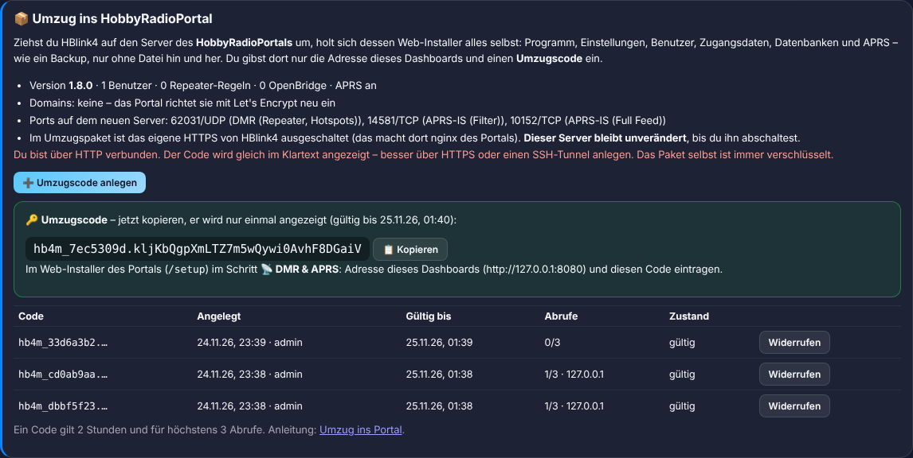

# Backup und Klonen

<p align="center"></p>
<p align="center"></p>

[← Adminbereich](adminbereich.md) · [Installation](installation.md) · [Betrieb](betrieb.md)

**Admin → Backup** erstellt eine übertragbare Sicherung der HBlink4-Installation.
Erstellen, Herunterladen, Prüfen und Wiederherstellen sind dem **Superadmin** vorbehalten,
weil das Archiv sämtliche Zugangsdaten und privaten Schlüssel enthalten kann.

Auf einem neuen Server kann die Sicherung außerdem direkt über **`sudo ./scripts/setup.sh` →
Vorhandenes HBlink4-Backup wiederherstellen** eingespielt werden. Dabei übernimmt das Setup
die Vorbereitung von Python-Umgebung, Diensten und Diensthelfer; ein vorheriger Dashboard-Login
ist nicht erforderlich. Siehe [Wiederherstellung beim Initial Setup](installation.md#vorhandenes-backup-beim-initial-setup-einspielen).

## Was gesichert wird

| Bestandteil | Verhalten |
|---|---|
| Programm und eigene Dateien | Gesamtes Installationsverzeichnis einschließlich lokaler Änderungen, Konfigurationen, Bilder und projektinterner Logs |
| Dashboard-Daten | Gesamtes Datenverzeichnis, Benutzer, Passwort-Hashes, Rechte, Einstellungen, Talkgroups, OpenBridge-Konfiguration, Statistiken, APRS-Daten und Caches |
| SQLite | Konsistente Kopien über die SQLite-Backup-API; bereits bestätigte Änderungen in WAL-Dateien sind enthalten |
| Zertifikate | Zertifikate im Datenverzeichnis und explizit konfigurierte TLS-Dateien; interne Zertifikatslinks werden als reguläre Dateien kopiert |
| Versionen | `VERSION`, Git-Bundle des aktuellen Commits und veröffentlichte Python-Paketversionen; Git-Zugangsdaten und Hooks werden nicht kopiert |
| systemd | Effektive Quell-Dienstdateien unter `metadata/services.json` als Referenz; auf dem Ziel gelten dessen bereits eingerichtete Dienste und Dienstkonten |

Die Sicherung bildet **HBlink4**, nicht das komplette Betriebssystem ab. Firewall, DNS,
IP-Adressen des Servers, FreePBX, systemweite Journale, Router-Portfreigaben und andere Dienste
werden nicht verändert. Laufende Funkverbindungen werden nach dem Neustart neu aufgebaut.
Virtuelle Python-Umgebungen, `.git`-Arbeitsdaten, Werkzeug-Caches, Sockets und vorhandene
Backup-Archive werden nicht rekursiv mitgesichert. Stattdessen werden Git-Commit und Paketversionen separat abgelegt.
Andere externe Symlinks oder lokale/editierbare Python-Abhängigkeiten führen zu einer klaren
Fehlermeldung, statt eine unvollständige Sicherung als vollständig auszugeben.

**Manuelle Archive sind nicht verschlüsselt.** [AutoBackup](autobackup.md) ergänzt
tägliche/wöchentliche, verschlüsselte Sicherungen nach SFTP oder Google Drive.
Manuelle Archive sicher herunterladen, geschützt aufbewahren und nicht
öffentlich teilen oder in Git einchecken. Nur vertrauenswürdige eigene Backups wiederherstellen:
Sie enthalten ausführbaren HBlink4-Programmcode. SHA-256 erkennt Beschädigungen, bestätigt aber
nicht die Herkunft einer Datei.

## Backup erstellen

1. Als Superadmin **Admin → Backup** öffnen.
2. **Backup erstellen und herunterladen** auswählen. Das Archiv wird zunächst auf dem Server
   erstellt; danach beginnt der Download. Der Funkbetrieb kann während der Sicherung weiterlaufen.
3. Den Download außerhalb des Servers sicher aufbewahren. Vorhandene Archive lassen sich im
   selben Menü erneut herunterladen, einschließlich automatischer Sicherungen vor einer Wiederherstellung.

Die Archive liegen in `dashboard/data/.hblink4-backup/`, bei einem abweichenden
`HBLINK4_DASH_DATA_DIR` entsprechend dort. Das Backup-Verzeichnis wird nicht öffentlich ausgeliefert.
Neben jedem gespeicherten Archiv steht **Löschen**. Nach Bestätigung wird ausschließlich
die lokale Datei entfernt; Kopien auf SFTP oder Google Drive bleiben erhalten. Das gilt
auch für verschlüsselte AutoBackups und Sicherungen vor einer Wiederherstellung.
Während einer laufenden Sicherung, Wiederherstellung oder Aktualisierung ist Löschen gesperrt.
Manuelle Archive bleiben bis zum Löschen erhalten; AutoBackup hat zusätzlich eine eigene
Aufbewahrung. Auf ausreichend freien Speicher achten.
Grenzen: **2 GiB komprimiert, 8 GiB entpackt, 100.000 Dateien**.

## Zielserver vorbereiten

Auf dem Ziel muss eine funktionierende HBlink4-Installation mit dieser Backup-Funktion
und den Diensten `hblink4.service` und `hblink4-dash.service` vorhanden sein.
Beide Dienste benötigen dasselbe Dienstkonto, dasselbe Installationsverzeichnis als
`WorkingDirectory` und die virtuelle Umgebung unter `venv/bin/python`.
Quelle und Ziel benötigen **Python ab 3.9**, dürfen aber verschiedene Unterversionen
verwenden, beispielsweise Quelle 3.11 und Ziel 3.13. Bei einem Versionswechsel prüft
der Helfer vor dem Stoppen der Dienste den gesicherten Programmcode mit Ziel-Python.
Er baut außerdem die gespeicherten Anwendungspakete in einer separaten Testumgebung,
installiert sie und führt `pip check` aus. Die Paketversionen der Anwendung bleiben
erhalten. Die Installationswerkzeuge `pip`, `setuptools` und `wheel` werden nicht auf
die Versionen des Quellservers festgelegt, sondern für die Zielumgebung vorbereitet.

Sind Code oder Paketversionen inkompatibel, bricht die Prüfung ab, während die
bisherigen Dienste weiterlaufen. Die Meldung nennt die betroffene Datei oder den
Paketfehler. Dann eine dazu passende Python-Version auf dem Ziel verwenden oder
den Quellstand vor einem neuen Backup aktualisieren. Nach erfolgreicher Prüfung
wird die endgültige Umgebung am Zielpfad neu angelegt und aus den vorbereiteten
Paketen ohne erneuten Download installiert. Eine vorhandene virtuelle Umgebung
wird nicht kopiert oder verschoben.

**Auf dem Ziel selbst** müssen System-Python und die HBlink4-Dienstumgebungen weiterhin
dieselbe Haupt-/Nebenversion verwenden; das prüft der Installer des Diensthelfers.

Im HBlink4-Verzeichnis des Zielservers einmal ausführen:

```bash
sudo ./scripts/install_backup_helper.sh
```

Der Installer prüft die Umgebung, installiert den Helfer rootgeschützt unter
`/usr/local/lib/hblink4-backup/` und `/usr/local/sbin/hblink4-restore` und erzeugt
`/etc/hblink4-backup.json`. Eine systemd-Path-Unit beobachtet bestätigte Wiederherstellungsaufträge
und startet den unabhängigen Root-Helfer. Das Dashboard benötigt keine sudo-Regel und behält
`NoNewPrivileges=true`. Die beiden HBlink4-Dienste werden beim Installieren nicht neu gestartet.

Der übergeordnete Installationsordner muss root gehören und darf nicht gruppen-/weltbeschreibbar
sein, beispielsweise `/opt` für `/opt/HBlink4`. Ein externes Datenverzeichnis braucht ebenfalls
einen rootgeschützten Elternordner und muss auf demselben Dateisystem liegen. Diese Bedingungen
verhindern, dass Verzeichnisse während einer privilegierten Wiederherstellung umgeleitet werden.
Nach Änderungen an `dashboard/backup.py` den Helfer erneut installieren; das Menü erkennt einen veralteten Helfer.

Für den Neuaufbau der Python-Umgebung benötigt der Zielserver Zugang zum konfigurierten
Python-Paketindex und die zur Plattform passenden Pakete/Build-Voraussetzungen. Bestehende
systemd-Einstellungen und Dienstkonten bleiben auf dem Ziel erhalten. Die Quell-Dienste werden
als Referenz gesichert, aber aus einem hochgeladenen Archiv niemals als root ausgeführt.

## Wiederherstellen

1. Auf dem **Zielserver** als dessen bisheriger Superadmin **Admin → Backup** öffnen.
2. Archiv auswählen, bei `.tar.gz.age` zusätzlich den separaten Wiederherstellungsschlüssel
   angeben und **Datei hochladen und prüfen** anklicken. Dateipfade, Dateitypen,
   Prüfsummen, Größen, Konfigurationen, Datenbanken und Python-Metadaten werden geprüft.
   Eine abweichende Quell-/Ziel-Python-Version erscheint in der Vorschau; die Code- und
   Paketprüfung folgt nach Bestätigung, bevor die laufenden Dienste unterbrochen werden.
3. Version, Datum und Dateianzahl in der Vorschau kontrollieren. Das aktuelle Passwort des
   **Zielservers** eingeben, `RESTORE` eintragen und die Wiederherstellung starten.
4. Bei abweichender Python-Version bereitet der unabhängige Diensthelfer zunächst die
   kompatible Zielumgebung vor. Danach stoppt er beide Dienste und erzeugt ein Backup des
   Zielzustands. Dann ersetzt er Programm und Daten, passt installationslokale Pfade an,
   baut die Python-Umgebung neu auf und startet die Dienste. Das kann mehrere Minuten dauern.
5. Seite neu öffnen und mit dem **Konto aus dem Quell-Backup** anmelden. Alle importierten
   Sitzungen wurden ungültig gemacht. Einstellungen, Talkgroups, Benutzer und APRS-Daten prüfen.

Ein Klon übernimmt auch Rufzeichen, Passwörter und OpenBridge-Identitäten des Quellservers.
Vor gleichzeitigem Betrieb beider Installationen deren Verbindungsidentitäten entsprechend anpassen.
Die Übertragung macht keine DNS-Änderung; die im Backup enthaltenen Dashboard-Domains müssen
für den Zielserver erreichbar sein. Andere Dienstkonten und Installationspfade auf dem Ziel
werden berücksichtigt; lokale Dateipfade in Konfiguration und Einstellungen werden angepasst.

## Fehler und Wiederherstellung des Zielzustands

Bei Fehlern während des Einspielens, beim Aufbau der Python-Umgebung oder beim Dienststart
spielt der Helfer den bisherigen Programm-, Daten- und Python-Umgebungszustand zurück und
startet die alten Dienste. Die Meldung steht nach der Anmeldung unter **Backup**.
Das zusätzliche Archiv `before-restore-…tar.gz` bleibt dort herunterladbar.

```bash
sudo journalctl -u hblink4-restore.service --no-pager -n 100
sudo systemctl status hblink4.service hblink4-dash.service --no-pager
```

Wenn auch die automatische Rücknahme scheitert, bleibt die bisherige Installation im
rootgeschützten Verzeichnis `hblink4-recovery-<Token>` neben dem Installationsverzeichnis erhalten.
Nach Stromausfall oder gewaltsamem Abbruch muss anhand dieses Verzeichnisses und des
automatischen Wiederherstellungsarchivs manuell geprüft werden; dafür gibt es keine Garantie
einer automatischen Rücknahme. Vor einer erneuten Wiederherstellung zuerst den Fehler beheben.

## Validierung der Funktion

Die automatisierten Tests prüfen echte Archiv-/SQLite-Rundläufe, WAL-Inhalte, Kontenübernahme,
Pfadanpassung, ungültige Archive, Berechtigungen, Upload-Veränderungen und die Rücknahme von
Programm, Daten und Python-Umgebung nach simulierten Dienstfehlern. Die systemd-
Dienststeuerung wird in diesen Tests ersetzt. Zusätzliche Integrationstests erzeugen
Archive unter Python 3.11 und 3.14 und prüfen den Paketaufbau sowie die Installation
in der Zielumgebung ohne Paketindex. Eine produktive Wiederherstellung auf
einem zweiten Linux-Server muss vor dem ersten Migrationseinsatz zusätzlich erprobt werden.

## Umzug ins HobbyRadioPortal

<p align="center"></p>

Ziehst du HBlink4 auf den Server des [HobbyRadioPortals](https://github.com/dhartmann1979/HobbyRadioPortal) um (dort läuft meist auch
der FRN-Server), holt sich dessen **Web-Installer** alles selbst – ohne Datei hin und her (ab 1.8.0):

1. Hier als Superadmin **⚙️ Admin → 💾 Backup → 📦 Umzug ins HobbyRadioPortal → ➕ Umzugscode anlegen**. Am besten über HTTPS oder
   einen SSH-Tunnel (`ssh -L 8080:127.0.0.1:8080 server`), denn der Code wird einmal im Klartext angezeigt.
2. Code kopieren (`hb4m_…`, 2 Stunden gültig, höchstens 3 Abrufe).
3. Im Web-Installer des Portals (`http://<neuer Server>/setup`) im Schritt **📡 DMR & APRS** die Adresse dieses Dashboards
   (z. B. `dmr.die-n8schicht.de:8080`) und den Code eintragen → **🔍 Prüfen** zeigt die Vorschau → *HBlink4 auf diesen Server umziehen*.
4. Beim Umzug holt das Portal den Klon **verschlüsselt** ab (n8mig: scrypt + SHAKE-256 + HMAC-SHA-256 mit dem Geheimteil des Codes),
   installiert HBlink4-FreeRadioID unter `/opt/HBlink4` und spielt ihn mit `scripts/setup_restore.py --yes` ein – genau wie eine
   Wiederherstellung über `setup.sh`, mit Ziel-Backup und Rollback.

Was anders ist als ein normales Backup:

| | |
|---|---|
| Eigenes HTTPS | im Klon **aus** (Dashboard und APRS-Domains) – auf dem neuen Server übernimmt nginx des Portals Port 80/443, Domains und Zertifikate |
| Dieser Server | bleibt **unverändert** und läuft weiter, bis du ihn abschaltest: `sudo systemctl disable --now hblink4 hblink4-dash` |
| Ports | das Portal öffnet sie bei aktivem ufw selbst (DMR-UDP, OpenBridge, APRS-IS) – sonst im Router/der Firewall freigeben |
| DNS | Domains (z. B. `dmr.…`, `aprs.…`) auf den neuen Server umstellen – Repeater mit Hostnamen kommen dann von selbst |
| Codes | Liste mit Abrufen und letzter IP; **Widerrufen** sperrt einen Code sofort; Fehlversuche sperren eine Adresse 15 Minuten |

Endpunkte (für das Portal, mit `Authorization: Bearer hb4m_…` und `X-Dashboard: 1`): `POST /api/migration/info` (Vorschau, verbraucht
nichts) und `POST /api/migration/export` (Klon, verschlüsselt, zählt als Abruf).

### Aus einer Sicherung ins Portal (ab 1.8.1)

Läuft der alte Server nicht mehr oder ist er nicht erreichbar, geht es auch mit einer **normalen Sicherung** – ohne Umzugscode:

- Im Web-Installer des Portals (ab 0.10.0) im Schritt **📡 DMR & APRS** *📦 aus einer Backup-Datei* wählen und hochladen:
  `backup-*.tar.gz` aus *💾 Backup* **oder** ein AutoBackup `auto-*.tar.gz.age` zusammen mit dem Wiederherstellungsschlüssel `.agekey`.
- Das Portal installiert HBlink4-FreeRadioID und macht die Sicherung vorher **portalfertig** – genau wie beim Umzugscode:

```bash
cd /opt/HBlink4
python3 -m dashboard.migration portalize /pfad/backup-….tar.gz /tmp/dmr.tar.gz
python3 -m dashboard.migration portalize /pfad/auto-….tar.gz.age /tmp/dmr.tar.gz --identity /pfad/HBlink4-Wiederherstellung.agekey
```

`portalize` entschlüsselt bei Bedarf, prüft das Archiv vollständig (Pfade, Größen, Prüfsummen, Datenbanken), schaltet in der **Kopie**
das eigene HTTPS aus (Dashboard und APRS-Domains), bildet die Prüfsummen neu, schreibt das Ergebnis mit Rechten 600 und gibt die
Vorschau als JSON aus (Titel, Domains, Ports, Benutzer). Die Originaldatei bleibt unverändert. Danach spielt
`scripts/setup_restore.py --yes` das Archiv wie jede Wiederherstellung ein.

## Zusammenspiel mit Updates (ab 1.6.0)

- Während ein Update läuft, lassen sich kein Backup, kein AutoBackup und keine Wiederherstellung starten – und umgekehrt.
- Der Zustand des N8 update guard (`dashboard/data/update.pending`, `update.result`) wird **nicht** gesichert: Er gehört zu genau diesem Server. Ein Klon startet ohne offene Update-Prüfung.
- Sicherheits-Header, Sprache DE/EN und Update-Rollback: [Sicherheit & N8 Kit](sicherheit.md).
