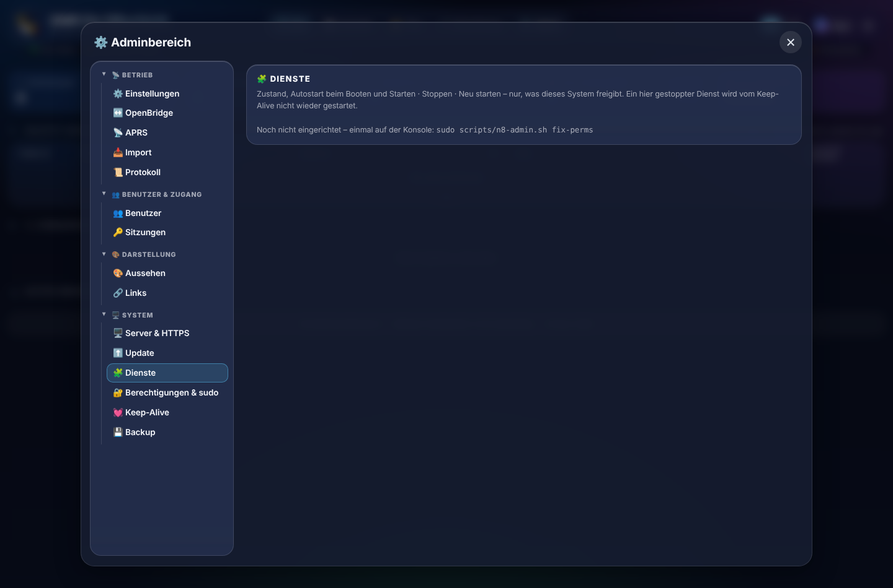
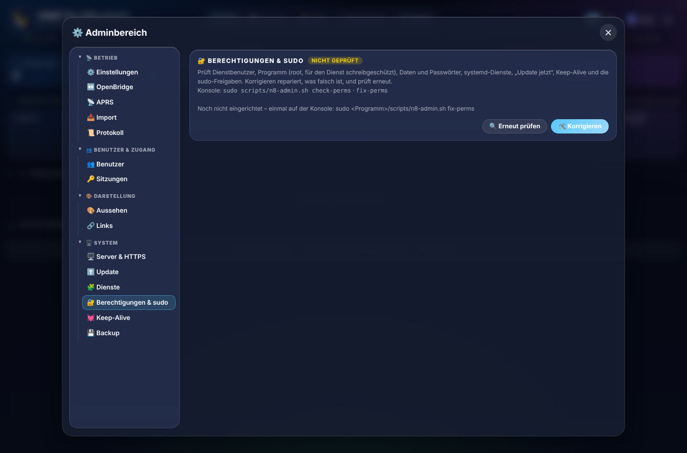
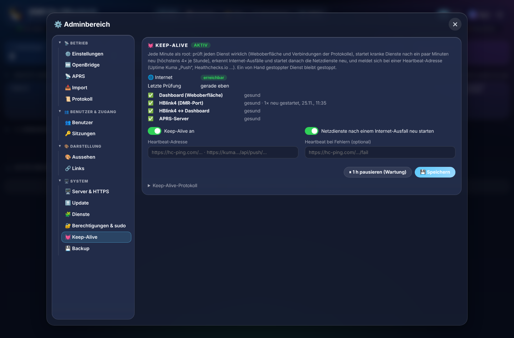

# 🩺 Betrieb & Fehlersuche

[← Übersicht](../../readme.md) · [Installation](installation.md) · [Dashboard](dashboard.md) · [Adminbereich](adminbereich.md) · [APRS](aprs.md) · [Anleitungen](anleitungen.md) · [Konfiguration](konfiguration.md) · [FreeRadioID](freeradioid.md) · **Betrieb & Fehlersuche**

---

## Die beiden Dienste

| Dienst | Was | Log |
|---|---|---|
| `hblink4` | DMR-Server (UDP 62031) | `journalctl -u hblink4` und `logs/hblink.log` |
| `hblink4-dash` | Dashboard und Adminbereich (8080, mit HTTPS 80/443) | `journalctl -u hblink4-dash` |

```bash
sudo systemctl status  hblink4 hblink4-dash
sudo systemctl restart hblink4 hblink4-dash
sudo journalctl -u hblink4 -u hblink4-dash -f          # live mitlesen
```

> 💡 **Immer mit `sudo`.** Ohne `sudo` fragt systemd (polkit) nach einem Passwort und wartet. Das sieht dann so aus, als würde der Neustart „hängen“.
> Im Dashboard geht es ohne Passwort unter **🖥️ System → 🧩 Dienste** (sudo-Freigaben von `scripts/n8-admin.sh`).

Aus dem Browser geht es auch: **Adminbereich → System → Restart dashboard / Restart DMR server**.

**Zum Testen ohne systemd** gibt es `./run_all.sh`. Es startet beides im Vordergrund und beendet es mit Strg+C. Es sollte nur laufen, wenn die Dienste gestoppt sind, und immer als Dienst-Benutzer, nicht als root.

## Schnell-Check: `scripts/check.sh`

```bash
sudo /opt/HBlink4/scripts/check.sh
```

Das Skript prüft der Reihe nach:
- die Dienste und ob sie in einer Neustart-Schleife hängen
- Dateirechte, den Socket `/tmp/hblink4.sock` und die Ports (aus dem Adminbereich bzw. den Config-Dateien)
- ob HBlink4 und das Dashboard als Dienst-Benutzer starten

Zu jedem Problem steht die passende Lösung mit **→** dahinter. Am Ende steht `No problems found.` oder die Zahl der Probleme.

## Typische Fehler

| Meldung / Symptom | Ursache | Lösung |
|---|---|---|
| `attempt to write a readonly database` | Dateien gehören root, weil etwas mit `sudo` gestartet wurde | `sudo chown -R hblink:hblink /opt/HBlink4` und Dienste neu starten |
| Dashboard zeigt **✗ DMR** (gelb) | Socket `/tmp/hblink4.sock` gehört dem falschen Benutzer, oder HBlink4 läuft nicht | `sudo rm -f /tmp/hblink4.sock && sudo systemctl restart hblink4-dash hblink4` |
| `Address already in use` (Port 62031) | Ein anderer DMR-Server (z. B. ADN/FreeDMR-Proxy) belegt den Port | anderen Port im Adminbereich wählen bzw. den anderen Dienst stoppen |
| HTTPS startet nicht | Domain zeigt nicht auf den Server, Port 80 zu oder belegt | Fehler im Log lesen; das Dashboard läuft so lange per HTTP weiter |
| `hblink4-dash` startet in einer Schleife | fehlende Python-Module | `sudo -u hblink ./venv/bin/pip install -r requirements.txt -r requirements-dashboard.txt` |
| Station kommt nicht rein (MSTNAK) | falsches Passwort, ID auf der Blacklist oder FreeRadioID.net nicht erreichbar | `journalctl -u hblink4` zeigt den Grund; zum Test das Gast-Passwort nehmen |
| Keine Avatare | ID nicht bei FreeRadioID.net registriert, Avatare abgeschaltet oder Liste noch nicht geladen | Adminbereich → System zeigt die Zahl der gespeicherten Avatare; **⟳ Refresh now** unter Callsign database |
| OpenBridge verbunden, aber keine Gespräche | Gegenstelle ist FreeDMR mit `ENHANCED_OBP`/`PROTO_VER` > 1, der Trunk läuft aber klassisch; im Log steht dann „is not classic OBP“ | beim Trunk `"enhanced_obp": true`, `"proto_ver": 5`, `"relax_checks": true` setzen, HBlink4 neu starten ([Konfiguration](konfiguration.md#openbridge-zu-einem-freedmr-server)) |
| OpenBridge bleibt auf **WAITING** | keine Keep-alives der Gegenstelle: Port zu, Ports vertauscht oder falsche Adresse | `sudo ufw allow 51084/udp`, Router-Weiterleitung prüfen; `PORT`/`TARGET_PORT` der Gegenstelle müssen zu `target_port`/`local_port` passen |
| `failed authentication – passphrase on both sides identical?` | Passwort verschieden (FreeDMR nutzt höchstens 20 Zeichen) | auf beiden Seiten dasselbe Passwort mit höchstens 20 Zeichen eintragen |
| App (Z3DMR, DroidStar) hört über OpenBridge nichts, Hotspots schon | ältere Version: Gespräche aus OpenBridge gingen mit 53 statt 55 Bytes an die Stationen; Apps verwerfen solche Pakete | aktualisieren (**⬇️ Update now**); seit dieser Version werden die Pakete auf 55 Bytes ergänzt |
| Eine Talkgroup läuft nur über einen der Trunks | ältere Version: eine Talkgroup in der Liste eines Trunks „gehörte“ nur diesem Trunk; Gespräche dieser Talkgroup von anderen Trunks wurden verworfen | aktualisieren; jetzt führen alle Trunks die Talkgroup parallel ([Adminbereich → Wohin ein Gespräch geht](adminbereich.md#wohin-ein-gespräch-geht)) |
| `own stream … came back – dropped` | zwei Trunks führen in Netze, die selbst verbunden sind; unser Gespräch kam über den anderen Trunk zurück | kein Fehler: der Echo-Schutz hat gegriffen |
| `frame is … s off our clock` | Uhrzeit eines Servers falsch | NTP einrichten: `sudo apt install chrony` |
| APRS-Karte leer, `APRS server not started` | APRS aus oder keine Server-ID | Adminbereich → 📡 APRS → Server; mehr in [APRS → Fehlersuche](aprs.md#fehlersuche) |
| `APRS port 14580 not available` | ein anderer APRS-Server (z. B. aprsc) belegt den Port | anderen Dienst stoppen oder anderen Port wählen |
| Karten-Domain ohne Zertifikat (`… is left out of the certificate`) | DNS der Domain zeigt nicht auf den Server | DNS korrigieren, Dashboard neu starten |
| Superadmin-Passwort vergessen | – | neuen Hash erzeugen (`./venv/bin/python -m dashboard.auth hash-password`), in `dashboard/config.json` eintragen, Dashboard neu starten; oder `sudo ./scripts/setup.sh` |

## Aktualisieren

Der Server fragt jede Stunde bei GitHub nach einer neuen Version. Eingeloggte Admins sehen dann einen Hinweis und können mit **⬇️ Update now** direkt im Browser installieren (siehe [Adminbereich → Update now](adminbereich.md#️-update-now)). Auf der Konsole geht es (ab 1.10.0) mit einem Befehl:

```bash
sudo /opt/HBlink4/scripts/update.sh            # genau wie „Update now“: holen, Pakete, Rechte & sudo, Neustart, Prüfung
```

Seit 1.12.0 läuft das Update wie in N8 Crosslink über den Root-Helfer **`scripts/n8-admin.sh`**: **Update now** im Dashboard legt nur
`dashboard/data/update.request` an, die Path-Unit `hblink4-update.path` startet `hblink4-update.service` als root und damit
`n8-admin.sh update --auto`. Der Helfer spult nur vor (nie über von Hand geänderte Dateien oder eigene Commits), installiert
Python-Pakete bei geänderten `requirements*`, **prüft und korrigiert Berechtigungen und sudo**, startet `hblink4` und `hblink4-dash`
neu und ruft das Dashboard auf. Antwortet es 90 Sekunden nicht, geht er automatisch auf den alten Stand zurück. Ergebnis unter
*Letztes Update*, Protokoll unter **🖥️ System → 📜 Update-Protokoll** (`dashboard/data/update.log`).

Das Programmverzeichnis gehört dabei **root** und ist für den Dienst schreibgeschützt; nur `dashboard/data`, `config/`, `logs/` und
`dashboard/config.json` gehören dem Dienst-Benutzer. Einmalig nach dem Update von 1.11 oder älter:

```bash
sudo /opt/HBlink4/scripts/n8-admin.sh fix-perms
```

### Dienste und Berechtigungen

<p align="center">
  
  
</p>

**🖥️ System → 🧩 Dienste** zeigt `hblink4`, `hblink4-dash` und den Update-Auslöser schlank mit Status, **Autostart**-Schalter und
**▶ Starten / ↻ Neu starten / ■ Stoppen**. Der eigene Eintrag **🔐 Berechtigungen & sudo** zeigt alle Prüfungen von `n8-admin.sh` (Dienst-Benutzer,
Programm root-eigen, Daten und Konfiguration des Dienstes, `config.json` und Datenbanken 600, systemd-Units, Update-Auslöser,
sudo installiert/eingebunden/gültig/aktuell/wirksam) mit **🛠️ Korrigieren** (prüfen → korrigieren → erneut prüfen). Konsole:
`sudo scripts/n8-admin.sh check-perms` bzw. `fix-perms`.

Die sudo-Freigaben stehen in `/etc/sudoers.d/hblink4-n8admin` – nur exakte Befehle (die Dienste, die Prüfung, der Update-Auslöser).
Damit das Dashboard sudo nutzen kann, läuft `hblink4-dash` ohne `NoNewPrivileges` und ohne enge `CapabilityBoundingSet`; der Helfer setzt
das bei Bedarf per Drop-in (`hblink4-dash.service.d/n8-admin.conf`). Die frühere Regel `/etc/sudoers.d/hblink4-update` entfällt.

Vorher eine [Sicherung](#sicherung) zu machen schadet nie. Die Einstellungen aus dem Adminbereich liegen in der Datenbank und bleiben erhalten. Welche Version läuft, steht unten in der Fußzeile jeder Seite und im Adminbereich unter **🖥️ System → ⬆️ Update**.

**Zurück zur vorherigen Version:** Im **📜 Log** steht bei jedem Update `alt → neu`. Mit dem alten Commit:

```bash
cd /opt/HBlink4
sudo -u hblink git reset --hard <alter-commit>
sudo systemctl restart hblink4 hblink4-dash
```


### 💓 Keep-Alive

<p align="center"></p>

Seit **1.13.0** wacht ein Keep-Alive über HBlink4 und das Dashboard. `hblink4-keepalive.timer` startet **jede Minute als root**
`scripts/n8-admin.sh keepalive`:

| Was | Wie |
|---|---|
| **Dashboard** | antwortet es? |
| **HBlink4** | lauscht der Prozess von `hblink4.service` wirklich auf seinem DMR-Port (UDP)? |
| **HBlink4 ↔ Dashboard** | ist das Dashboard mit HBlink4 verbunden? (`/api/n8/health`, nur lokal erreichbar) |
| **APRS** | wenn eingeschaltet: lauscht der APRS-Server, steht der Uplink? |
| **Neustart** | nach **3 Minuten** krank (sofort bei `failed`), **höchstens 4× je Stunde** – danach „aufgegeben“ im Protokoll |
| **Internet-Ausfall** | 1.1.1.1, 9.9.9.9 und github.com (Port 443) nicht erreichbar → keine sinnlosen Neustarts; ist das Netz nach mindestens 60 s wieder da, werden `hblink4` und `hblink4-dash` einmal neu gestartet (Peers, OpenBridge und APRS-Uplink stehen sofort wieder) |
| **Heartbeat** | optional jede Minute ein Ping an Uptime Kuma („Push“) oder Healthchecks.io, bei Fehlern an die Fehler-Adresse |
| **Wartung** | **⏸ 1 h pausieren**; ein unter *Dienste* gestoppter Dienst bleibt gestoppt, bis du ihn dort startest |

Dateien in `dashboard/data/`: `keepalive.conf`, `keepalive.json`, `keepalive.log` (höchstens 400 Zeilen). Eingerichtet wird der
Timer von Installer, Update und `fix-perms`; `check-perms` prüft ihn mit.

```bash
systemctl status hblink4-keepalive.timer
sudo scripts/n8-admin.sh keepalive          # eine Runde von Hand
tail -f dashboard/data/keepalive.log
```

### Schutz gegen Angriffe von außen

- **Wer überhaupt drankommt:** Update now ist nur nach Login und nur für die eingestellte Rolle erreichbar (Standard: Superadmin), und auch dann nur mit erneuter Passworteingabe. Fehlversuche werden wie beim Login gebremst und protokolliert.
- **Schutz vor fremden Seiten:** Anfragen anderer Seiten (CSRF) blockt das Dashboard, weil jede Änderung einen eigenen Kopf-Eintrag braucht und das Login-Cookie `SameSite=Strict` ist.
- **Woher der Code kommt:** Installiert wird nur aus dem Git-Remote, das auf dem Server eingerichtet ist, und nur der Commit, den GitHub gemeldet hat. Es geht nur vorwärts; Hooks und lokale Transporte sind aus. Zum Prüfen: `git -C /opt/HBlink4 remote -v`.
- **Rechte:** Das Dashboard läuft als normaler Benutzer ohne Root. Mit Weg B darf es höchstens die beiden Dienste neu starten.
- **Abschalten:** Wer Updates nur auf der Konsole will, stellt *Who may press “Update now”* auf **Nobody**. Der Hinweis bleibt, installiert wird dann nur von Hand.

## Sicherung

Alles Wichtige steckt in drei Dateien:

```bash
cd /opt/HBlink4
sudo -u hblink sqlite3 dashboard/data/dashboard.db ".backup '/tmp/dashboard-$(date +%F).db'"
sudo tar czf ~/hblink4-backup-$(date +%F).tgz config/config.json dashboard/config.json /tmp/dashboard-$(date +%F).db
```

Mit APRS kommt `dashboard/data/aprs.db` dazu (Stationen, Spuren, Rohpakete; höchstens 90 Tage): genauso mit `.backup` sichern, oder weglassen – sie füllt sich von selbst wieder.

`.backup` sichert die Datenbank auch im laufenden Betrieb sauber; dafür braucht es das Paket `sqlite3`. **Zurückspielen:** Dienste stoppen, die drei Dateien an ihren Platz kopieren, die Rechte für den Dienst-Benutzer setzen und die Dienste starten.

## Umziehen auf einen neuen Server

1. Auf dem neuen Server [installieren](installation.md) mit `setup.sh`.
2. Dienste stoppen und die drei Dateien aus der Sicherung einspielen.
3. `sudo chown -R hblink:hblink /opt/HBlink4 && sudo systemctl start hblink4 hblink4-dash`.
4. Den DNS-Eintrag umstellen. Das HTTPS-Zertifikat holt das Dashboard auf dem neuen Server selbst.

---

[← Zurück zur Übersicht](../../readme.md)
