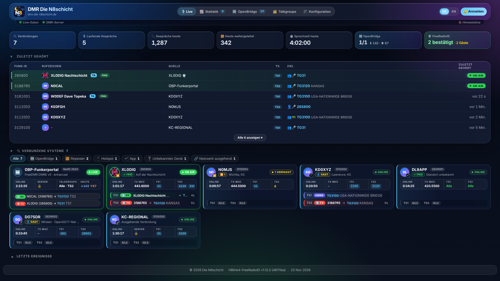
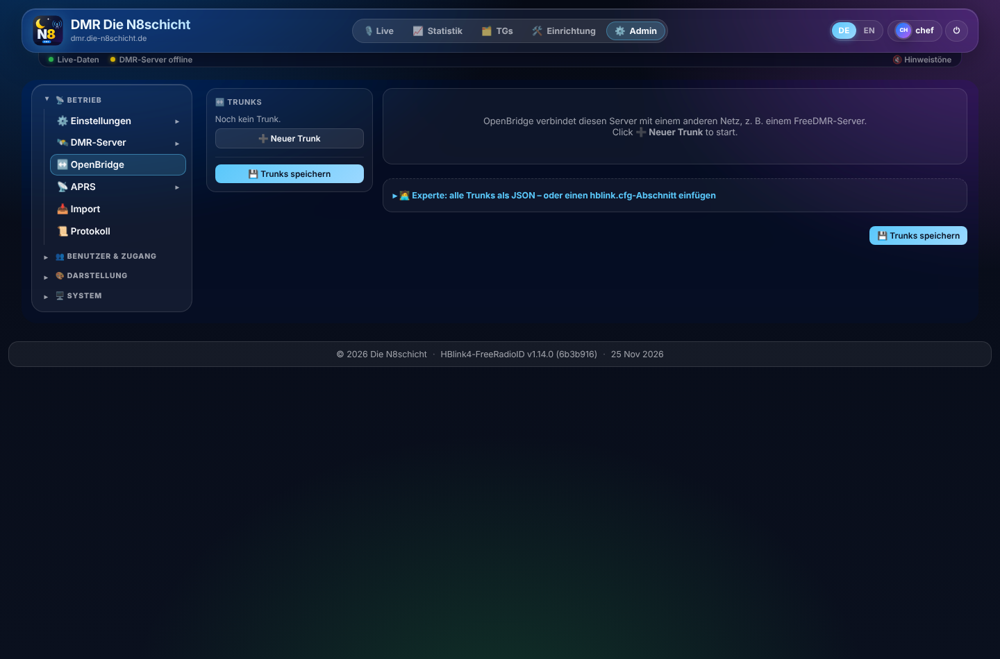
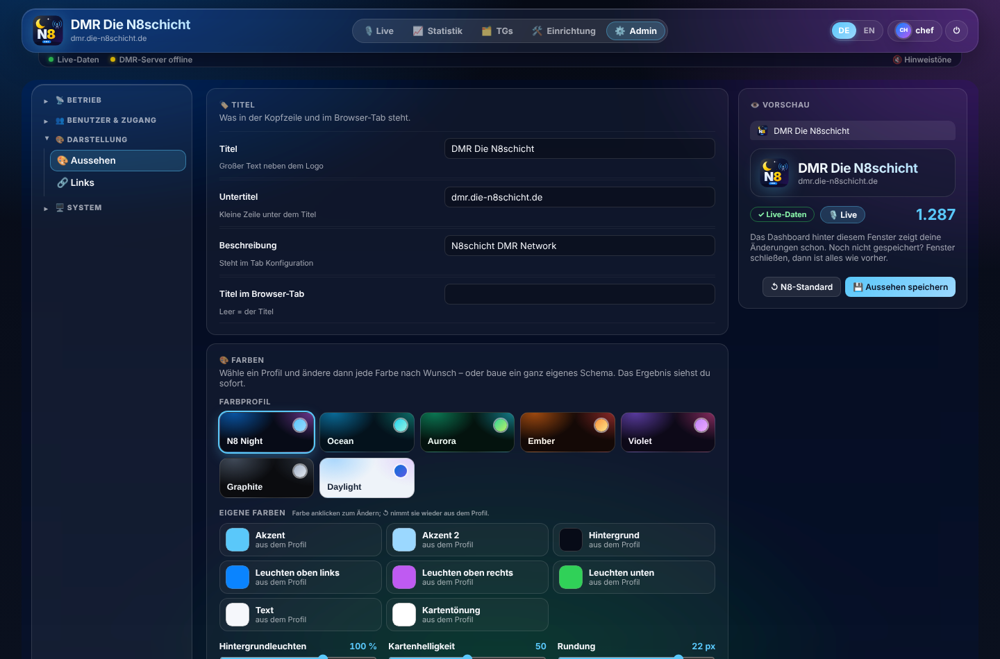
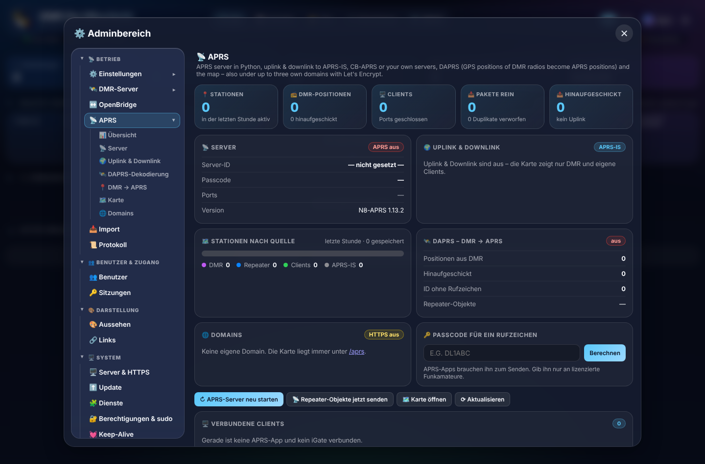
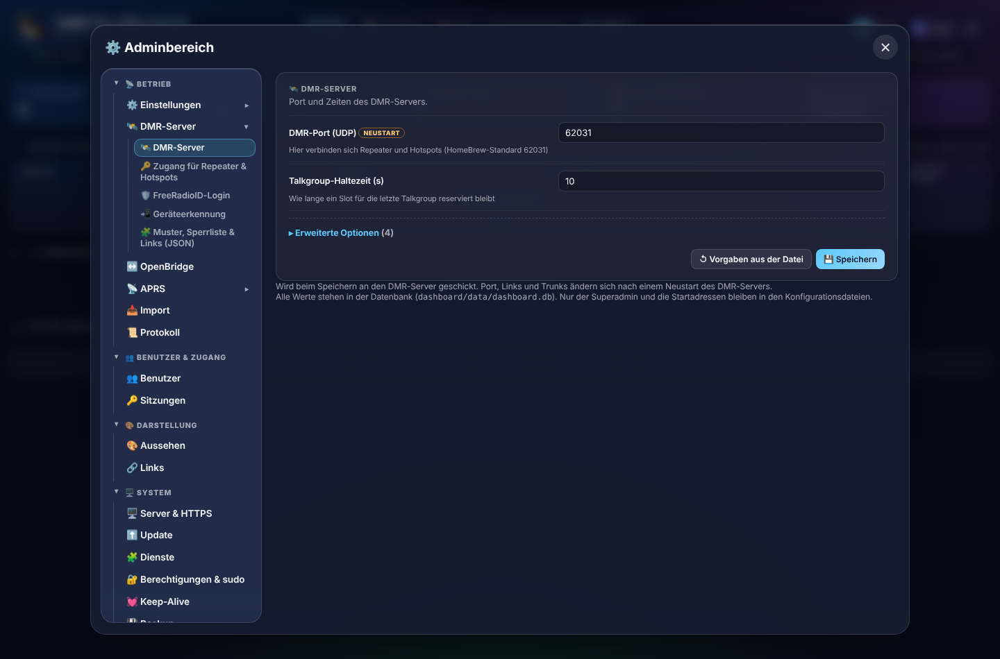

<p align="center">
  
</p>

<p align="center">
  <b>HBlink4 DMR-Server · FreeRadioID.net Secure Login · Dashboard mit Adminbereich</b><br>
  Der Server hinter <a href="https://dmr.die-n8schicht.de">dmr.die-n8schicht.de</a> – zum Nachbauen für den eigenen Verbund.
</p>

<p align="center">
  <a href="CHANGELOG.md"></a>
  <a href="CHANGELOG.md"></a>
</p>

<p align="center">
  <a href="#schnellstart">Schnellstart</a> ·
  <a href="docs/de/installation.md">Installation</a> ·
  <a href="docs/de/dashboard.md">Dashboard</a> ·
  <a href="docs/de/adminbereich.md">Adminbereich</a> ·
  <a href="docs/de/backup.md">Backup</a> ·
  <a href="docs/de/aprs.md">APRS</a> ·
  <a href="docs/de/konfiguration.md">Konfiguration</a> ·
  <a href="docs/de/freeradioid.md">FreeRadioID</a> ·
  <a href="docs/de/betrieb.md">Betrieb &amp; Fehlersuche</a> ·
  <a href="docs/de/sicherheit.md">Sicherheit</a> ·
  <a href="CHANGELOG.md">Änderungen</a>
</p>

---

## Was ist das?

Ein DMR-Server für Repeater, Hotspots und Apps wie Z3DMR (HomeBrew-Protokoll, z. B. MMDVM, Pi-Star, WPSD, DMRGateway) auf Basis von [HBlink4](https://github.com/n0mjs710/HBlink4) von N0MJS, erweitert für **DMR Die N8schicht**:

| | |
|---|---|
| 🛡️ **FreeRadioID Secure Login** | Stationen melden sich mit ihrem persönlichen Passwort von [FreeRadioID.net](https://freeradioid.net) an und haben volle Rechte. Wer das allgemeine Passwort benutzt, ist **Gast** und darf nur auf die Gast-Talkgroups senden. |
| 🗂️ **Talkgroup-Verzeichnis** | rund 1.400 Talkgroup-Namen aus der [N8schicht-Liste](https://github.com/dhartmann1979/n8schicht/blob/main/talkgroup_ids.json), mit Suche, Aktivität und eigenen Namen; die Namen stehen auch in Last Heard, auf den Karten und in der Statistik |
| 📈 **Talkgroup-Statistik** | Eigener Tab: welche Talkgroups wie viel laufen, Sprechzeit und Gespräche heute, über 24 h, 7 oder 30 Tage, als Diagramm und Tabelle |
| ↔️ **OpenBridge** | FreeDMR-kompatibel (`DMRE` v5, Keep-alives) und klassisch; im Adminbereich als Formular mit Protokoll-Auswahl, „alle Talkgroups“ oder Auswahl aus der Talkgroup-Liste. Tab im Dashboard mit Status, Gegenstelle, Verkehr in beide Richtungen, Top-Talkgroups, letzten Gesprächen und durchsuchbarer Talkgroup-Liste. In der Live-Ansicht nur kompakt, in der Statistik mitgezählt. |
| 🛠️ **Configuration-Tab** | Server, Port, FreeRadioID- und Gast-Passwort, Talkgroups und fertige Einstellungen für Pi-Star/WPSD und MMDVMHost, zum Kopieren |
| 🎙️ **Live-Dashboard** | Wer gerade spricht, steht immer ganz oben (**ON AIR**). Last Heard zeigt Avatare und FreeRadioID-Profile. Die Darstellung ist für Smartphone und Desktop optimiert. |
| 🎨 **Eigenes Aussehen** | N8 Theme: 7 Farbprofile inkl. hellem **Daylight**, jede Farbe frei wählbar (Akzente, Hintergrund, Leuchtfarben, Text, Karten), Rundung, Lesbarkeitsprüfung; Logo und Favicon hochladen, Titel und Browser-Tab, alles mit Live-Vorschau. Dieselbe Engine wie in der FRN-Oberfläche und im N8-Hotspot. |
| 📥 **Konfigurations-Konverter** | Umzug von HBlink3, FreeDMR/FDMR+, ADN oder einem anderen HBlink4: Datei laden, Vorschläge prüfen, übernehmen |
| 🧭 **Ein Menü + Statusleiste** | Kopfzeile mit Logo, Reitern, Links und Login ganz rechts (ohne Aufklappmenü, **⚙️ Admin** nach dem Login als Menüpunkt); darunter eine schmale Statusleiste für Live-Daten, DMR-Server und APRS |
| 🔗 **Link-Menü** | eigene Links (Webseite, Chat, Kontakt …) als Menü oder Knopfreihe in der Kopfzeile, mit den **Favicons der verlinkten Seiten** (im Dashboard in SQLite zwischengespeichert) |
| ⚙️ **Adminbereich statt Config-Dateien** | Alle Einstellungen von Dashboard **und** DMR-Server liegen in SQLite und werden im Browser geändert. Änderungen am DMR-Server wirken sofort, ohne SSH. |
| 👥 **Benutzer & Rechte** | Superadmin, Admins und Benutzer. **IP-Adressen und Ports sehen nur Admins.** Dazu Sitzungen und ein Protokoll aller Änderungen. |
| 📘 **FreeRadioID-ID-Listen** | Rufzeichen kommen standardmäßig aus der Liste von FreeRadioID.net (radioid.net plus FreeRadioID-IDs). |
| 📡 **APRS & DAPRS** *(neu in 1.2.0)* | APRS-Server in Python (Ports 14580/10152), **Uplink & Downlink wählbar: APRS-IS, CB-APRS oder eigene Server**, **DAPRS**: GPS-Positionen von DMR-Funkgeräten (im Sprachruf und als Datenruf, NMEA/LRRP) werden APRS-Positionen, Repeater als Objekte. Live-**Karte** im N8-Design unter `/aprs`, als Dashboard-Tab und unter **bis zu drei eigenen Domains** mit Let's Encrypt. Standardmäßig aus, die Installation fragt es ab. |
| 🔒 **HTTPS** | Let's-Encrypt-Zertifikat, automatisch geholt und erneuert – auch für die APRS-Domains |
| 🧩 **Update, Dienste & Berechtigungen** *(neu in 1.12.0)* | **Update now** mit Prüfung und automatischem Zurück, Dienste schlank aktivieren/deaktivieren/starten/stoppen/neu starten, Berechtigungsprüfer mit Korrektur und sudo-Einrichtung – derselbe Helfer `scripts/n8-admin.sh` wie in N8 Crosslink und ADN-FRN-Server ([mehr](docs/de/betrieb.md#dienste-und-berechtigungen)) |
| 🧭 **Geführte Installation** | `scripts/setup.sh` fragt alles ab, richtet die Dienste ein und prüft am Ende das Ergebnis. |

<p align="center">
  
  &nbsp;
  
</p>

**🔌 Verbundene Systeme** *(neu in 1.6.1)*: OpenBridge, Repeater, Hotspots, Apps und Netzwerk-Links stehen in einem gemeinsamen Raster
aus gleich großen, schlanken Karten – mit Filter-Pillen pro Art. Mehr dazu in der [Dashboard-Doku](docs/de/dashboard.md#-verbundene-systeme).

<p align="center"></p>

## Schnellstart

Auf einem Debian- oder Ubuntu-Server, als root bzw. mit `sudo`:

```bash
git clone https://github.com/dhartmann1979/HBlink4-FreeRadioID /opt/HBlink4
sudo /opt/HBlink4/scripts/setup.sh
```

Das Installationsskript führt durch alle Einstellungen. Jede Frage hat eine Vorgabe, die du mit Enter übernimmst. Danach öffnest du das Dashboard, meldest dich oben rechts an und stellst alles Weitere im **Adminbereich** ein.

<p align="center">
  
  
</p>

➡️ Ausführlich: **[Installation](docs/de/installation.md)**

## So sieht es aus

<table>
<tr>
<td width="50%"><br><b>ON AIR</b>: Die Station, die gerade spricht, steht oben und leuchtet grün – mit dem <b>Talker Alias</b> aus dem Funkgerät statt des Datenbank-Namens (<a href="docs/de/dashboard.md#-talker-alias--der-name-aus-dem-funkgerät">mehr</a>).</td>
<td width="50%"><br><b>Detailansicht</b> mit Avatar, FreeRadioID-Profil, Talkgroups und Funkdaten.</td>
</tr>
<tr>
<td><br><b>Tab 📈 Statistics</b>: Top-Talkgroups, Verlauf pro Stunde oder Tag, Tabelle mit aktivster Station und eigener Rangliste der <b>Talker Alias</b>.</td>
<td><br><b>Tab 🛠️ Configuration</b>: alles zum Verbinden, mit N8schicht-Logo und Kopier-Knöpfen – auch, wie Funkgeräte ihre Position per DAPRS senden.</td>
</tr>
<tr>
<td><br><b>Tab ↔️ OpenBridge</b>: Trunk-Status, Verkehr empfangen/gesendet, Top-Talkgroups und alle Talkgroups des Trunks.</td>
<td><br><b>Kompakt in der Live-Ansicht</b>: gleiche Karte wie alle verbundenen Systeme – Talkgroups, Gespräche heute, laufende Gespräche.</td>
</tr>
<tr>
<td><br><b>OpenBridge im Formular</b>: Protokoll, Verbindung, Talkgroups und fertiger Abschnitt für die Gegenstelle.</td>
<td><br><b>🎨 Appearance</b>: 7 Farbprofile, jede Farbe frei wählbar, Logo-Upload, Titel, mit Live-Vorschau.</td>
</tr>
<tr>
<td><br><b>🗺️ APRS-Karte</b>: DMR-Positionen, Repeater, APRS-Apps und Stationen aus APRS-IS bzw. CB-APRS, live.</td>
<td><br><b>Station mit DMR-Daten</b>: Talkgroup, Hotspot, Art der GPS-Meldung, Spur und Rohpakete.</td>
</tr>
<tr>
<td><br><b>📡 APRS im Adminbereich</b>: Server, Verbindungen, DAPRS, Domains und Clients auf einen Blick.</td>
<td><br><b>🌍 Uplink & Downlink</b>: APRS-IS, CB-APRS oder eigene Server mit Richtung.</td>
</tr>
<tr>
<td><br><b>☀️ Daylight</b>: das helle Farbprofil.</td>
<td><br><b>🔗 Link-Menü</b> mit den Site-Icons der verlinkten Seiten.</td>
</tr>
<tr>
<td><br><b>Einstellungen im Baum-Menü</b>: Abschnitte als Zweige, Schalter, Auswahllisten, seltene Optionen eingeklappt.</td>
<td><br><b>📥 Import</b>: Konfiguration von HBlink3, FreeDMR oder ADN übernehmen.</td>
</tr>
</table>

## Dokumentation

| Anleitung | Inhalt |
|---|---|
| 📦 [Installation](docs/de/installation.md) | Voraussetzungen, geführte Installation, HTTPS, Firewall, Aktualisieren |
| 🎙️ [Dashboard](docs/de/dashboard.md) | Tabs Live/Statistics/OpenBridge/Talkgroups/Configuration, ON AIR, Talkgroup-Statistik, Last Heard, Karten, Detailansicht, Login-Arten |
| 🧭 [Anleitungen](docs/de/anleitungen.md) | Schritt für Schritt: Hotspot verbinden, Umzug mit dem Import, OpenBridge zu FreeDMR, Logo und Farben, Link-Menü, Ankündigung, Admins |
| 📡 [APRS](docs/de/aprs.md) | APRS-Server, Uplink & Downlink (APRS-IS, CB-APRS, manuell), DAPRS, Karte, eigene Domains mit Let's Encrypt, Fehlersuche |
| ⚙️ [Adminbereich](docs/de/adminbereich.md) | Baum-Menü, Anmelden, Rollen, Benutzer, Einstellungen, Aussehen, Link-Menü, OpenBridge-Editor, Backup, Import, Sitzungen, Protokoll, System (Update ohne Passwort, Dienste, Berechtigungen & sudo, Keep-Alive, Abstürze) |
| 💾 [Backup und Klonen](docs/de/backup.md) | Vollständige Sicherung, Download, Archivprüfung und Wiederherstellung auf einem anderen HBlink4-Server; [verschlüsselte AutoBackups](docs/de/autobackup.md) nach SFTP/Google Drive |
| 🧾 [Konfiguration](docs/de/konfiguration.md) | Was in den Dateien steht und was in SQLite, alle Einstellungen im Überblick, Patterns |
| 🛡️ [FreeRadioID](docs/de/freeradioid.md) | Secure Login, Gastzugang, Avatare, Profile, ID-Listen |
| 🔐 [Sicherheit & N8 Kit](docs/de/sicherheit.md) | Sicherheits-Header, API-Doku aus, Schutz vor XSS, Reverse-Proxy (Caddy/nginx), neun Sprachen, Anmeldefenster, Updates mit Prüfung und Rollback |
| 🩺 [Betrieb & Fehlersuche](docs/de/betrieb.md) | Dienste, Keep-Alive, 💥 Abstürze (Teil, Ursache, Protokoll), `check.sh`, typische Fehlermeldungen, Sicherung, Aktualisieren |
| 🏷️ [Versionen](docs/de/versionen.md) · [Änderungen](CHANGELOG.md) | Versionsnummer, was sich in welcher Version geändert hat, wie eine neue Version entsteht |

Englisch / technisch: [FreeRadioID login (EN)](docs/freeradioid.md) · [Dashboard (EN)](dashboard/README.md) · [systemd (EN)](SYSTEMD.md) · [Original-README von HBlink4](docs/upstream-readme.md) · [weitere technische Doku des Originals](docs/)

## Aktualisieren

```bash
cd /opt/HBlink4
sudo -u hblink git pull                 # Dienst-Benutzer statt hblink, falls anders gewählt
sudo ./scripts/setup.sh                 # optional: übernimmt die aktuellen Werte als Vorgabe
sudo systemctl restart hblink4 hblink4-dash
```

## Danksagung & Lizenz

- **HBlink4** von Cort Buffington, N0MJS – [n0mjs710/HBlink4](https://github.com/n0mjs710/HBlink4). Ohne HBlink4 gäbe es diesen Fork nicht.
- **FreeRadioID.net** von Andi, DO5ALF: Secure Login, ID-Listen und Avatare. Die Login-Logik ist eine Portierung seines [FDMR-Secure-Server-Betatests](https://freeradioid.net/betatest.html).
- Anpassungen, Dashboard-Erweiterungen und Logo: **DMR Die N8schicht**.

Lizenz wie das Original: GNU GPLv3, Copyright © 2016–2025 Cortney T. Buffington, N0MJS (siehe [Original-README](docs/upstream-readme.md#license)). Support für den Fork gibt es über die Issues dieses Repositorys; Fragen zum Original-HBlink4 bitte nicht an N0MJS.

<p align="center"></p>
